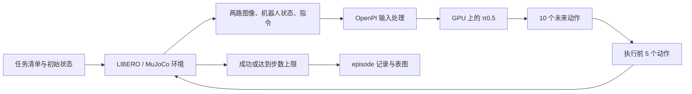

# 实验协议与模型执行流程

本项目使用作者已经在 LIBERO 上训练过的 `pi05_libero` checkpoint，不自行 fine-tune，也不称为未经任务训练的基础模型 zero-shot 实验。原版 LIBERO 检查任务表现，LIBERO-Plus 检查相机、机器人初始状态、语言、光照、背景、噪声和物体布局变化下的表现。

## 任务类型与实例

四个 suite 的区别在于任务之间主要改变的因素。Spatial、Object 和 Goal 分别侧重空间关系、目标物体和操作目标；`libero_10` 包含综合性较强、执行序列较长的任务。各组均通过完整机器人操作的成功率评估策略，而非单独测量图像识别或语言分类准确率。任务设计依据 [LIBERO 论文 §4.2](https://arxiv.org/html/2306.03310v2#S4.SS2)。

| Suite | 主要考察内容 | 任务设计 | 基础任务实例 |
|---|---|---|---|
| `libero_spatial` | 空间关系理解与目标定位 | 使用相似的物体集合和放置目标，通过位置或相对关系区分目标，包括外观相同的碗 | 将盘子与小碗之间的黑碗放到盘子上；将柜子上的黑碗放到盘子上 |
| `libero_object` | 物体识别与不同物体的抓取 | 基本操作均为抓取并放入篮子，主要更换目标物体，需要适应其外观与形状 | 将牛奶放入篮子；将番茄酱放入篮子 |
| `libero_goal` | 指令条件下的目标选择与动作执行 | 使用同一组物体和固定的空间关系，改变任务目标及所需操作 | 打开柜子中间的抽屉；将碗放到炉子上；打开炉子 |
| `libero_10` | 综合操作与较长序列执行 | 组合物体、空间关系和操作技能，部分任务包含多个子目标，通常需要较长动作序列 | 将黑碗放入柜子底层抽屉并关闭抽屉；将杯子放入微波炉并关门 |

实例对应固定版本的 [LIBERO 任务清单](https://github.com/Lifelong-Robot-Learning/LIBERO/blob/f78abd68ee283de9f9be3c8f7e2a9ad60246e95c/libero/libero/benchmark/libero_suite_task_map.py)，本地文件为 `.runtime/repos/libero_clean/libero/libero/benchmark/libero_suite_task_map.py`。这些分类表示任务设计的侧重点，各类操作仍同时依赖感知、语言理解和运动控制；单个 suite 的成功率不足以将失败归因于某个网络模块。

### `libero_10` 的命名与任务数量

`libero_10` 中的 **10 表示该任务集包含 10 种基础任务**。它来源于 LIBERO-100 的划分：90 个较短任务构成 LIBERO-90，另外 10 个较长任务构成 LIBERO-10，论文中也称 LIBERO-Long。数字 10 不表示每个任务需要 10 个动作、重复 10 次或难度等级 10。来源：[LIBERO 官方说明](https://github.com/Lifelong-Robot-Learning/LIBERO#benchmarking-knowledge-transfer-for-lifelong-robot-learning)及上述论文。

Spatial、Object 和 Goal 也各有 10 种基础任务，只是名称采用能力类别。因此，本项目使用的四个 suite 合计包含 **40 种基础任务**。

基础任务与 episode 的计数不同：

- 一个基础任务规定一条操作指令及其目标，例如“将黑碗放入底层抽屉并关闭抽屉”。
- 一个 episode 是策略从指定初始状态开始，对该任务进行的一次完整试验。
- 本项目 clean 协议对每种任务使用 50 个初始状态，因此 `libero_10` 对应 **10 种任务 × 50 次试验 = 500 个 episodes**，四组共 2,000 个 episodes。
- Plus 对基础任务构造扰动变体，再按变体执行评测。当前 `libero_10` 组包含 2,519 个变体，不代表其基础任务数量变为 2,519。

### 基础任务类型与扰动类别

在本次 LIBERO-Plus 协议中，每个变体同时归属一个基础任务 suite 和一个扰动类别。例如，spatial 任务的相机视角变体同时进入 `libero_spatial` 与 `Camera Viewpoints` 的分组统计，但在总体成功率中只计一次。四个 suite 的统计和七类扰动的统计是对同一批 10,030 个 episode 的两种汇总方式。

## 闭环执行流程

1. Benchmark 指定任务定义 BDDL、初始状态和语言。Plus 包装器根据变体名改变环境/观测，因此评测时必须传递上游的**逻辑变体文件名**；磁盘上的 BDDL 可以是去掉 `_view_...` 的基础文件。直接批量改名会改变实验。
2. 环境重置并加载指定初始状态，先执行 10 个等待动作让物体稳定。环境生成 256×256 的前视和腕部相机图像。
3. 与 OpenPI 示例一致，将两幅图像旋转 180°、保持比例缩放并补边到 224×224。状态接口是末端位置 3 维、轴角 3 维和夹爪位置 2 维，共 8 维。语言使用上游 `task.language`，实际传入内容写入日志。
4. OpenPI 的 policy adapter 执行图像/语言处理及 checkpoint 对应的归一化。π0.5 的视觉语言主干为动作预测提供条件；动作分支从噪声出发，按 flow matching 学到的向量场做 10 步 Euler 积分，输出一个动作片段。本项目调用作者实现，不重新实现网络。
5. 此配置的预测长度是 10。内部动作维度经过 adapter 后成为 LIBERO 的 7 维控制向量（末端运动及夹爪）；执行前 5 个动作，然后用新观测重新规划。这是闭环控制，不是给整段视频一次性打分。
6. 环境返回任务成功则结束，否则到 horizon 后记失败。运行时异常中止并单独保存，不能混入模型失败率。

状态输入配置需要结合模型实现解释：锁定的 `pi05_libero` 设置 `discrete_state_input=False`，且 π0.5 不走 π0 的连续状态 token 分支。虽然客户端保留标准 8 维 state 接口，也不能据此断言该配置把它作为 state token 输入网络。请结合上游 `training/config.py`、`models/pi0.py` 和 `policies/libero_policy.py` 阅读。

同一 GPU 作业内运行两个进程：Python 3.11/OpenPI/JAX 提供本机 WebSocket policy 服务；Python 3.10/LIBERO/MuJoCo 执行环境并发送观测。服务只监听 `127.0.0.1`。隔离环境避免两套项目的依赖冲突；并不意味着申请两张 GPU。

## 固定协议

| 参数 | 本项目值 |
|---|---|
| Checkpoint | `gs://openpi-assets/checkpoints/pi05_libero/` |
| 模型 backend | JAX，官方 Orbax 参数 |
| NumPy / 环境 seed | 7 |
| 模型初始 RNG | 与 OpenPI 默认 `jax.random.key(0)` 一致 |
| Flow 积分步数 / 预测长度 / 执行长度 | 10 / 10 / 5 |
| 图像 render / policy 分辨率 | 256 / 224 |
| 等待步数 | 10，不计入下列控制步数 |
| spatial / object / goal / libero_10 horizon | 220 / 280 / 300 / 520 |
| clean 完整协议 | 每 suite 10 个任务，每个前 50 个初始状态 |
| Plus 完整协议 | 每逻辑变体 1 次，使用上游返回的第 0 个初始状态 |
| 排序 | spatial → object → goal → libero_10；各 suite 按上游 task_id |
| 默认 prompt | 上游 `task.language`，不清洗文件名元数据 |

### Episode horizon 与终止条件

`config/evaluation.json` 的 `horizons` 指定**每次 episode 允许执行的最多环境控制步数**。配置由任务清单生成器写入每条任务的 `max_steps`，评测器据此限制 rollout 长度。一次控制步对应一次 `env.step(action)`：向机器人发送一个末端运动及夹爪控制向量，并由仿真器推进环境。抓取、搬运或关闭抽屉等完整操作通常需要多个控制步共同完成；控制步也不同于 MuJoCo 内部的物理积分子步。

| Suite | 每个 episode 的 horizon |
|---|---:|
| `libero_spatial` | 220 个控制步 |
| `libero_object` | 280 个控制步 |
| `libero_goal` | 300 个控制步 |
| `libero_10` | 520 个控制步 |

这些上限与固定版本的 [OpenPI LIBERO 评测示例](https://github.com/Physical-Intelligence/openpi/blob/215abfb217dbac7d5f1273282331b9b1866c0479/examples/libero/main.py)一致；其源码注释以各组演示轨迹长度说明不同的步数预算。`libero_10` 的较长上限为较长操作序列提供执行预算，并非要求每次试验必须执行 520 步。

以 `libero_10` 中的一次抽屉操作试验为例：如果第 180 个控制步后目标条件满足，立即记为成功并结束；如果执行完第 520 个控制步仍未满足目标，记为任务失败。每个 episode 开始前的 10 个静置步单独执行，不占用该预算，因此一条达到上限的试验共执行 10 + 520 次 `env.step`。

Horizon 以控制步计数，不是实际运行秒数、模型推理次数或 Slurm 作业时限。推理、渲染、首次 JIT 编译和通信等待都会增加实际运行时间，但不会额外消耗环境控制步。通信或渲染异常、单 episode 墙钟超时等属于基础设施错误，单独记录，不与正常达到 horizon 的任务失败混合。

### 任务数量与推理步数参数

| 名称或参数 | 当前值 | 计数对象 |
|---|---:|---|
| `libero_10` 名称中的 10 | 10 | 该 suite 内的基础任务种类 |
| `horizons.libero_10` | 520 | 每次试验最多执行的环境控制步 |
| 模型 `action_horizon` | 10 | 单次模型推理预测的未来动作数量 |
| `replan_steps` | 5 | 每次预测后实际执行的动作数量，再用新观测重新推理 |
| `num_steps` | 10 | 单次动作预测内部的 flow 积分次数 |
| `wait_steps` | 10 | 每次试验开始前的静置控制步 |

例如，模型一次预测 10 个动作，评测器仅执行前 5 个动作，再获取新观测进行下一次预测。这一轮只消耗 5 个 episode 控制步；若完整执行 520 步且没有提前终止，则进行 104 次模型推理。模型内部的 10 次 flow 积分不计入环境 horizon。

参数入口为 [config/evaluation.json](../config/evaluation.json)，执行逻辑为 [src/vla_startup/evaluate.py](../src/vla_startup/evaluate.py)。修改 horizon 会改变任务可用的执行预算，属于评测协议变更，需使用新 run ID 并与默认协议结果区分。

### 版本与任务覆盖

三个上游 commit、uv 版本和资产 SHA 固定在 `config/sources.json`。checkpoint 的每个 GCS object 固定 generation、长度、CRC32C；tokenizer 固定 SHA256；不是每次执行时下载浮动的 latest。sim 依赖由本仓库 lock 固定，OpenPI 依赖使用该 commit 自带的 `uv.lock`。

分类 JSON 的 `id` 从 1 开始，benchmark API 的 `task_id` 从 0 开始；本项目按完整任务**名称**关联，避免类别错位。完整 Plus 清单检查结果：

| Suite | 变体数 |
|---|---:|
| libero_spatial | 2,402 |
| libero_object | 2,518 |
| libero_goal | 2,591 |
| libero_10 | 2,519 |
| 总计 | 10,030 |

| 扰动类别 | 变体数 |
|---|---:|
| Camera Viewpoints | 1,599 |
| Robot Initial States | 1,550 |
| Language Instructions | 1,537 |
| Light Conditions | 1,142 |
| Background Textures | 1,076 |
| Sensor Noise | 1,601 |
| Objects Layout | 1,525 |

## 公开结果对照

原版 LIBERO 官方 `pi05_libero` 参考：spatial 98.8%、object 98.2%、goal 98.0%、libero_10 92.4%，四项等权平均 96.85%。这些是**原版**分数。来源：[OpenPI 固定版本的 LIBERO 说明](https://github.com/Physical-Intelligence/openpi/blob/215abfb217dbac7d5f1273282331b9b1866c0479/examples/libero/README.md)。

Plus 仓库 issue #57 中，Skywalker-yqz 在 2026-07-13 自报使用同一 checkpoint：Camera 67.3%、Robot 78.8%、Language 86.3%、Light 95.8%、Background 93.8%、Noise 87.3%、Layout 86.4%，Overall 84.2%。这是**社区自报**，不是官方 π0.5 leaderboard 条目；未提供全部协议与逐变体记录，因此只能作描述性对照。来源：[原始报告](https://github.com/sylvestf/LIBERO-plus/issues/57)。

总体成功率按 `全部成功 episode / 全部预期 episode` 计算，完整 Plus 分母是 10,030；各类别样本量不同，不能把七个类别成功率简单平均当 Overall。汇总器另行提供 category macro，但明确分开。完整 clean 四个 suite 各 500 次，micro 与四 suite 等权均值相同。

没有足够依据规定“误差小于某个数就一定复现正确”。先核对 coverage、checkpoint、prompt、仿真版本、图像方向、horizon、replan、初始状态和 seed，再分析分数。共享基础任务的 Plus 变体并非独立随机样本，不能随意把普通二项置信区间解释成全面泛化保证。

本项目为 clean 和 Plus 使用同一套 MuJoCo 3.2.3 / robosuite 1.4.0 仿真依赖，与社区 issue #65 披露的组合一致；并未宣称与 OpenPI 最初产出官方 clean 分数时的所有依赖、硬件和采样过程完全相同。它是可追踪的对照实验；若要做严格复现，还需进一步核对作者的完整运行环境。

**已知 prompt 差异：**锁定版本会把部分非语言变体的文件名参数带入 `task.language`。社区在 Camera/object 子集上观察到清洗 prompt 后分数变化；这不等于整个 Plus 的固定增益。为避免暗中修改 benchmark，默认保留发布行为并记录实际 prompt。可用 `manifest --prompt-mode bddl` 创建单独的消融实验，但汇总器会禁用其默认参考比较。来源：[issue #65](https://github.com/sylvestf/LIBERO-plus/issues/65)。不要把自定义 prompt 的分数标成与默认协议严格可比。

## 源码索引

1. `src/vla_startup/manifest.py`：任务怎样选择，类别怎样关联，episode 分母如何确定。
2. `src/vla_startup/evaluate.py`：reset → 初始状态 → 观测处理 → infer → env.step → success。
3. `src/vla_startup/server.py`：加载官方配置与 checkpoint，保存/恢复采样 RNG。
4. 上游 `openpi/src/openpi/policies/policy_config.py`、`policy.py`、`libero_policy.py`：归一化与网络输入输出。
5. 上游 `openpi/src/openpi/models/pi0.py` 的 `sample_actions`：动作噪声如何逐步变成控制序列。
6. Plus `libero/libero/envs/env_wrapper.py` 与 `benchmark/__init__.py`：扰动与初始状态如何生效。
7. `journal.py`、`summarize.py` 和 `scripts/report.py`：错误、缺失、续跑和统计如何处理。
