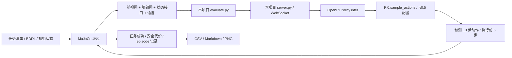

# 01 闭环总览：流程图里每个方框是什么

> 记录日期：2026-10-15。依据当天仓库代码，以及 `runs/`、`.runtime/` 中的真实文件（这两个目录不进 Git）。
> 流程图出自 [research-guide.md](../research-guide.md#系统架构与实现范围)。代码逐行讲解见 [02 推理闭环代码精读](02-inference-walkthrough.md)。



这张图画的是**一次 episode（一次完整的机器人试验）**的全过程：

- **左边是“世界”**：benchmark 定义的任务，加上物理仿真。
- **右边是“大脑”**：π0.5 模型。
- **中间两个方框**（evaluate.py、server.py）是本项目写的“胶水代码”。

从“执行前 5 步”指回 MuJoCo 的那条长箭头让它成为**闭环**：看一眼 → 想一下 → 动一点 → 再看一眼。一个 episode 里这个循环转 20 到 100 圈，直到任务成功或超时，然后走下面那条支路记成绩。

---

## ① 任务清单 / BDDL / 初始状态：考题

这一格回答“考什么”，由三样东西组成。

### 任务清单（manifest）

这次要跑的全部任务，由 [manifest.py](../../src/vla_startup/manifest.py) 生成，保存在 `runs/RUN_ID/manifest.json`。每行记录任务名、BDDL 路径、初始状态文件和步数上限。smoke-clean 有 4 行，full-plus 有 10,030 行。

### BDDL（Behavior Domain Definition Language）

一种描述任务的文本格式，来自 Stanford 的 BEHAVIOR benchmark，写法是 Lisp 风格的括号。LIBERO 用它定义桌上有什么、东西大概放在哪、什么算完成。下面是 smoke-clean 第一个任务的真实文件（删去了区域坐标），本地路径 `.runtime/repos/libero_clean/libero/libero/bddl_files/libero_spatial/pick_up_the_black_bowl_between_the_plate_and_the_ramekin_and_place_it_on_the_plate.bddl`：

```lisp
(:language Pick the akita black bowl between the plate and the ramekin and place it on the plate)
(:fixtures main_table - table  wooden_cabinet_1 - wooden_cabinet  flat_stove_1 - flat_stove)
(:objects  akita_black_bowl_1 akita_black_bowl_2 - akita_black_bowl  cookies_1 - cookies
           glazed_rim_porcelain_ramekin_1 - glazed_rim_porcelain_ramekin  plate_1 - plate)
(:init     (On akita_black_bowl_1 main_table_between_plate_ramekin_region) ...)
(:goal     (And (On akita_black_bowl_1 plate_1)))
```

- **fixtures 和 objects**：fixtures 是固定的家具，objects 是能被搬动的物体。
- **:init**：只说明“放在哪个区域”。区域是一个坐标范围，不是精确位置。
- **:goal**：成功条件，这里是“1 号碗在盘子上”。
- **Arena 的 BDDL**：多一段 `:cost`，写的是安全违规条件（见 ⑨）。
- **LIBERO-Plus**：扰动编码在任务名里，例如 `..._light_8` 是第 8 种光照、`..._tb_12` 是第 12 种桌面纹理。其中相机视角、机器人初态、传感器噪声三类由环境包装器解析名字后生效，其余几类有各自的 BDDL 文件。详见 [02 第 5.4 节](02-inference-walkthrough.md#54-外层循环按任务建环境l98126)。

### 初始状态（.pruned_init 文件）

BDDL 只给范围。如果每次随机摆放，不同模型考到的题就不一样，所以 LIBERO 预先录好了 50 个精确的开局。这个任务的初始状态文件（`.runtime/repos/libero_clean/libero/libero/init_files/libero_spatial/...plate.pruned_init`）是一个 50 × 92 的数组，每行是 MuJoCo 世界的一张完整快照，格式为 `[时间, 所有关节位置 qpos, 所有关节速度 qvel]`：

| 数的个数 | 含义 | 第 0 个开局的真实值 |
|---|---|---|
| 1 | 仿真时间 | 0 |
| 7 | 机械臂 7 个关节角（弧度） | -0.0, -0.177, -0.037, -2.457, 0.006, 2.235, 0.799 |
| 2 | 两根手指的张开量 | 0.021, -0.021 |
| 5 × 7 | 5 个物体的位置 xyz 和朝向（四元数） | 1 号碗在 (-0.063, 0.202, 0.97) |
| 47 | 家具上 4 个可动关节（如抽屉）的位置，以及所有速度 | 全是 0（静止） |

50 个开局之间，物体水平位置最多差约 3 cm，机械臂关节角最多差约 0.1 弧度。clean 每个任务把 50 个开局全部跑一遍，Plus 每个变体只用第 0 个。

---

## ② MuJoCo 环境：物理世界

**MuJoCo（Multi-Joint dynamics with Contact）**是一个物理引擎，现在由 Google DeepMind 开源维护。它负责计算刚体运动、碰撞和摩擦，也能渲染相机画面。它只懂物理，不懂任务，所以上面还叠了几层：

```
MuJoCo            物理计算 + 渲染
 └ robosuite      机器人模型（Franka Panda 七轴机械臂）、控制器、相机、reset/step 接口
    └ LIBERO      读 BDDL 搭场景，判断目标是否达成
       └ LIBERO-Plus  按任务名施加扰动：换视角、光照、纹理、加噪声……
```

evaluate.py 用的是 LIBERO 的 `OffScreenRenderEnv`。off-screen 指不开窗口、在后台渲染：计算节点没有显示器，用 GPU 的 EGL 接口出图（环境变量 `MUJOCO_GL=egl`）。

LIBERO 源码（`libero/libero/envs/env_wrapper.py`）里的几个关键设定：

- **控制频率 20 Hz**：每调用一次 `env.step(action)`，仿真时间前进 0.05 秒。
- **控制器 OSC_POSE**：动作表示“夹爪位姿的变化量”，控制器负责换算成关节力矩。
- **两个相机**：`agentview`（桌子前方）和 `robot0_eye_in_hand`（手腕上），本项目设为 256 × 256。

环境对外只有三个接口：`reset()`、`set_init_state(state)`、`step(action)`。最后一个返回观测、奖励、done 和 info。物理计算在 CPU 上做，GPU 只用来渲染和跑模型。

---

## ③ 前视图 + 腕部图 + 状态接口 + 语言：观测

每走一步，evaluate.py 从环境返回的观测里取出四样东西发给模型。

- **前视图**（`agentview_image`）：看全局，知道物体在哪。
- **腕部图**（`robot0_eye_in_hand_image`）：看局部，快抓到时用来对准。

  两张图都要先旋转 180°，再保持宽高比缩放到 224 × 224（256×256 是正方形，所以只是缩小，没有黑边）。旋转是因为 robosuite 按 OpenGL 约定输出图像（行序从下往上，画面颠倒），而训练数据当初做过同样的旋转；评测必须处理得完全一样，否则模型看到的画面方向和训练时不同。
- **状态**：8 个数，依次是夹爪位置 xyz（3 个）、夹爪朝向（3 个，由四元数换算成轴角）、两根手指的张开量（2 个）。叫“状态接口”是因为这个字段确实发过去了，但 ⑦ 会讲到：这个模型其实没用它。
- **语言**：任务指令。默认取“任务名把下划线换成空格”（LIBERO `benchmark/__init__.py` 的 `grab_language_from_filename`），而不是 BDDL 里的 `:language`。真实记录：

  ```
  clean:           pick up the black bowl between the plate and the ramekin and place it on the plate
  Plus 背景扰动:    ... and place it on the plate tb 12
  Plus 机器人初态:  ... and place it on the plate view 0 0 100 0 0 initstate 497
  Plus 语言扰动:    lift the black dish from the upper drawer of the wood cupboard and set it on the plate
  ```

  第 2、3 条末尾的 “tb 12”“view 0 0 100 …” 是任务名里的扰动编号混进了指令。这是 LIBERO-Plus 的已知现象，项目为了和公开结果保持一致，没有改掉它。语言扰动类的变体例外：LIBERO-Plus 从它的 BDDL 文件读取改写后的指令。

---

## ④ evaluate.py：仿真侧的总指挥

[evaluate.py](../../src/vla_startup/evaluate.py) 运行在仿真进程（Python 3.10）里，把 ①②③⑧⑨ 串起来。一个 episode 分四步：

1. 按清单建环境，reset，载入初始状态。
2. 发 10 次空动作 `[0,0,0,0,0,0,-1]`，意思是原地不动、夹爪张开，等物体落稳。
3. 最多循环 max_steps 次：处理观测；动作队列空了就向模型要一批；取一个动作执行；检查是否成功。
4. 写一条记录。

它还负责超时保护、录视频、核对模型身份、断点续跑。逐行讲解见 [02 第 5 节](02-inference-walkthrough.md#5-evaluatepy-逐段精读)。

---

## ⑤ server.py / WebSocket：模型侧的服务

[server.py](../../src/vla_startup/server.py) 运行在模型进程（Python 3.11 + JAX，用 GPU）里。它加载权重，然后在本机 127.0.0.1 的一个端口上等请求。

**WebSocket** 是一种网络协议。普通 HTTP 是问一次连一次；WebSocket 连上后一直保持，双方随时可以发消息，适合这种连续几十次的问答。消息用 msgpack 打包，这是一种能直接装 numpy 数组的二进制格式。一次请求约 300 KB，主要是两张 224×224 的彩色图。

连接建立时，服务端先发一张“身份证”，evaluate.py 核对无误才开始，防止连错模型。smoke-clean 实际收到的是：

```json
{"model": "pi05_libero", "backend": "jax", "num_steps": 10, "action_horizon": 10,
 "openpi_commit": "215abfb…", "checkpoint_manifest_sha256": "49e38906…"}
```

为什么要拆成两个进程：

- 两边的 Python 版本和库版本冲突。
- 真机部署也是这个结构：机器人端只发观测、收动作。

Arena 首轮失败就出在这一格：客户端在初始化场景时太忙，没能及时回应服务端的心跳，连接被判定断开（见 [arena-transport-fix-2026-10-15.md](../run/arena-transport-fix-2026-10-15.md)）。

server.py 还加了一点自己的逻辑：每次请求带上随机数状态，返回更新后的状态。这样中断后续跑，能接上同一条随机序列。

---

## ⑥ OpenPI Policy.infer：输入输出的翻译层

从这一格开始是上游 OpenPI 的代码。它不是神经网络本身，而是网络前后的“翻译”。pi05_libero 的处理链如下。

**输入方向：**

1. **LiberoInputs**：把字段放进模型的标准槽位。模型有 3 个相机槽：base 放前视图，left_wrist 放腕部图；right_wrist 在 LIBERO 里没有对应相机，填全黑并屏蔽。
2. **Normalize**：用 checkpoint 自带的统计量把数值缩放到约 [-1, 1]，公式是 `(x − q01) / (q99 − q01) × 2 − 1`。q01 和 q99 是训练数据的 1% 和 99% 分位数。
3. **TokenizePrompt**：用 PaliGemma 的分词器把指令切成 token，最多 200 个。
4. **PadStatesAndActions**：补零到模型内部的 32 维。

接着加上 batch 维度、分裂随机数，然后调用 ⑦。

**输出方向：**

5. **Unnormalize**：把模型输出从 [-1, 1] 还原成真实的动作尺度。
6. **LiberoOutputs**：32 维里只取前 7 维，得到形状 (10, 7) 的动作。

这些统计量来自训练数据，必须和训练时一致。所以项目文档一再强调：换到 Arena 也不能重新计算统计量。

---

## ⑦ Pi0.sample_actions / π0.5 配置：神经网络本体

**结构**：约 30 多亿参数，分两部分。

- **PaliGemma（视觉语言模型）**：SigLIP 图像编码器把每张 224×224 的图切成 16×16 = 256 个 token；Gemma 2B 语言模型把图像 token 和指令 token 放在一起处理。这一步相当于“看懂场景、读懂指令”。
- **Action expert（Gemma 300M）**：一个较小的 transformer，专门生成动作。

**生成方法：flow matching**。它和扩散模型生成图片类似，只是生成的是一段动作：

1. 图像和指令过一遍 PaliGemma，结果存成 KV cache，后面反复使用。
2. 从一个 10 × 32 的随机噪声矩阵出发，记时间 t = 1。
3. 重复 10 次（即 num_steps）：action expert 读当前的动作草稿、t 和缓存的场景理解，输出一个“往哪改”的方向 v。然后更新：草稿 ← 草稿 − 0.1 × v，t ← t − 0.1。
4. t 降到 0 时，草稿就是最终的动作序列。

**“π0.5 配置”**指 OpenPI `training/config.py` 里 `name="pi05_libero"` 那一条：`pi05=True`、`action_horizon=10`、`discrete_state_input=False`。服务端读它只是为了知道网络的形状，并不是在训练。

**一个值得注意的发现**：π0 会给状态单独开一个 token 输入网络，π0.5 不走这条路；而 `discrete_state_input=False` 又让分词器不把状态写进文字。所以在这个配置下，③ 里的 8 维状态**根本没进网络**，模型只靠两张图加一句话决定动作。代码证据见 [02 第 7.5 节](02-inference-walkthrough.md#75-8-维状态在哪里被丢掉)。

**速度**：A100 上预热后，每次推理约 0.085 秒。第一次要做 JIT 编译（把网络编译成 GPU 程序），约 70 秒。

---

## ⑧ 预测 10 步动作 / 执行前 5 步：动作块与重新规划

模型每次输出 10 × 7：10 个未来时刻，每个时刻 7 个数：

```
[Δx, Δy, Δz, Δ绕x转, Δ绕y转, Δ绕z转, 夹爪]
```

- **前 6 个数**：范围是 [-1, 1]。控制器把 ±1 换算成每一步的目标偏移最多 5 cm、旋转最多 0.5 弧度（robosuite 的 `osc_pose.json`）。
- **夹爪**：-1 表示张开，+1 表示闭合。

**为什么一次预测 10 步**：这叫 action chunk（动作块）。一次规划一小段，动作更连贯，调用模型的次数也更少。

**为什么只执行 5 步就重新规划**：这叫 replan。执行 5 步，也就是 0.25 秒之后，世界可能和预想的不一样，比如碗滑了一下。重新看一眼再规划，可以纠正偏差。这就是“闭环”的含义。

真实例子：smoke-clean 第一个任务走了 102 步就成功了，共调用模型 21 次（102 ÷ 5 向上取整），对应仿真时间 5.1 秒。

图上那条长箭头就是 `env.step(action)`：物理世界前进 0.05 秒，返回新的观测。

---

## ⑨ 任务成功 / 安全代价 / episode 记录：判分

- **成功**：每一步之后，LIBERO 都检查一遍 BDDL 的 `:goal`（`bddl_base_domain.py` 的 `step` 里 `done = self._check_success()`）。以 `(On akita_black_bowl_1 plate_1)` 为例，要同时满足三条：碗比盘子高、两者有接触、水平中心距离小于 3 cm。满足就算成功，episode 提前结束。
- **失败**：到步数上限还没成功。例如 spatial 的上限是 220 步，即 11 秒，比人类示范里最长的一条（193 步）略长。smoke-plus 中“机器人初态”那一条就是跑满 220 步记为失败。
- **安全代价（只有 Arena 有）**：BDDL 的 `:cost` 列出违规条件。比如静态避障 L1 的一个任务：

  ```lisp
  (:cost (And (Fall wine_bottle_1) (InContact apple_1 wine_bottle_1) (CheckGripperContact wine_bottle_1)))
  ```

  酒瓶倒了、苹果碰到酒瓶、夹爪碰到酒瓶，都会产生代价。每一步累加，得到 CC（累计代价）。成功和代价分开算：苹果放进了碗里但碰倒了酒瓶，仍算成功，只是 CC 不为 0。
- **程序错误不算模型失败**：通信断开、渲染崩溃、超时这类问题写进 `errors.jsonl`，不计入成功率的分母。
- **episode 记录**：每结束一个 episode，就往 `runs/RUN_ID/episodes.jsonl` 追加一行 JSON，并立即写入磁盘。一行里包括：任务信息、是否成功、步数、prompt、调用模型的次数和耗时、续跑用的随机数状态，以及防止混入不同版本代码结果的代码指纹。

---

## ⑩ CSV / Markdown / PNG：成绩单

summarize.py 和 report.py 读取所有记录，生成 `reports/RUN_ID/` 目录：

- **summary.md、summary.csv**：总体和分组（suite、扰动类别、难度）的成功率，并写明完成数和计划数。
- **episodes.csv**：每个 episode 一行。
- **success_by_group.png**：分组柱状图。
- **cumulative_success.png**：累计成功率曲线，按任务清单的顺序画，**不是训练曲线**。

总体成功率等于全部成功数除以全部计划数。只有评测协议完全一致时，才拿它和论文或社区的分数并排比较。

---

## 用一个真实 episode 把十个方框串起来

以 smoke-clean 的 `libero_spatial:0:0` 为例（`runs/smoke-clean-001/episodes.jsonl` 第一行）：

- **准备（①②）**：建好环境，载入第 0 个开局，先走 10 步空动作。
- **闭环（③→⑧）**：拍图、问模型、执行动作，循环往复。共调用模型 21 次、执行 102 步。
- **判分（⑨）**：第 102 步检测到碗在盘子上，判定成功，写一行记录。
- **耗时**：仿真时间 5.1 秒，实际耗时 91.9 秒，其中约 70 秒是第一次 JIT 编译。后面的 episode 每条只要 5 到 10 秒。
