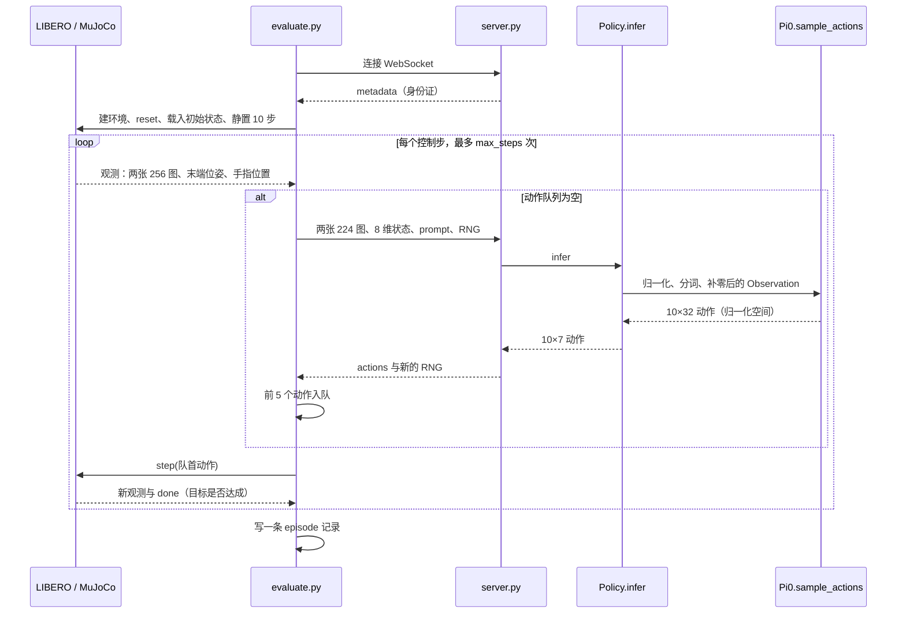

# 02 推理闭环代码精读：evaluate.py → server.py → OpenPI

> **范围**：一次推理从仿真环境出发、经过模型、再变回机器人动作的完整代码路径。**不含训练**。benchmark 任务生成、成绩统计、Slurm 调度只在必要处点到。
> **依据**：2026-10-15 的代码。`src/vla_startup/evaluate.py` 和 `server.py` 自 commit `a09efbc` 起未改动；OpenPI 固定在 `215abfb`。
> **源码位置**：本项目文件用相对链接。上游文件链接到固定 commit 的 GitHub 页面，本地对应 `.runtime/repos/openpi/`、`.runtime/repos/libero_clean/`、`.runtime/repos/libero_plus/`。
> **前置阅读**：[01 闭环总览](01-closed-loop-overview.md)。

---

## 1. 全景



| 环节 | 运行在 | 代码 |
|---|---|---|
| 启动两个进程、等模型就绪 | Slurm 作业的主进程 | [scripts/run_node.py](../../scripts/run_node.py) |
| 建环境、取观测、执行动作、判成功、写记录 | 仿真进程：`.runtime/sim`，Python 3.10，CPU + EGL | [src/vla_startup/evaluate.py](../../src/vla_startup/evaluate.py) |
| 收发消息 | 两端 | OpenPI 的 `websocket_client_policy.py`、`websocket_policy_server.py` |
| 加载模型、管理随机数 | 模型进程：`.runtime/server`，Python 3.11，GPU | [src/vla_startup/server.py](../../src/vla_startup/server.py) |
| 输入输出处理 | 模型进程 | OpenPI 的 `policy.py`、`libero_policy.py`、`transforms.py` |
| 神经网络采样 | 模型进程（GPU） | OpenPI 的 `pi0.py`、`gemma.py`、`siglip.py` |

---

## 2. 两个进程怎么启动、怎么连上

[scripts/run_node.py](../../scripts/run_node.py) 在 Slurm 分配的 GPU 节点上运行，负责拉起两个进程。

**选端口**：

```python
with socket.socket() as sock:
    sock.bind(('127.0.0.1', 0))
    port = sock.getsockname()[1]
```

绑定 0 号端口时，操作系统会分配一个空闲端口。记下端口号后关掉 socket，再交给两个进程使用。

**启动模型服务**：

```python
server = subprocess.Popen([runtime/'server/bin/python', '-m', 'vla_startup.server',
                           '--checkpoint', runtime/'checkpoints/pi05_libero', '--port', str(port),
                           '--num-steps', str(manifest['evaluation']['num_steps'])], ...)   # 节选
```

然后每 2 秒请求一次 `http://127.0.0.1:PORT/healthz`，最多等 900 秒。healthz 由 WebSocket 服务端回应（第 4.1 节）。服务端加载完模型才开始监听，所以 healthz 返回 200 就说明模型已就绪。

**启动仿真客户端**：

```python
client = subprocess.Popen([runtime/'sim/bin/python', '-m', 'vla_startup.evaluate',
                           '--run-dir', str(run), '--port', str(port),
                           '--videos', '2' if smoke else '0'], env=sim_env)                  # 节选
```

`sim_env` 的 PYTHONPATH 指向 `.runtime/repos/libero_clean` 或 `libero_plus`，由 manifest 的 benchmark 字段决定，后面再加上 openpi-client 和本项目的 `src`。同一句 `from libero.libero import ...`，具体导入哪一套 LIBERO 由 PYTHONPATH 决定。

[slurm/evaluate.sbatch](../../slurm/evaluate.sbatch) 事先设好的环境变量：

| 变量 | 作用 |
|---|---|
| `JAX_PLATFORMS=cuda` | JAX 只用 GPU |
| `XLA_PYTHON_CLIENT_PREALLOCATE=false` | JAX 默认一启动就占用 75% 显存；关掉后按需分配，给同一张卡上的 EGL 渲染留空间 |
| `MUJOCO_GL=egl`、`PYOPENGL_PLATFORM=egl` | 在没有显示器的节点上用 GPU 渲染 |
| `OMP/OPENBLAS/MKL_NUM_THREADS=1` | 限制数学库的线程数，避免多个库抢 CPU |

---

## 3. server.py 逐段

### 3.1 参数与延迟导入（L11–21）

```python
def main():
    parser.add_argument('--checkpoint', type=Path, required=True)
    parser.add_argument('--port', type=int, default=8000)
    parser.add_argument('--num-steps', type=int, default=10)
    args = parser.parse_args()
    import jax
    import numpy as np
    from openpi.policies import policy_config
    from openpi.serving.websocket_policy_server import WebsocketPolicyServer
    from openpi.training.config import get_config
```

JAX、OpenPI 这些重型依赖放在函数里导入，只有真正启动服务时才加载。

### 3.2 GPU 检查与读取配置（L22–24）

```python
if not any(d.platform == 'gpu' for d in jax.devices()):
    raise RuntimeError('A CUDA GPU is required; refusing CPU model inference')
config = get_config('pi05_libero')
```

- **GPU 检查**：`jax.devices()` 会初始化 CUDA。拿不到 GPU 就直接报错，不让 JAX 悄悄退回 CPU，因为 CPU 推理慢到无法使用。
- **读取配置**：`get_config('pi05_libero')` 返回 OpenPI 的 `TrainConfig`（[config.py#L744](https://github.com/Physical-Intelligence/openpi/blob/215abfb217dbac7d5f1273282331b9b1866c0479/src/openpi/training/config.py#L744)）。推理只用到其中两部分：
  - `model=Pi0Config(pi05=True, action_horizon=10, discrete_state_input=False)`：网络结构；
  - `data=LeRobotLiberoDataConfig(...)`：输入输出处理链。

  其余字段（batch size、学习率等）是训练用的，推理时不读。

### 3.3 create_trained_policy（L25）

```python
policy = policy_config.create_trained_policy(config, args.checkpoint, sample_kwargs={'num_steps': args.num_steps})
```

它依次做五件事（[policy_config.py#L16](https://github.com/Physical-Intelligence/openpi/blob/215abfb217dbac7d5f1273282331b9b1866c0479/src/openpi/policies/policy_config.py#L16)）：

1. **确认权重位置**：`download.maybe_download(checkpoint_dir)` 遇到本地路径原样返回，不联网。
2. **建网络、加载权重**：目录里没有 `model.safetensors`，判定为 JAX 权重。`restore_params(checkpoint_dir / "params", dtype=bfloat16)` 用 Orbax 读出参数，`config.model.load(...)` 建出 `Pi0` 网络并填入权重。服务端日志实测读取 6.2 GiB，用时约 4.7 秒。
3. **生成处理链**：`config.data.create(...)` 生成数据变换（LiberoInputs、LiberoOutputs）和模型变换（ResizeImages、TokenizePrompt、PadStatesAndActions）。
4. **读取归一化统计**：从 checkpoint 的 `assets/physical-intelligence/libero/norm_stats.json` 读，不用当前数据重新计算。π0.5 用分位数归一化（`use_quantile_norm = model_type != PI0`，[config.py#L187](https://github.com/Physical-Intelligence/openpi/blob/215abfb217dbac7d5f1273282331b9b1866c0479/src/openpi/training/config.py#L187)）。
5. **组装 Policy**。把 `create_trained_policy` 里几段列表展开后，实际内容是：

```python
Policy(model,
       transforms=[InjectDefaultPrompt(None), LiberoInputs(PI05),
                   Normalize(norm_stats, use_quantiles=True),
                   InjectDefaultPrompt(None), ResizeImages(224, 224),
                   TokenizePrompt(PaligemmaTokenizer(200), discrete_state_input=False),
                   PadStatesAndActions(32)],
       output_transforms=[Unnormalize(norm_stats, use_quantiles=True), LiberoOutputs()],
       sample_kwargs={'num_steps': 10})
```

推理时 repack 变换为空，所以上面没有列出。

`Policy.__init__` 里还有两行很关键（[policy.py#L63-L65](https://github.com/Physical-Intelligence/openpi/blob/215abfb217dbac7d5f1273282331b9b1866c0479/src/openpi/policies/policy.py#L63-L65)）：

```python
self._sample_actions = nnx_utils.module_jit(model.sample_actions)   # 用 jax.jit 包装，第一次调用时编译
self._rng = rng or jax.random.key(0)                                # 随机数从 key(0) 开始
```

### 3.4 ReplayablePolicy：把随机数状态交给客户端保管（L29–40）

```python
class ReplayablePolicy:
    def infer(self, observation):
        observation = dict(observation)
        state = observation.pop('__vla_rng', None)
        if state is None or len(state) != 2 or any(not 0 <= int(x) < 2 ** 32 for x in state):
            raise ValueError('Client must supply the two uint32 words of the JAX RNG state')
        policy._rng = jax.random.wrap_key_data(np.asarray(state, dtype=np.uint32))
        result = policy.infer(observation)
        result['__vla_rng'] = np.asarray(jax.random.key_data(policy._rng)).tolist()
        return result
```

- **随机性只有一处**：推理里唯一的随机性，是 `sample_actions` 起点的那块噪声（第 7.2 节）。噪声由 `policy._rng` 决定。`Policy.infer` 每次调用都会 `split` 一次，所以 `_rng` 是一条不断往前走的随机序列。
- **原版的问题**：原版 OpenPI 里这条序列只存在服务端内存中，服务一重启就回到 `key(0)`。
- **这个包装的做法**：让客户端保管随机数状态。请求里带上当前状态（两个 uint32），服务端先设好再推理，再把推进后的状态放进响应。evaluate.py 把它写进每条 episode 记录；续跑时从最后一条记录取回，随机序列就能从断点无缝接上。
- **和原版一致**：全新运行的第一次请求带 `[0, 0]`，这正是 `key(0)` 的内部数据，所以和原版 OpenPI 的行为完全一致。
- **两个转换函数**：`wrap_key_data` 和 `key_data` 负责在 JAX 的 key 对象与两个整数之间互相转换。

### 3.5 身份证与启动服务（L42–48）

```python
metadata = {'model': 'pi05_libero', 'backend': 'jax', 'num_steps': args.num_steps,
            'action_horizon': config.model.action_horizon, 'initial_rng': [0, 0],
            'openpi_commit': sources['openpi']['commit'],
            'checkpoint_manifest_sha256': hashlib.sha256((ROOT / 'config/checkpoint_files.json').read_bytes()).hexdigest()}
WebsocketPolicyServer(ReplayablePolicy(), host='127.0.0.1', port=args.port, metadata=metadata).serve_forever()
```

- **权重标识**：`checkpoint_manifest_sha256` 是 [config/checkpoint_files.json](../../config/checkpoint_files.json) 的哈希。这个文件列出 16 个权重文件的名字、大小和 CRC32C，下载脚本按它校验过权重，所以这个哈希间接标识了权重版本。
- **只监听 127.0.0.1**：只有同一台机器上的客户端能连，外部访问不到。
- **常驻服务**：`serve_forever()` 进入 asyncio 事件循环，一直运行到进程被终止。

---

## 4. WebSocket 通信层

### 4.1 服务端

[websocket_policy_server.py#L37-L90](https://github.com/Physical-Intelligence/openpi/blob/215abfb217dbac7d5f1273282331b9b1866c0479/src/openpi/serving/websocket_policy_server.py#L37-L90)（节选并加注释）：

```python
async def run(self):
    async with _server.serve(self._handler, self._host, self._port,
                             compression=None, max_size=None, process_request=_health_check) as server:
        await server.serve_forever()

async def _handler(self, websocket):
    packer = msgpack_numpy.Packer()
    await websocket.send(packer.pack(self._metadata))           # 连上后先发身份证
    while True:
        try:
            obs = msgpack_numpy.unpackb(await websocket.recv())  # 等一个请求
            action = self._policy.infer(obs)                     # 同步推理（GPU）
            action["server_timing"] = {"infer_ms": ...}
            await websocket.send(packer.pack(action))            # 回传
        except websockets.ConnectionClosed:
            break
        except Exception:
            await websocket.send(traceback.format_exc())         # 出错：先发错误文本
            await websocket.close(code=INTERNAL_ERROR, ...)      # 再以 1011 关闭
            raise
```

- **健康检查**：`process_request=_health_check` 让普通 HTTP 请求 `/healthz` 直接得到 200，run_node.py 就靠它判断模型是否就绪。
- **`compression=None, max_size=None`**：不压缩（图像本来就难压缩，省 CPU），也不限制消息大小。
- **同步推理**：`policy.infer` 是同步调用，推理期间事件循环被占住。一个连接上同一时刻只处理一个请求。

### 4.2 客户端

[websocket_client_policy.py#L18-L54](https://github.com/Physical-Intelligence/openpi/blob/215abfb217dbac7d5f1273282331b9b1866c0479/packages/openpi-client/src/openpi_client/websocket_client_policy.py#L18-L54)（节选）：

```python
def __init__(self, host, port):
    self._uri = f"ws://{host}:{port}"
    self._ws, self._server_metadata = self._wait_for_server()    # 构造时就连接；连不上每 5 秒重试

def infer(self, obs):
    self._ws.send(self._packer.pack(obs))
    response = self._ws.recv()                                   # 阻塞等待
    if isinstance(response, str):                                # 收到文本 = 服务端的错误信息
        raise RuntimeError(f"Error in inference server:\n{response}")
    return msgpack_numpy.unpackb(response)
```

### 4.3 消息格式：msgpack + numpy

msgpack 是二进制版的“JSON”。OpenPI 的 `msgpack_numpy` 把 numpy 数组编码成 `{__ndarray__: True, data: 原始字节, dtype, shape}`，接收端按 dtype 和 shape 还原。整个过程不经过 pickle，对方无法借反序列化执行代码，所以安全。

一次请求和响应的内容：

| 方向 | 键 | 内容 |
|---|---|---|
| 请求 | `observation/image` | (224, 224, 3) uint8，前视图 |
| 请求 | `observation/wrist_image` | (224, 224, 3) uint8，腕部图 |
| 请求 | `observation/state` | (8,) float64 |
| 请求 | `prompt` | 字符串 |
| 请求 | `__vla_rng` | 两个 uint32（本项目加的） |
| 响应 | `actions` | (10, 7) |
| 响应 | `__vla_rng` | 推进后的随机数状态 |
| 响应 | `policy_timing`、`server_timing` | 服务端耗时（毫秒） |

一次请求约 300 KB，几乎全是两张图：224 × 224 × 3 × 2 = 301,056 字节。

### 4.4 心跳（keepalive）

websockets 库默认每 20 秒发一次 ping，20 秒内收不到 pong 就以 1011 关闭连接。evaluate.py 在建环境之前就连上了服务端。

- **LIBERO**：这条路径在实际运行中（smoke 加一万多条 full episode）没有触发问题。
- **Arena**：环境初始化时间更长，首轮 5 个 worker 全部因心跳超时断开。
- **修复范围**：Arena 的修复（`src/arena_startup/transport.py`：场景就绪后再连接、关闭心跳、改用请求超时）没有改动 LIBERO 的代码。详见 [arena-transport-fix-2026-10-15.md](../arena-transport-fix-2026-10-15.md)。

---

## 5. evaluate.py 逐段精读

### 5.1 启动保护（L44–57）

```python
parser.add_argument('--run-dir', type=Path, required=True)
parser.add_argument('--port', type=int, default=8000)
parser.add_argument('--episode-timeout', type=int, default=1800)
parser.add_argument('--videos', type=int, default=2, help='Maximum videos per run; 0 disables')
...
lock = (run / '.lock').open('w')
fcntl.flock(lock, fcntl.LOCK_EX | fcntl.LOCK_NB)
manifest = json.loads((run / 'manifest.json').read_text())
validate(manifest)
protocol = manifest['evaluation']
```

- **排他锁**：`flock(LOCK_EX | LOCK_NB)` 给运行目录加一把排他锁，拿不到立即报错，防止两个评测进程同时往同一个 run 写记录。进程退出时锁自动释放。
- **校验清单**：`validate(manifest)` 核对清单的哈希、任务不重复、episode 总数正确（属于 manifest.py，本篇不展开）。
- **协议参数**：`protocol` 就是当时 [config/evaluation.json](../../config/evaluation.json) 的内容：num_steps 10、replan_steps 5、wait_steps 10、render 256、policy 224，以及各 suite 的 horizon。

### 5.2 延迟导入与随机种子（L58–67）

```python
import numpy as np
import torch
from libero.libero import benchmark, get_libero_path
from libero.libero.envs import OffScreenRenderEnv
from openpi_client import image_tools
from openpi_client.websocket_client_policy import WebsocketClientPolicy
import imageio.v2 as imageio
np.random.seed(manifest['seed'])
random.seed(manifest['seed'])
torch.set_num_threads(1)
```

- **延迟导入**：仿真相关的库只在这里导入，所以文件里的纯函数可以被别处直接复用。例如 Arena 的 evaluate.py 导入了这里的 `quat_to_axisangle`，而 Arena 环境里根本没装 LIBERO。
- **种子**：种子 7 来自 manifest，和 OpenPI 官方示例一致。
- **torch 单线程**：torch 在仿真端主要用来读初始状态文件，限制为 1 个线程，避免和 MuJoCo 抢 CPU。

### 5.3 连接模型、核对身份、准备续跑（L68–97）

```python
client = WebsocketClientPolicy('127.0.0.1', args.port)
metadata = client.get_server_metadata()
expected_checkpoint = hashlib.sha256((ROOT / 'config/checkpoint_files.json').read_bytes()).hexdigest()
if (metadata.get('model') != 'pi05_libero' or metadata.get('num_steps') != protocol['num_steps']
        or metadata.get('action_horizon') != 10
        or metadata.get('openpi_commit') != manifest['sources']['openpi']['commit']
        or metadata.get('checkpoint_manifest_sha256') != expected_checkpoint):
    raise ValueError('Policy-server identity differs from the locked experiment')
```

连接后第一件事是核对身份证：模型名、flow 步数、动作长度、OpenPI 版本、权重清单哈希。任何一项不符就拒绝评测。

接下来几行属于“实验记账”，这里只说它们的作用：

```python
settings = {'server': metadata, **protocol, 'seed': ..., 'prompt_mode': ..., 'manifest_sha256': ...}
settings['code_sha256'] = {...}            # 本项目评测代码、补丁、OpenPI uv.lock 的哈希
settings['simulation_lock_sha256'] = ...   # 仿真依赖锁文件的哈希
fingerprint = digest(settings)             # 整个实验设置的指纹
records = read_records(run / 'episodes.jsonl', repair_tail=True)
expected_keys = validate_prefix(records, manifest, fingerprint)
```

- **`fingerprint`**：模型、协议、代码、依赖任何一处变了，指纹就会变。旧记录的指纹对不上时拒绝续跑，防止把不同设置的结果混在一起。设置同时写进 `run_config.json`；文件已存在但内容不同时，同样拒绝。
- **`records`**：已完成的 episode。
- **`expected_keys`**：按清单顺序排好的全部 episode 编号，例如 `libero_spatial:0:0`，格式是 suite:task_id:第几次。

```python
rng_state = records[-1]['rng_after'] if records else [0, 0]
resume_np = records[-1]['numpy_after'] if records else None
resume_task = (records[-1]['suite'], records[-1]['task_id']) if records else None
```

- **`rng_state`**：模型随机数（见 3.4）。新运行从 `[0, 0]` 开始；续跑时接着上一条记录。
- **`resume_np`**：numpy 随机数状态，只在续跑到“任务中途”时恢复，原因见 5.4 末尾。

```python
signal.signal(signal.SIGALRM, timeout_handler)
signal.signal(signal.SIGTERM, lambda *unused: (_ for _ in ()).throw(InterruptedError('Slurm termination')))
```

- **`SIGALRM`**：配合后面的 `signal.alarm(1800)`，一个 episode 的墙钟时间超过 30 分钟就抛 `TimeoutError`。这算程序故障，不算任务失败。
- **`SIGTERM`**：Slurm 快到时限时会发 TERM。sbatch 里设了 `--signal=B:TERM@90`，即提前 90 秒；run_node.py 收到后再转发给子进程。这里把 TERM 变成 `InterruptedError`，让当前 episode 走异常处理、留下错误记录。lambda 里不能写 `raise`，所以借生成器的 `.throw()` 抛异常，这是 Python 的一个小技巧。

### 5.4 外层循环：按任务建环境（L98–126）

```python
cursor = 0
suites = {}
for row in manifest['tasks']:
    suite_name, task_id = row['suite'], row['task_id']
    trials = manifest['trials_per_task']
    if cursor + trials <= len(records):        # 这个任务的所有 episode 都已完成
        cursor += trials
        continue
```

`cursor` 是当前任务的第一个 episode 在全部 episode 中的序号。已完成的任务直接跳过，所以续跑不会重做。

```python
    if suite_name not in suites:
        with contextlib.redirect_stdout(io.StringIO()):
            suites[suite_name] = benchmark.get_benchmark_dict()[suite_name](task_order_index=0)
    suite = suites[suite_name]
    task = suite.get_task(task_id)
    if task.name != row['name']:
        raise ValueError('Task indices no longer match manifest names')
```

- **建 suite**：`get_benchmark_dict()[suite_name](task_order_index=0)` 建一个 suite 对象。LIBERO 为终身学习实验准备了多种任务顺序，第 0 种就是原始顺序。建 suite 时 LIBERO 会打印整个顺序列表（Plus 有两千多个编号），所以用 `redirect_stdout` 吞掉。
- **`task`**：一条任务记录，包含 `name`、`language`、`problem_folder`、`bddl_file` 等字段。
- **名字核对**：确认上游的 task_id 编号仍对应清单里的同一个任务。

```python
    env = OffScreenRenderEnv(
        bddl_file_name=str(Path(get_libero_path('bddl_files')) / task.problem_folder / task.bddl_file),
        camera_heights=protocol['render_resolution'], camera_widths=protocol['render_resolution'])
    env.seed(manifest['seed'])
```

- **为什么必须保留逻辑文件名**：BDDL 路径用的是上游给的**逻辑文件名**。相机视角、机器人初态、传感器噪声这三类 LIBERO-Plus 变体，磁盘上并没有这个文件。LIBERO-Plus 的环境构造函数（[env_wrapper.py#L207](https://github.com/sylvestf/LIBERO-plus/blob/4976dc30028e805ff8094b55501d532c48fec182/libero/libero/envs/env_wrapper.py#L207)）会在 `_view_` 处把名字切开：
  - 前半段是真实的 BDDL 文件；
  - 后半段解析出相机参数（水平、垂直角度、缩放等）；
  - `_initstate_K` 把机器人换成编号对应的 Panda 变体，例如 `Panda497`；
  - `_noise_N` 给出噪声编号。噪声在每次 `step` 后加到前视图上（[#L285](https://github.com/sylvestf/LIBERO-plus/blob/4976dc30028e805ff8094b55501d532c48fec182/libero/libero/envs/env_wrapper.py#L285)）：1–10 运动模糊、11–20 高斯模糊、21–30 缩放模糊、31–40 雾、41–50 玻璃模糊。

  光照、背景、物体布局、语言这四类变体各有真实的 BDDL 文件。代码注释强调必须保留逻辑文件名，就是因为一旦换成真实文件名，扰动就消失了。
- **分辨率**：相机设为 256 × 256。
- **`env.seed(7)`**：它实际上就是 `np.random.seed(7)`（LIBERO [bddl_base_domain.py#L162](https://github.com/Lifelong-Robot-Learning/LIBERO/blob/f78abd68ee283de9f9be3c8f7e2a9ad60246e95c/libero/libero/envs/bddl_base_domain.py#L162)）。OpenPI 官方示例的注释提到，即使随后载入固定初始状态，这个种子仍会影响物体位置。

```python
    initial_states = suite.get_task_init_states(task_id)
    if len(initial_states) < trials:
        raise ValueError('Not enough initial states for requested trials')
    prompt = task.language if manifest['prompt_mode'] == 'upstream' else env.language_instruction
    if resume_task == (suite_name, task_id) and resume_np is not None:
        restore_numpy(np, resume_np)
```

- **初始状态**：clean 每个任务 50 个，全部用上；Plus 只用第 0 个。
- **prompt**：默认 `upstream` 模式用 `task.language`（任务名去掉下划线）；`bddl` 模式用 BDDL 文件里的 `:language`。
- **numpy 状态恢复**：每个任务开始时 `env.seed(7)` 都会把 numpy 重置成同一状态，所以在任务边界续跑不需要恢复。只有续跑到任务中途时，例如 clean 某任务已做了 20 次，才需要把 numpy 恢复到第 20 次结束时的状态，保证结果和不中断时完全一样。

### 5.5 内层循环：一个 episode 的准备（L127–147）

```python
for episode in range(trials):
    index = cursor + episode
    if index < len(records):
        continue                                   # 任务中途续跑：跳过已完成的
    current_key = expected_keys[index]
    signal.alarm(args.episode_timeout)             # 开始计时，1800 秒
    start = time.monotonic()
    env.reset()
    observation = env.set_init_state(initial_states[episode])
    for _ in range(protocol['wait_steps']):
        observation, _, _, _ = env.step([0.0] * 6 + [-1.0])
    actions = deque()
    succeeded = False
    calls = 0
    inference_seconds = 0.0
    steps = 0
    writer = None
    if index < args.videos:
        (run / 'videos').mkdir(exist_ok=True)
        writer = imageio.get_writer(run / 'videos' / f'{suite_name}_{task_id}_{episode}.mp4', fps=10)
```

- **`env.reset()`**：重置仿真。LIBERO 会在 BDDL 区域内随机摆放物体。
- **`env.set_init_state(...)`**：用录好的开局覆盖随机摆放。内部依次是 `set_state` → `sim.forward()`（按新状态算一遍运动学）→ 重新生成观测（[env_wrapper.py#L136](https://github.com/Lifelong-Robot-Learning/LIBERO/blob/f78abd68ee283de9f9be3c8f7e2a9ad60246e95c/libero/libero/envs/env_wrapper.py#L136)）。返回值就是开局时的观测。
- **静置 10 步**：开局里的物体可能略微悬空。用“不动、夹爪张开”的动作，让物理引擎把它们放稳。这 10 步不计入 max_steps。
- **`actions = deque()`**：动作队列。每次放进 5 个，每步取出 1 个。
- **视频**：只录整个运行的前 `--videos` 个 episode（smoke 是 2 个，full 是 0 个）。

### 5.6 闭环核心：每个控制步（L148–175）

```python
for steps in range(1, row['max_steps'] + 1):
    # ① 图像预处理
    front = np.ascontiguousarray(observation['agentview_image'][::-1, ::-1])
    wrist = np.ascontiguousarray(observation['robot0_eye_in_hand_image'][::-1, ::-1])
    resolution = protocol['policy_resolution']
    front = image_tools.convert_to_uint8(image_tools.resize_with_pad(front, resolution, resolution))
    wrist = image_tools.convert_to_uint8(image_tools.resize_with_pad(wrist, resolution, resolution))
    if writer:
        writer.append_data(front)
    # ② 队列空了才问模型
    if not actions:
        state = np.concatenate((observation['robot0_eef_pos'],
                                quat_to_axisangle(observation['robot0_eef_quat'], np),
                                observation['robot0_gripper_qpos']))
        request = {'observation/image': front, 'observation/wrist_image': wrist,
                   'observation/state': state, 'prompt': str(prompt), '__vla_rng': rng_state}
        call_start = time.monotonic()
        response = client.infer(request)
        inference_seconds += time.monotonic() - call_start
        chunk = np.asarray(response['actions'])
        if chunk.ndim != 2 or chunk.shape[0] < protocol['replan_steps'] or chunk.shape[1] != 7 or not np.isfinite(chunk).all():
            raise ValueError(f'Invalid action chunk: {chunk.shape}')
        rng_state = response['__vla_rng']
        actions.extend(chunk[:protocol['replan_steps']])
        calls += 1
    # ③ 执行一个动作
    observation, _, done, _ = env.step(actions.popleft().tolist())
    if done:
        succeeded = True
        break
```

下面按代码里的 ①②③ 逐行解释。

**① 图像**

- **`[::-1, ::-1]`**：行倒序加列倒序，等于旋转 180°。必须和训练数据的处理一致；OpenPI 官方示例同样写着 “rotate 180 degrees to match train preprocessing”。
- **`np.ascontiguousarray`**：倒序切片得到的是负步长视图，内存不连续。PIL 缩放和 msgpack 打包都需要连续内存，所以复制一份。
- **`resize_with_pad(…, 224, 224)`**（[image_tools.py#L15](https://github.com/Physical-Intelligence/openpi/blob/215abfb217dbac7d5f1273282331b9b1866c0479/packages/openpi-client/src/openpi_client/image_tools.py#L15)）：保持宽高比缩放，不足的部分补黑。256×256 是正方形，所以实际就是双线性缩小到 224×224，没有黑边。
- **`convert_to_uint8`**：只在图像是浮点数时才转换。MuJoCo 给的已经是 uint8，这一步不改变数据。
- **每步都处理图像**：即使这一步不需要问模型，图像也会处理一遍，因为要录视频；Arena 版改成了只在需要时才处理。视频录的是模型看到的 224 图。

**② 状态和请求**

- **8 维状态**由三部分拼成：
  - `robot0_eef_pos`：夹爪末端在世界坐标中的位置（米），3 个数。
  - `quat_to_axisangle(robot0_eef_quat)`（L26–32）：把朝向从四元数换成轴角，3 个数。robosuite 的四元数顺序是 (x, y, z, w)；角度 = 2·arccos(w)，转轴 = (x, y, z)/sqrt(1 − w²)，返回“转轴 × 角度”；w = ±1（几乎没有转动）时返回 0。和 OpenPI 示例里的 `_quat2axisangle` 等价。
  - `robot0_gripper_qpos`：两根手指的位置，2 个数。
- **请求**：共 5 个键，见 4.3。`str(prompt)` 保证 prompt 是普通字符串。
- **`client.infer`**：阻塞调用，发出请求后一直等到动作返回。`inference_seconds` 统计的是客户端视角的往返时间，包括网络和服务端计算。
- **校验**：返回的动作必须是二维、至少 5 行、正好 7 列、全部是有限数。不满足就抛异常：这是基础设施错误，不能当成“模型没完成任务”。
- **入队**：保存新的 `rng_state`；取前 `replan_steps = 5` 个动作入队，剩下 5 个丢弃。

**③ 执行**

`actions.popleft().tolist()` 取出一个 7 维动作，转成 Python 列表交给环境。7 个数的含义：

| 维度 | 含义 | 尺度 |
|---|---|---|
| 0–2 | 末端位置变化 Δx, Δy, Δz | ±1 对应 ±5 cm（OSC_POSE 的 `output_max`） |
| 3–5 | 末端朝向变化（轴角） | ±1 对应 ±0.5 弧度 |
| 6 | 夹爪 | -1 张开，+1 闭合 |

- **`env.step`**：推进 0.05 秒仿真（20 Hz），返回新观测。
- **`done` 的含义**：在 LIBERO 里，`done` 表示**目标已达成**。`bddl_base_domain.py` 的 `step` 用 `done = self._check_success()` 覆盖了 robosuite 原本“到时间就结束”的含义（[#L800](https://github.com/Lifelong-Robot-Learning/LIBERO/blob/f78abd68ee283de9f9be3c8f7e2a9ad60246e95c/libero/libero/envs/bddl_base_domain.py#L800)）。所以 `done` 为真就记成功并跳出循环，队列里剩下的动作直接丢弃。
- **跑满步数**：循环执行完 `max_steps` 步还没成功时，`succeeded` 保持 False，`steps` 等于 max_steps。

一次 replan 的节奏：第 1 步问模型并执行动作 1；第 2–5 步执行队列里的动作 2–5；第 6 步队列空了，用最新画面再问一次模型。

### 5.7 记录、异常与收尾（L176–199）

```python
            finally:
                if writer:
                    writer.close()
            record = {**row, 'episode': episode, 'episode_key': current_key,
                      'manifest_sha256': ..., 'run_fingerprint': fingerprint,
                      'success': succeeded, 'steps': steps, 'prompt': str(prompt),
                      'inference_calls': calls, 'inference_seconds': inference_seconds,
                      'elapsed_seconds': time.monotonic() - start,
                      'rng_after': rng_state, 'numpy_after': numpy_state(np),
                      'slurm_job_id': os.environ.get('SLURM_JOB_ID')}
            append(run / 'episodes.jsonl', record)
            records.append(record)
        cursor += trials
    except BaseException as error:
        append(run / 'errors.jsonl', {'episode_key': current_key, 'error': repr(error),
                                     'traceback': traceback.format_exc(), 'time': time.time()})
        raise
    finally:
        signal.alarm(0)
        if env is not None:
            env.close()
```

- **写记录**：每个 episode 写一条记录。`append` 写入后立即 `fsync` 落盘（属于 journal.py，本篇不展开）。记录里的 `rng_after` 和 `numpy_after` 就是续跑时读回的两个随机数状态。
- **异常处理**：任何异常，包括超时、Slurm 终止、通信错误、动作格式不对，都会写一条带完整 traceback 的 `errors.jsonl`，然后**重新抛出**，进程以非零状态退出。这个 episode 不会写进 `episodes.jsonl`，也不计入成功率；续跑时从它重新开始。
- **`finally`**：取消计时器，关闭环境，释放渲染资源。

---

## 6. Policy.infer 内部（OpenPI）

### 6.1 函数本身

[policy.py#L68](https://github.com/Physical-Intelligence/openpi/blob/215abfb217dbac7d5f1273282331b9b1866c0479/src/openpi/policies/policy.py#L68)，去掉 PyTorch 分支后：

```python
def infer(self, obs: dict, *, noise=None) -> dict:
    inputs = jax.tree.map(lambda x: x, obs)                  # 复制一份：后面的变换可能原地修改
    inputs = self._input_transform(inputs)                    # 输入处理链（6.2）
    inputs = jax.tree.map(lambda x: jnp.asarray(x)[np.newaxis, ...], inputs)   # 加 batch 维 → 1
    self._rng, sample_rng = jax.random.split(self._rng)       # 推进随机序列，拿一个子 key
    observation = _model.Observation.from_dict(inputs)        # 整理成模型的输入结构
    outputs = {
        "state": inputs["state"],
        "actions": self._sample_actions(sample_rng, observation, **self._sample_kwargs),  # 网络（第 7 节）
    }
    outputs = jax.tree.map(lambda x: np.asarray(x[0, ...]), outputs)                    # 去 batch 维，拷回 CPU
    outputs = self._output_transform(outputs)                 # 输出处理链
    outputs["policy_timing"] = {"infer_ms": ...}
    return outputs
```

- **`split` 的作用**：`split` 之后 `self._rng` 前进一步，`sample_rng` 用来生成本次的初始噪声。ReplayablePolicy 返回给客户端的，就是前进后的 `self._rng`。
- **为什么输出里保留 `"state"`**：后面的 Unnormalize 设了 `strict=True`，要求统计量里的每个键（state 和 actions）都出现在数据里。

### 6.2 处理链逐步追踪

以一次真实请求为例，数据每经过一步之后的样子：

| 步骤 | 做了什么 | 之后的数据 |
|---|---|---|
| 收到（已去掉 `__vla_rng`） | — | `observation/image` (224,224,3) uint8、`observation/wrist_image` 同、`observation/state` (8,)、`prompt` |
| InjectDefaultPrompt(None) | 没有默认 prompt，不变 | 同上 |
| [LiberoInputs](https://github.com/Physical-Intelligence/openpi/blob/215abfb217dbac7d5f1273282331b9b1866c0479/src/openpi/policies/libero_policy.py#L30) | 改成模型的标准结构 | `state` (8,)；`image`：`base_0_rgb` 放前视、`left_wrist_0_rgb` 放腕部、`right_wrist_0_rgb` 全 0；`image_mask`：True、True、**False**；`prompt` |
| [Normalize](https://github.com/Physical-Intelligence/openpi/blob/215abfb217dbac7d5f1273282331b9b1866c0479/src/openpi/transforms.py#L115)（分位数） | `state ← (state − q01)/(q99 − q01)·2 − 1` | state 大致落在 [-1, 1] |
| InjectDefaultPrompt(None) | 不变 | — |
| [ResizeImages(224, 224)](https://github.com/Physical-Intelligence/openpi/blob/215abfb217dbac7d5f1273282331b9b1866c0479/src/openpi/transforms.py#L185) | 已经是 224，不变 | — |
| [TokenizePrompt](https://github.com/Physical-Intelligence/openpi/blob/215abfb217dbac7d5f1273282331b9b1866c0479/src/openpi/transforms.py#L248) | 取走 `prompt` 并分词 | 新增 `tokenized_prompt`（200 个整数）、`tokenized_prompt_mask`（200 个布尔值） |
| [PadStatesAndActions(32)](https://github.com/Physical-Intelligence/openpi/blob/215abfb217dbac7d5f1273282331b9b1866c0479/src/openpi/transforms.py#L328) | 补零 | `state` (8,) → (32,) |
| 加 batch 维 | — | 所有数组前面多一维 1 |
| [Observation.from_dict](https://github.com/Physical-Intelligence/openpi/blob/215abfb217dbac7d5f1273282331b9b1866c0479/src/openpi/models/model.py#L110) | uint8 图像 → float32，`/255·2−1` | 图像值域 [-1, 1] |
| `sample_actions` | 见第 7 节 | `actions` (1, 10, 32)，归一化空间 |
| 去 batch 维 | — | (10, 32) |
| [Unnormalize](https://github.com/Physical-Intelligence/openpi/blob/215abfb217dbac7d5f1273282331b9b1866c0479/src/openpi/transforms.py#L149)（分位数） | 前 7 维 `(x+1)/2·(q99−q01)+q01`，后 25 维不动 | 动作回到控制器的尺度 |
| [LiberoOutputs](https://github.com/Physical-Intelligence/openpi/blob/215abfb217dbac7d5f1273282331b9b1866c0479/src/openpi/policies/libero_policy.py#L87) | 只取 `actions[..., :7]`，丢掉 state | `{"actions": (10, 7)}` |

checkpoint 自带的 `norm_stats.json` 里，动作 1% 和 99% 分位数举例：Δx 为 -0.747 和 0.937，夹爪为 -1.0 和 1.0。

### 6.3 分词的真实例子

[tokenizer.py#L22](https://github.com/Physical-Intelligence/openpi/blob/215abfb217dbac7d5f1273282331b9b1866c0479/src/openpi/models/tokenizer.py#L22) 在本配置下（不带 state）的逻辑：

```python
cleaned_text = prompt.strip().replace("_", " ").replace("\n", " ")
tokens = self._tokenizer.encode(cleaned_text, add_bos=True) + self._tokenizer.encode("\n")
# 不足 200 补 0；mask 中真实 token 为 True、补位为 False；超过 200 截断
```

用本地 tokenizer 实测（SentencePiece，词表 257,152）：

- **clean 指令**：`pick up the black bowl between the plate and the ramekin and place it on the plate` 切成 **20 个 token**：`<bos>`、`pick`、`▁up`、`▁the`、`▁black`、`▁bowl`、`▁between` ……最后一个是换行符。
- **Plus 指令**：带扰动编号的 `... place it on the plate view 0 0 100 0 0 initstate 497` 切成 **37 个 token**。这些编号也被逐个切成 token 送进了模型。

200 个位置里剩下的都是补位，被 mask 屏蔽。

---

## 7. sample_actions 内部（OpenPI）

### 7.1 网络由哪些部分组成

[pi0.py#L66](https://github.com/Physical-Intelligence/openpi/blob/215abfb217dbac7d5f1273282331b9b1866c0479/src/openpi/models/pi0.py#L66) 的 `Pi0.__init__`：

| 模块 | 作用 | 规模 |
|---|---|---|
| `PaliGemma.img`：SigLIP So400m/14 | 把每张 224×224 的图切成 14×14 像素的小块，得到 16×16 = 256 个 token，投影到 2048 维 | 约 4 亿参数 |
| `PaliGemma.llm` 专家 0：Gemma 2B | 处理图像 token 和文字 token（“理解”） | 宽 2048、18 层、MLP 16384 |
| `PaliGemma.llm` 专家 1：Gemma 300M（action expert） | 处理动作 token（“生成”） | 宽 1024、18 层、MLP 4096 |
| `action_in_proj` | 动作草稿 32 维 → 1024 维 | 线性层 |
| `time_mlp_in/out` | 时间 t 的编码（π0.5 专有） | 两层 MLP |
| `action_out_proj` | 1024 维 → 32 维的速度 v | 线性层 |

两个专家都是 8 个注意力头、头维度 256、1 个 KV 头（multi-query）。注意力头的形状一致，所以两者能在同一次注意力计算里互相看到（见 7.4）。

### 7.2 前缀：图像和指令过一遍，存 KV cache

[pi0.py#L217](https://github.com/Physical-Intelligence/openpi/blob/215abfb217dbac7d5f1273282331b9b1866c0479/src/openpi/models/pi0.py#L217) 的 `sample_actions` 前半段：

```python
observation = _model.preprocess_observation(None, observation, train=False)
dt = -1.0 / num_steps                                   # -0.1
noise = jax.random.normal(rng, (batch_size, self.action_horizon, self.action_dim))   # (1, 10, 32)

prefix_tokens, prefix_mask, prefix_ar_mask = self.embed_prefix(observation)
prefix_attn_mask = make_attn_mask(prefix_mask, prefix_ar_mask)
positions = jnp.cumsum(prefix_mask, axis=1) - 1
_, kv_cache = self.PaliGemma.llm([prefix_tokens, None], mask=prefix_attn_mask, positions=positions)
```

- **`preprocess_observation(train=False)`**：检查三个图像槽都在。推理时**不做**数据增强；随机裁剪、旋转、颜色抖动只在训练时打开。
- **`noise`**：整个推理过程中唯一的随机量，由 `sample_rng` 决定。
- **[embed_prefix](https://github.com/Physical-Intelligence/openpi/blob/215abfb217dbac7d5f1273282331b9b1866c0479/src/openpi/models/pi0.py#L106)**：三张图各 256 个 token，加上 200 个文字 token，共 968 个位置，每个 2048 维。
  - `input_mask` 标出有效位置：右腕槽（全黑）的 256 个 token 和文字补位都是无效的。
  - `ar_mask` 全为 False，表示前缀内部是**双向注意力**，任意两个有效 token 互相可见。
- **`positions`**：只给有效 token 编位置号。
- **只过专家 0**：llm 的输入列表第二项是 None，所以前缀只经过专家 0，得到 18 层的 K/V 缓存。这一步每次推理只做一次。

### 7.3 去噪循环：10 步把噪声变成动作

`sample_actions` 后半段：

```python
def step(carry):
    x_t, time = carry
    suffix_tokens, suffix_mask, suffix_ar_mask, adarms_cond = self.embed_suffix(
        observation, x_t, jnp.broadcast_to(time, batch_size))
    suffix_attn_mask = make_attn_mask(suffix_mask, suffix_ar_mask)
    prefix_attn_mask = einops.repeat(prefix_mask, "b p -> b s p", s=suffix_tokens.shape[1])
    full_attn_mask = jnp.concatenate([prefix_attn_mask, suffix_attn_mask], axis=-1)
    positions = jnp.sum(prefix_mask, axis=-1)[:, None] + jnp.cumsum(suffix_mask, axis=-1) - 1
    (prefix_out, suffix_out), _ = self.PaliGemma.llm(
        [None, suffix_tokens], mask=full_attn_mask, positions=positions,
        kv_cache=kv_cache, adarms_cond=[None, adarms_cond])
    v_t = self.action_out_proj(suffix_out[:, -self.action_horizon:])
    return x_t + dt * v_t, time + dt

def cond(carry):
    x_t, time = carry
    return time >= -dt / 2

x_0, _ = jax.lax.while_loop(cond, step, (noise, 1.0))
return x_0
```

- **[embed_suffix](https://github.com/Physical-Intelligence/openpi/blob/215abfb217dbac7d5f1273282331b9b1866c0479/src/openpi/models/pi0.py#L140)** 做三件事：
  - 动作草稿 `x_t` (1,10,32) 经过 `action_in_proj`，变成 10 个 1024 维的动作 token。
  - 时间 t 先做正弦余弦编码，再过两层 MLP（swish 激活），得到 `adarms_cond`（见 7.4）。
  - `ar_mask = [True, False × 9]`：10 个动作 token 组成一个块，块内互相可见；块开头的 True 表示前缀看不到这些动作 token。
- **注意力掩码**：每个动作 token 能看见全部有效前缀 token，以及 10 个动作 token。
- **`positions`**：接在前缀有效 token 的数量之后继续编号。
- **只有专家 1 在算**：这次 llm 调用的输入列表第一项是 None。专家 1 用自己的 query 去查缓存里专家 0 的 K/V。
- **输出速度**：取最后 10 个输出，经 `action_out_proj` 得到速度 `v_t`，形状 (1,10,32)。
- **更新**：`x ← x − 0.1·v`，`t ← t − 0.1`。
- **停止条件 `cond`**：t ≥ 0.05 时继续。t 依次取 1.0、0.9 …… 0.1，共循环 10 次，t 降到 0 时停止。
- **直观理解**：网络学到的 v 指向“噪声减去真实动作”的方向，所以沿 −v 走，就从噪声一步步走向一个合理的动作序列。分 10 小步而不是一步走完，是因为 v 本身随位置和时间变化，小步走更准。
- **`jax.lax.while_loop`**：JAX 在编译期使用的循环写法。整个 10 步循环会被编进同一个 GPU 程序。

### 7.4 两个专家怎么共享注意力；adaRMSNorm

[gemma.py#L164](https://github.com/Physical-Intelligence/openpi/blob/215abfb217dbac7d5f1273282331b9b1866c0479/src/openpi/models/gemma.py#L164) 注意力层的结构（伪代码，省略位置编码和缓存拼接的细节）：

```
for i, x in enumerate([前缀 token, 动作 token]):      # 任一项可以是 None
    if x is None: continue
    q_i, k_i, v_i = 第 i 个专家自己的投影权重(x)
q, k, v = 沿序列方向拼接两个专家的结果（再接上 kv_cache 里缓存的 K/V）
一次联合注意力 → 按长度切回两段 → 各自走自己的输出投影和 MLP
```

- **共享注意力，参数分开**：两个专家的**参数完全分开**，只在注意力这一步“见面”。理解场景的大模型（2B）和生成动作的小模型（300M）因此可以分工：大模型每次推理只算一遍，小模型每个去噪步算一遍，所以速度快。
- **adaptive RMSNorm**：普通 [RMSNorm](https://github.com/Physical-Intelligence/openpi/blob/215abfb217dbac7d5f1273282331b9b1866c0479/src/openpi/models/gemma.py#L113) 只有一个可学习的缩放。adaptive RMSNorm 把 `adarms_cond`（时间 t 的编码）送进一个全连接层，算出 `scale`、`shift`、`gate` 三组数，去调制每一层。π0.5 用这种方式告诉动作专家“现在去噪到第几步”；π0 则是把 t 和动作 token 拼在一起，过一个 MLP。

### 7.5 8 维状态在哪里被丢掉

state 一路被归一化、补到 32 维、放进 `Observation`。但网络读它的地方只有两处，在本配置下都被跳过：

```python
# transforms.py 的 TokenizePrompt：只有 discrete_state_input=True 才把 state 离散化写进文字
if self.discrete_state_input:
    state = data.get("state")
else:
    state = None

# pi0.py 的 embed_suffix：只有 π0（不是 π0.5）才给 state 开一个 token
if not self.pi05:
    state_token = self.state_proj(obs.state)[:, None, :]
```

- **两个分支都不走**：`pi05_libero` 的设置是 `pi05=True`、`discrete_state_input=False`。
- **唯一剩下的用途**：`pi0.py` 里 `obs.state` 只剩一处，用来读 batch 大小。
- **结论**：这个 checkpoint 实际上是“两张图加一句话 → 动作”，不看机器人的本体状态。训练时走的是同一套 embed 函数，也没有用到 state。
- **这是显式设置**：π0.5 的 `discrete_state_input` 默认值是 True（`pi0_config.py`），`pi05_libero` 这一条是特意关掉的。

### 7.6 JIT 编译

- **怎么编译**：`Policy.__init__` 用 `nnx_utils.module_jit` 把 `sample_actions` 包成 `jax.jit` 函数（[nnx_utils.py#L15](https://github.com/Physical-Intelligence/openpi/blob/215abfb217dbac7d5f1273282331b9b1866c0479/src/openpi/shared/nnx_utils.py#L15)）。第一次调用时，JAX 按输入的形状把整个函数（SigLIP、两个 Gemma、10 步循环）编译成 GPU 程序。之后只要形状不变，就直接复用。
- **实测（smoke-clean，A100）**：第一个 episode 的 21 次推理共 73.3 秒，其中约 70 秒是编译；之后每次约 0.085 秒。
- **日志里的提示**：服务端日志中的 `Trying algorithm … for conv`，是编译期间 cuDNN 在为 SigLIP 的 14×14 卷积挑选最快的算法。

---

## 8. 一次推理的形状与耗时速查

| 位置 | 数据 | 形状 |
|---|---|---|
| 环境观测 | 前视、腕部图 | (256, 256, 3) uint8 |
| evaluate.py 处理后 | 旋转 + 缩放 | (224, 224, 3) uint8 |
| 状态 | 位置 + 轴角 + 手指 | (8,) |
| 进网络前 | 图像 3 槽（右腕全黑并屏蔽） | 3 × (1, 224, 224, 3) float32，值域 [-1, 1] |
| 进网络前 | 文字 | (1, 200) token + mask |
| 进网络前 | state（网络不读） | (1, 32) |
| 前缀 | 3×256 个图像 token + 200 个文字 token | (1, 968, 2048) |
| 动作草稿 / 噪声 | — | (1, 10, 32) |
| 动作 token | — | (1, 10, 1024) |
| 网络输出 | 去噪 10 次后的动作 | (1, 10, 32) |
| 返回客户端 | 反归一化、取前 7 维 | (10, 7) |
| 实际执行 | 前 5 个 | 5 × 7 |

| 时间（smoke-clean，A100） | 数值 |
|---|---|
| 首次推理（含 JIT） | 约 70 秒 |
| 预热后每次推理（客户端往返） | 约 0.085 秒 |
| 一个 102 步的 episode | 21 次推理；仿真时间 5.1 秒 |
| 预热后一个 episode 的墙钟时间 | 5–10 秒，其中推理 2–4 秒，其余是仿真和渲染 |

---

## 9. 容易混淆的地方

- **四个“步数”不是一回事**：
  - `num_steps=10`：一次推理内部的去噪次数；
  - `action_horizon=10`：一次预测的动作个数；
  - `replan_steps=5`：执行几个动作后重新推理；
  - `max_steps`（220/280/300/520）：一个 episode 最多执行多少个控制步。
- **两套随机数**：
  - 模型随机数（JAX key）只决定初始噪声，由 ReplayablePolicy 交给客户端保存；
  - 环境随机数（numpy）由 `env.seed` 设置，影响仿真。

  两者分别保存、分别恢复。
- **`done` 是成功，不是“结束”**：LIBERO 改写了它的含义。跑满步数结束时，`done` 是 False。
- **模型不看 state**：8 维状态照常发送，但在这个配置下网络不读它（7.5）。
- **图像方向必须和训练一致**：180° 旋转漏做或多做一次，模型看到的就是“颠倒的世界”。成绩可能大幅下降，程序却不会报错。
- **归一化统计跟着 checkpoint 走**：用别的数据重新计算统计量，等于改变了模型输入输出的含义。
- **推理里没有训练**：读 `training/config.py` 只是为了拿到网络结构和处理链，权重全程不更新。

---

## 10. 问答：把整个流程串起来时容易混的地方

> 2026-10-15，回答学习过程中的提问。

### 10.1 修正后的完整流程

```
一个 Slurm 作业（run_node.py 只执行一次）
├─ 启动 server.py：加载模型一次，之后常驻
├─ 等 /healthz 就绪后启动 evaluate.py，两者通过 WebSocket 连上
└─ evaluate.py 依次执行清单里的所有任务：
   for 每个任务:                          建一次环境（Arena 是每个 episode 新建一次）
     for 每个初始状态（一个 episode）:
        reset → 载入初始状态 → 空走 10 步
        for 每个控制步（最多 max_steps）:
           取环境返回的观测，预处理两张图
           if 动作队列为空:
               把两张图、8 维状态、指令发给 server，收回 10 个动作，前 5 个入队
           执行队首 1 个动作：env.step → 物理前进 0.05 秒 → 环境判断目标是否达成
           达成 → 成功，跳出
        写一条 episode 记录（成功，或跑满步数的失败）
```

### 10.2 容易混的几个点

| 容易这样理解 | 实际 |
|---|---|
| 每个任务都要启动一次 server 和 evaluate | 一个作业只启动一次。实测从作业开始到两者连上要 41 秒到 11 分钟（取决于共享存储的缓存），首次推理还要 30–70 秒编译；按任务重启会浪费大量时间 |
| Policy 先做 infer，再把结果交给 π0.5 | `Policy.infer` 内部就包含调用网络：预处理 → `sample_actions`（网络）→ 后处理。Policy 是外壳，π0.5 网络在它里面 |
| 5 个动作一次性交给环境执行 | 每次只执行 1 个。每执行一个，环境就返回新观测和 done；这 5 步之间不问模型，第 6 步队列空了才用最新画面再问 |
| evaluate.py 检查目标是否达成 | 由环境（benchmark 代码）在 `env.step` 内部判断，evaluate.py 只读取返回的 `done` |
| 没达成就继续问模型 | 先把队列里剩下的动作执行完，队列空了才问；跑满 max_steps 还没达成，也写一条记录（失败）；程序出错写 `errors.jsonl`，不算 episode |

用词：环境返回给 evaluate.py 的叫**观测**（observation），包括两张相机图和机器人本体状态；“state”在这里专指其中那 8 维本体状态。

### 10.3 为什么先空走 10 步

- **作用**：载入初始状态后，物体可能略微悬空或和桌面稍有穿插，物理引擎需要几步让它们落稳、接触稳定。OpenPI 官方示例的注释原话是 “the simulator drops objects and we need to wait for them to fall”。
- **空动作 `[0,0,0,0,0,0,-1]`**：末端位姿变化为 0（机械臂保持不动），夹爪张开。
- **时长**：10 步 × 0.05 秒 = 0.5 秒仿真时间，不计入 max_steps；Arena 中这 10 步的代价也不计分。
- **它是协议的一部分**：不等或改成别的步数，模型第一眼看到的场景就不同，结果不能和原协议比较。

### 10.4 infer 是什么

infer 来自 inference（推理）。在机器学习里，**训练**是用数据更新权重；**推理**是用训练好的、固定不变的权重，从输入算出输出。评测全程只做推理。

代码里有三层同名的 `infer`，一层层往下转交：

1. `client.infer(request)`（evaluate.py）：把请求打包，通过 WebSocket 发出去，等待回复；
2. `ReplayablePolicy.infer`（server.py）：设好随机数状态，转交给 OpenPI；
3. `Policy.infer`（OpenPI）：预处理 → 调用网络 `Pi0.sample_actions` 生成动作 → 后处理，返回 10 × 7 的动作。

第 1 节时序图里的 Pol 和 Net，分别是第 3 层的外壳（Policy）和它内部调用的网络（Pi0），两者都在同一个模型进程里。

### 10.5 和真机的对应

| 仿真 | 真机 |
|---|---|
| MuJoCo 环境 | 真实世界和机器人硬件 |
| evaluate.py | 机器人端的控制程序：读相机和关节状态，执行动作 |
| server.py（同一节点，走 127.0.0.1） | 另一台带 GPU 的电脑，走网络 |
| BDDL 的 `:goal` 自动判断成功 | 通常由人或单独的检测程序判断 |

请求格式和通信协议在两种情况下可以完全一样，这正是 OpenPI 采用这种结构的原因。
