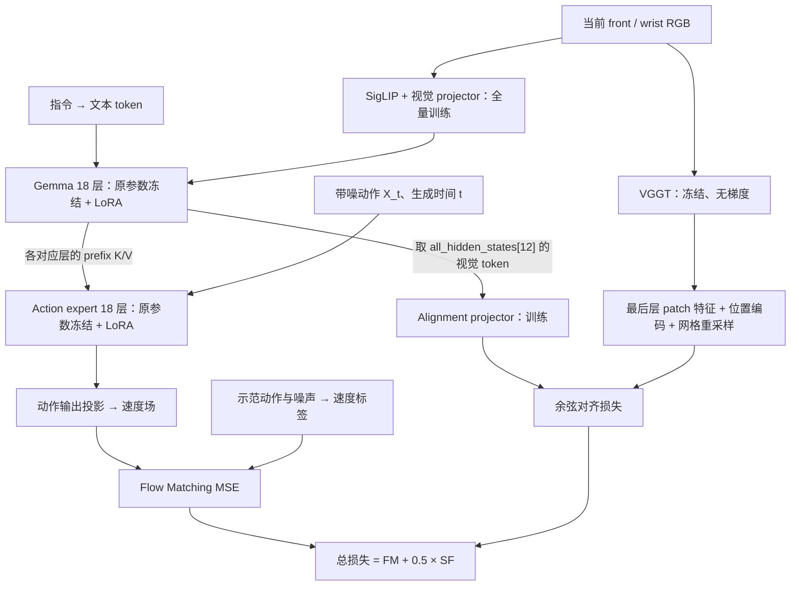

# 04 Spatial Forcing：原文怎样微调 π0，我们怎样用于 π0.5

> 阅读目标：分清 LoRA 与 SF 各自做什么，理解原文 π0 实验能确认的设置，并沿代码走通本项目 π0.5 + SF 的一次训练。
>
> 核对日期：2026-10-21。论文采用 [SF arXiv v2](https://arxiv.org/html/2510.12276v2)；公开实现采用本项目固定的 [Spatial-Forcing commit 372819b](https://github.com/OpenHelix-Team/Spatial-Forcing/tree/372819b31ba9a2c8fc5989edc7d525cb187cecd5)。本项目实现以 [recipe.json](../../config/sf_training/recipe.json)、[model.py](../../src/sf_training/model.py)、[lora.py](../../src/sf_training/lora.py) 为准。
>
> π0.5 的 token、逐层 attention 与 Flow Matching 基础见 [05 π0.5 学习文档](05-pi05-flow-matching.md)。运行命令见[训练操作说明](../run/training-operations.md)，实际作业与结果见[实验记录](../results-overview.md)。

<a id="overview"></a>

## 1. 先回答两个问题

**SF 原文在 π0 上做的是：保留动作学习任务，增加视觉特征对齐监督，并用 LoRA 进行微调。** 论文 第 3.1 节 明确写了 π0 / PaliGemma、RoboTwin、1 张 H100、30k iterations；但没有列出足以重建该实验的完整 LoRA 超参数和冻结清单。公开代码能解释 SF 怎样计算，不能把其中另一个示例的参数直接当成 RoboTwin 论文配方。

**我们的实验是：从 `pi05_base` 出发，在 Arena 示范上微调 π0.5，比较“只用动作损失”和“动作损失 + SF”。** 两组使用相同的策略网络与 LoRA 实现；SF 组额外加载冻结的 VGGT，并训练一个特征投影器。这是 π0.5 + Arena 的适配实验。

| 问题 | 原文 π0 实验 | 本项目 π0.5 实验 |
|---|---|---|
| 模型与场景 | π0，RoboTwin | π0.5，Arena L0-L 示范 |
| 微调方式 | 论文说明采用 LoRA；完整插入范围与超参数未披露 | Gemma rank 16，action expert rank 32，具体冻结范围见 第 4 节 |
| SF 监督对象 | VLA 中间层的视觉表示 | `all_hidden_states[12]` 中两路真实相机的视觉 token |
| 动作学习 | π0 的动作学习目标与 SF 联合优化 | π0.5 的 Flow Matching MSE，与 SF 权重 0.5 联合优化 |
| 训练预算 | 论文报告 1 × H100、30k iterations | 初始配方 60k updates；实际执行协议后来调整，见 第 7 节 |
| 推理额外输入 | 不要求额外三维传感器输入 | 仍输入图像与指令，推理不调用 VGGT 或 SF projector |

论文实验设置依据：[第 3.1 节](https://arxiv.org/html/2510.12276v2#S3.SS1)。本项目具体选择依据：[Arena / SF 训练说明](../arena-sf-training.md)。

## 2. LoRA 和 SF 分别改变什么

**LoRA 决定用哪些参数来适应新任务；SF 决定增加什么学习目标。** 二者可以组合，也可以单独使用。Baseline 也使用 LoRA，因此“baseline 对 SF”并不是“不开 LoRA 对开 LoRA”。

### 2.1 LoRA：给冻结的大矩阵增加可训练的小矩阵

用行向量约定，普通线性层为 $`y=xW`$。LoRA 将它改为：

```math
y=xW+\frac{\alpha_{\mathrm{LoRA}}}{r}xAB,
\qquad
A\in\mathbb{R}^{d_{\mathrm{in}}\times r},
\quad
B\in\mathbb{R}^{r\times d_{\mathrm{out}}}.
```

原有 $`W`$ 冻结，训练新增的 $`A,B`$。低秩更新的参数量为 $`r(d_{\mathrm{in}}+d_{\mathrm{out}})`$，通常比直接训练 $`d_{\mathrm{in}}d_{\mathrm{out}}`$ 个参数少。这里的 A/B 是 LoRA 矩阵，与后文的动作标签 A、batch 大小 B 无关。

LoRA 不要求把整个策略都冻结。哪些层使用 LoRA、哪些层仍全量训练，取决于具体实现；本项目的视觉编码器就仍然全量训练。注意 $`\alpha_{\mathrm{LoRA}}`$ 控制低秩更新的缩放，和下面 SF 损失的权重 $`\lambda`$ 是两个参数。

### 2.2 SF：为视觉 token 加一个训练目标

设 $`h_i`$ 是 VLA 中间层的第 i 个视觉 token，$`g_{\phi}`$ 是可训练 projector，$`z_i`$ 是同一图像位置的 VGGT 教师特征。本项目沿用公开 projector 的余弦损失；忽略 batch，记有效 token 集合为 $`\mathcal{V}`$：

```math
\mathcal{L}_{\mathrm{SF}}
=
\frac{1}{|\mathcal{V}|}
\sum_{i\in\mathcal{V}}
\left(
1-
\frac{g_{\phi}(h_i)^{\top}z_i}
{\|g_{\phi}(h_i)\|_2\|z_i\|_2}
\right).
```

代码用 `F.normalize` 的数值稳定实现。最小化这个损失，就是让投影后的学生特征与教师特征方向接近；它比较的是特征，不需要给动作额外标注深度图或点云。

```math
\mathcal{L}_{\mathrm{total}}
=
\mathcal{L}_{\mathrm{FM}}
+\lambda\mathcal{L}_{\mathrm{SF}},
\qquad \lambda=0.5.
```

动作损失让模型学会做任务；SF 为中间视觉表示提供几何监督。VGGT 的输出作为固定目标，梯度只更新学生侧与 projector。实现依据：[公开 AlignProjector](https://github.com/OpenHelix-Team/Spatial-Forcing/blob/372819b31ba9a2c8fc5989edc7d525cb187cecd5/openpi-SF/src/openpi/models_pytorch/projectors.py)、[本项目 Experiment.forward](../../src/sf_training/model.py)。

<a id="original-pi0"></a>

## 3. 原文究竟怎样在 π0 上使用 LoRA 和 SF

### 3.1 论文确认到什么程度

论文的 π0 实验在 RoboTwin 上进行，使用 PaliGemma 主干，以 LoRA 在单张 H100 上训练 30k iterations。原文采用的 SF 权重默认是 0.5。论文里的 LIBERO 主结果则使用 OpenVLA-OFT，不能把其训练卡数、步数或 32 层网络的对齐层消融直接搬给 π0。依据：[论文 第 3.1 节](https://arxiv.org/html/2510.12276v2#S3.SS1)、[附录 A](https://arxiv.org/html/2510.12276v2#A1)。

从训练目标理解，它是在同一次训练里做两件事：

1. 用示范动作监督 π0 的动作预测。
2. 用同一观测图像的 VGGT 表示监督 VLA 中间的视觉 token。

LoRA 提供参数更新的方式，SF 提供额外的监督。VGGT 不参与动作生成的 ODE 积分。

**论文没有给出 π0 / RoboTwin 实验完整的 LoRA rank、alpha、插入模块和冻结范围。** 本文不会将后文我们采用的 16/32 ranks 写成原论文已经明确报告的数值。

### 3.2 公开代码怎样实现 π0 的 SF 前向

固定版本的 `openpi-SF` 提供 PyTorch 实现。沿 [pi0_align_pytorch.py](https://github.com/OpenHelix-Team/Spatial-Forcing/blob/372819b31ba9a2c8fc5989edc7d525cb187cecd5/openpi-SF/src/openpi/models_pytorch/pi0_align_pytorch.py#L365) 可以读到：

1. 取图像、指令、state 和动作标签，构造带噪动作、生成时间及速度标签。
2. Prefix 和动作 suffix 一起经过 PaliGemma / action expert，计算 Flow Matching 动作损失，同时保留中间层 hidden states。
3. 从指定的 prefix hidden states 中切出视觉 token；这里对齐的是 **Gemma 处理后的视觉表示**。
4. 未做学生数据增强的图像经过 VGGT，在 `torch.no_grad()` 中提取特征；去掉相机等特殊 token。
5. 教师特征加入位置编码，并通过双线性插值匹配学生的 patch 网格。
6. 学生特征经 projector，计算余弦对齐损失。缺失相机及图像补边位置由 mask 排除。
7. 动作损失与对齐损失加权相加，再反向传播。

这里与 π0.5 学习文档中的 action expert 有直接联系：Gemma 的视觉表示可以经对应层的 K/V 被动作专家读取。SF 改善这个条件表示的训练方式；它不直接把 VGGT 特征拼成新的动作 token。

### 3.3 公开 ALOHA 示例不是论文 RoboTwin LoRA 的完整配方

官方 [openpi-SF README](https://github.com/OpenHelix-Team/Spatial-Forcing/blob/372819b31ba9a2c8fc5989edc7d525cb187cecd5/openpi-SF/README.md) 明确以真实机器人部署为例，指导用户转换 `pi0_base` 为 PyTorch 权重，并加载 VGGT。其 [pi0_align_aloha_place_block 配置](https://github.com/OpenHelix-Team/Spatial-Forcing/blob/372819b31ba9a2c8fc5989edc7d525cb187cecd5/openpi-SF/src/openpi/training/config.py#L773) 为：

| 项目 | 公开 ALOHA 示例 |
|---|---|
| 模型 | 普通 `Pi0Config()`，即 π0 |
| 初始权重 | `pi0_base` 的 PyTorch 转换版 |
| 数据 | ALOHA 放积木示范 |
| 学生 / 教师特征索引 | 12 / -1 |
| 教师位置编码、插值 | 启用；bilinear |
| Projector 输入 LayerNorm | `use_vlm_norm=True` |
| SF 权重 | 0.5 |
| 训练步数 / batch | 20,000 / 16 |

**这个示例本身没有选择 LoRA variant。** 在本文核对的 [train_align_pytorch.py](https://github.com/OpenHelix-Team/Spatial-Forcing/blob/372819b31ba9a2c8fc5989edc7d525cb187cecd5/openpi-SF/scripts/train_align_pytorch.py#L484) 中，优化器接收策略与 projector 的参数；该 PyTorch 入口没有展示 LoRA 注入或 JAX `freeze_filter` 的应用。仓库其他位置保留的普通 OpenPI LoRA 配置，也不能直接证明论文实验用了同一套设置。

所以，公开实现足以说明 SF 的特征提取和损失计算，但这里仍存在**论文实验与公开示例之间的配方信息缺口**。这不否定论文使用 LoRA 的报告；它意味着不能声称只运行上述示例就复现了论文的 π0 / RoboTwin LoRA 实验。

<a id="our-pi05"></a>

## 4. 我们怎样在 π0.5 上做 LoRA 微调

### 4.1 初始化与数据

两组都从 `pi05_base` 开始，使用同一份 Arena L0-L 数据：3,018 条示范、361,736 帧、60 个任务。每个样本提供当前 front/wrist 图像、指令和未来 10 条 7 维动作；归一化后将动作补到 32 维，模型预测形状为 `[B,10,32]`。

`pi05=True` 保留 π0.5 的 action expert、adaRMS 和 timestep MLP。两组设置 `discrete_state_input=False`；state 虽然仍在数据结构里，但不进入文本，π0.5 路径也不使用 π0 的连续 state token。模型的有效条件是图像与指令。

初始化、数据、归一化和动作定义依据：[model.py](../../src/sf_training/model.py)、[data.py](../../src/sf_training/data.py)、[训练说明](../arena-sf-training.md)。归一化中的极小分位差回退是本项目明确采用的适配，两组相同。

### 4.2 LoRA 加在哪里

本项目的参数选择参考固定 Arena 版本的 [pi05_vla_arena_low_mem_finetune](https://github.com/PKU-Alignment/VLA-Arena/blob/babe582ebffc82b979b77964a7e56417d02f63a4/vla_arena/models/openpi/src/openpi/training/config.py#L972)，并由 [inject_lora](../../src/sf_training/lora.py) 在 PyTorch 中显式实现。

| 位置 | LoRA 设置 | 原有参数 |
|---|---|---|
| Gemma 语言/视觉 Transformer 的全部 18 层 | rank 16、alpha 16 | 冻结 |
| Action expert 的全部 18 层 | rank 32、alpha 32 | 冻结 |
| 每层 attention | `q_proj/k_proj/v_proj/o_proj` 均插入 LoRA | 冻结 |
| 每层 FFN | `gate_proj/up_proj/down_proj` 均插入 LoRA | 冻结 |

总计 $`2\times18\times7=252`$ 个 projection。Attention 的 LoRA 按 head 的轴分别构造低秩更新，匹配 Arena/OpenPI 的 einsum 结构；不能把一个展平后的大矩阵上的普通 rank-r 更新当成完全相同的实现。

本项目的 LoRA A/B 都以标准差 0.01 的高斯初始化，alpha/r 均为 1，不使用 LoRA dropout。Baseline 与 SF 的策略和 adapter 初始化使用相同种子；教师和 SF projector 的创建不会改变这个配对初始化。

### 4.3 到底训练哪些参数

| 模块 | Baseline | SF |
|---|---|---|
| Gemma / action expert 原有矩阵、embedding、norm、expert adaRMS 参数 | 冻结 | 冻结 |
| 两个 Transformer 新增的 LoRA 参数 | 训练 | 训练 |
| SigLIP 视觉编码器与视觉 projector | 全量训练 | 全量训练 |
| Action 输入/输出投影、time MLP | 全量训练 | 全量训练 |
| SF alignment projector | 不创建 | 训练 |
| VGGT 教师 | 不加载 | 冻结，`eval()`、`no_grad()` |

因此我们不是“只训练几个小 adapter”。策略侧可训练参数检查得到 **466,957,072，约 4.67 亿**；其中视觉编码器约 4.12 亿、LoRA 约 5,000 万，其余是相关投影层。SF 再增加 alignment projector。对应[参数说明](../arena-sf-training.md)和 [parameter_manifest](../../src/sf_training/lora.py)。

“冻结原参数”只意味着不更新这些参数，**不等于把整个分支放进 no_grad**。反向传播仍须经过冻结层，才能训练更早的视觉编码器和 LoRA。教师才是整条不需要梯度的分支。

## 5. 我们的 π0.5 + SF 一次训练长什么样

### 5.1 结构与两条监督路径



图中 Gemma → expert 的箭头汇总了每层对应的 attention 连接，具体结构见 [05 第 4.3 节](05-pi05-flow-matching.md#sec4)。Baseline 使用相同动作路径，省去右侧的教师、alignment projector 和 SF 损失。

### 5.2 学生特征：取哪一层、哪些 token

[Policy.flow](../../src/sf_training/model.py) 在 SF 组请求 `output_hidden_states=True`，读取：

```python
result[2][12][0]  # 第 12 个索引位置的 prefix hidden states
```

层号需要仔细解释：[公开 gemma_pytorch.py](https://github.com/OpenHelix-Team/Spatial-Forcing/blob/372819b31ba9a2c8fc5989edc7d525cb187cecd5/openpi-SF/src/openpi/models_pytorch/gemma_pytorch.py#L242) 在执行每个 block **之前**保存 hidden states。因此 `all_hidden_states[12]` 表示：

- 零基编号 block 12 的输入；
- 也就是已经经过 block 0–11，按从 1 开始数是**前 12 个 block 的输出**；
- 它不是零基编号 block 12 运算后的输出。

接着只取两路真实相机的图像 token。每张 224×224 图像对应 16×16 = 256 个 patch，两张共 512 个，学生特征为 **`[B,512,2048]`**。指令 token、动作 token 和被 mask 的第三路相机均不参与对齐。

### 5.3 教师特征与 projector

[Experiment.forward](../../src/sf_training/model.py) 的教师路径按以下顺序执行：

1. 使用同样的两路 RGB，但不加学生侧的颜色扰动；两组学生都禁用几何 crop/rotation，以保持 patch 的空间对应。
2. 将图像缩放至 518×518，输入冻结的 VGGT。教师只开启 backbone 特征输出，不运行深度、点云、相机或跟踪预测头。
3. 取最后一层（索引 -1）的特征，去掉特殊 token，保留每个相机 37×37 个 patch。
4. 沿用上游 `custom_pooling`：**先加入位置编码，再双线性插值到 16×16**。两路教师特征最终为 `[B,512,2048]`。
5. 学生特征通过 projector，再与对应位置的教师特征计算 `mean(1 - cosine)`。

本项目构造 `AlignProjector(2048, 1024, use_vlm_norm=False)`。第二个参数为 VGGT 的基础宽度，projector 实际输出是它的两倍，因此网络是：

```text
学生 [B,512,2048]
  → Linear(2048,2048)
  → GELU
  → Linear(2048,2048)
  → 与教师 [B,512,2048] 逐 token 计算余弦损失
```

这里**没有额外的输入 LayerNorm**；这与公开 ALOHA 示例的 `use_vlm_norm=True` 不同。余弦计算里的 L2 normalize 仍然存在。教师的两路真实图像全部有效，学生切片已排除空相机，所以本项目对这 512 个 token 使用全真 mask。教师位置编码与插值实现见 [custom_pooling](https://github.com/OpenHelix-Team/Spatial-Forcing/blob/372819b31ba9a2c8fc5989edc7d525cb187cecd5/openpi-SF/src/vggt/heads/utils.py#L144)。

### 5.4 动作损失与反向传播

采样动作同形状的高斯噪声 ε，以及 `t ~ Beta(1.5,1) × 0.999 + 0.001`，构造：

```math
X_t=t\epsilon+(1-t)A,\qquad
U=\epsilon-A,\qquad
\mathcal{L}_{\mathrm{FM}}=
\mathrm{mean}\left((v_{\theta}(X_t,t,c)-U)^2\right).
```

MSE 与固定 OpenPI 实现一样，覆盖全部 10×32 个动作坐标。训练一次只需要在采样的时间点做前向，并不运行推理时的 10 步 ODE 积分。

下面是对应代码的教学简写；真实实现包含 batch、混合精度与梯度累积：

```python
# 两组使用同一策略路径、示范数据和动作损失。
fm_loss, visual_features = policy.flow(
    observation, normalized_actions, need_features=(arm == "sf")
)
loss = fm_loss
if arm == "sf":
    with no_grad():
        teacher_features = extract_and_resample_vggt(current_rgb)
    sf_loss = cosine_alignment(projector(visual_features), teacher_features)
    loss = fm_loss + 0.5 * sf_loss

loss.backward()
optimizer.step()  # 只更新 requires_grad=True 的参数
```

在当前的单向 prefix → action attention 结构下，各项损失的直接梯度范围是：

| 损失 | 直接更新哪些可训练参数 |
|---|---|
| FM 动作损失 | 策略中的视觉编码器/投影、Gemma LoRA、expert LoRA、action/time 投影等 |
| SF 对齐损失 | Alignment projector、视觉编码器/投影、对齐点之前的 Gemma LoRA |
| 任意损失 | 均不更新冻结的 VGGT 或被冻结的原有策略参数 |

SF 对齐点位于 prefix 内，prefix 不读取动作，所以 **SF 损失不直接训练 action expert，也不直接训练对齐点之后的 Gemma 层**。Expert 的 LoRA 仍由 FM 损失训练，并在后续前向中使用逐渐改变的视觉条件。这解释了 SF 如何通过视觉表示影响最终动作。此梯度范围是根据本项目计算图推导的；不能把“总损失含 SF”理解成所有参数都直接接收 SF 梯度。

## 6. 推理时留下什么

推理继续用 π0.5 的图像/指令编码、逐层 prefix K/V 和动作专家，经过 ODE 积分生成动作块。**不需要 VGGT，也不需要 alignment projector。** SF 的作用保存在已经训练过的策略参数里。

本项目 [export.py](../../src/sf_training/export.py) 会加载策略训练参数，将 LoRA 更新合并回对应的线性层，再导出策略与训练时的归一化统计。教师和 alignment projector 不进入导出的策略。导出后的结构可按普通 π0.5 策略使用；实际延迟还取决于推理后端、精度等设置，不能把“没有 SF 辅助网络”直接当作延迟实测。

## 7. 我们的对照实验与原论文有哪些区别

| 项目 | 本项目采用的设置及含义 |
|---|---|
| 起点 | 两组均为 `pi05_base`；不是在 `pi05_libero` 成品上继续加 SF |
| 数据 | 两组使用相同 Arena L0-L 示范、归一化、数据顺序与 seed |
| 训练方式 | 两组均采用 第 4 节 中的 LoRA + 部分模块全量训练 |
| 几何增强 | 两组都禁用 crop/rotation，避免学生/教师 patch 错位；学生保留颜色扰动 |
| Baseline | 只计算 FM，不加载 VGGT，不创建 SF projector |
| SF | FM + 0.5 × 对齐损失，增加冻结 VGGT 和可训练 projector |
| 优化器 | AdamW；global batch 32；warmup 1,000，峰值学习率 2.5e-5，随后衰减到 2.5e-6；无 EMA |
| 结论范围 | 检验 SF 对 π0.5 + Arena 的影响，不直接等同于论文 π0 + RoboTwin 的复现 |

**参考配方与实际执行预算要分开。** [recipe.json](../../config/sf_training/recipe.json) 保留最初 60,000 updates 的参考配置；[后续协议](../run/after-24h-followup.md) 已改为两组分别完成初始 24 小时分配，用各自最终 checkpoint 评测，并分别追加 15,000 updates。追加阶段采用 4 卡、每卡 micro-batch 2、累积 4，global batch 仍为 32。

相同初始时限不保证相同训练步数，因为 SF 增加教师前向开销。当前 900-episode 对照使用同一任务/初态集合，但必须记录两组实际 checkpoint 步数，不能称为“等更新步数对照”。“追加 15k”也是各自起点加 15k，不保证累计步数相同。这里描述的是协议，不表示所有阶段已经完成；状态和测量结果以[实验记录](../results-overview.md)为准。

## 8. 对照源码阅读

| 想核对什么 | 来源 |
|---|---|
| 论文 π0 的 LoRA、硬件与步数 | [SF 第 3.1 节](https://arxiv.org/html/2510.12276v2#S3.SS1) |
| 公开示例为什么不能直接当作 RoboTwin 配方 | [SF ALOHA 配置](https://github.com/OpenHelix-Team/Spatial-Forcing/blob/372819b31ba9a2c8fc5989edc7d525cb187cecd5/openpi-SF/src/openpi/training/config.py#L773)、[PyTorch trainer](https://github.com/OpenHelix-Team/Spatial-Forcing/blob/372819b31ba9a2c8fc5989edc7d525cb187cecd5/openpi-SF/scripts/train_align_pytorch.py#L484) |
| 本项目 LoRA rank、损失权重与学习率 | [recipe.json](../../config/sf_training/recipe.json) |
| 哪些层冻结、252 个投影如何插 LoRA | [lora.py](../../src/sf_training/lora.py) |
| 两条前向路径、视觉 token 切片与教师冻结 | [model.py](../../src/sf_training/model.py) |
| 配对初始化与优化器参数范围 | [train.py](../../src/sf_training/train.py) |
| 推理时如何移除训练辅助网络 | [export.py](../../src/sf_training/export.py) |
| 当前实验定义与实际执行预算 | [训练说明](../arena-sf-training.md)、[后续协议](../run/after-24h-followup.md) |
