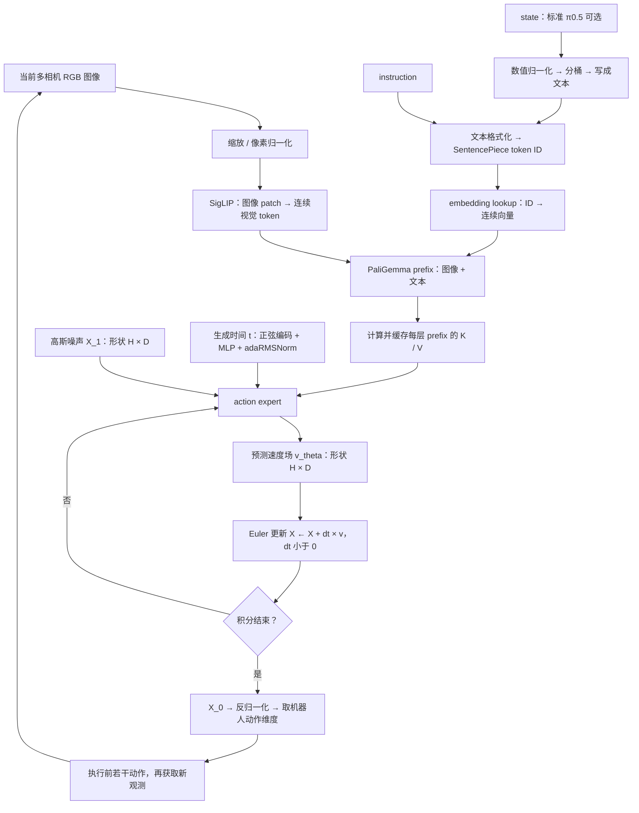
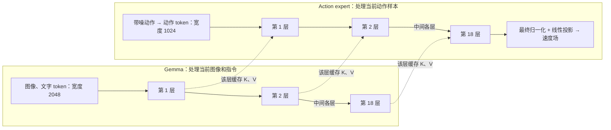
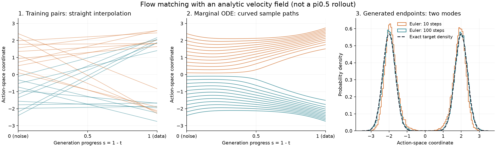

# 05 从图像与指令到动作：π0.5 的训练、推理与 Flow Matching

> 阅读目标：能够沿着数据流解释 π0.5 的一次前向计算，写出训练损失和推理更新式，并理解这些公式为什么能把高斯噪声变成动作。
>
> 核对日期：2026-10-20。实现部分以本项目固定的 OpenPI commit `215abfb217dbac7d5f1273282331b9b1866c0479` 为准；理论部分采用统一符号自行推导。本文不需要先读懂整个项目，也不要求已有微分方程背景。
>
> 这是一份模型原理笔记。项目训练配置与操作见 [Arena / SF 训练说明](../arena-sf-training.md)，机器人闭环见 [02 推理闭环代码精读](02-inference-walkthrough.md)。

## 阅读路线

- **第一次读**：[整体流程](#sec2) → [输入编码](#sec3) → [action expert](#sec4) → [训练](#sec7) → [推理](#sec8) → [完整例子](#sec10)。
- **补数学**：[导数与 ODE](#sec5) → [flow matching 推导](#sec6) → [概率、PDE 与 diffusion](#sec11)。
- **对照论文与项目**：[版本和配置](#sec1) → [训练配方](#sec9) → [常见误区](#sec12) → [源码地图](#sec13) → [自测](#sec14)。

<a id="sec1"></a>

## 1. 先把三个不同的“π0.5 流程”分开

“π0.5 怎样训练”至少涉及三个层面，不能把它们写成同一段训练代码。

| 层面 | 需要理解的事情 | 本文对应 |
|---|---|---|
| 原始 π0.5 论文的完整系统 | 异构数据、离散动作预训练、加入连续 action expert 的后训练、语义子任务与动作的分层推理 | 第 9 节 |
| 后续 knowledge insulation 方法与公开模型说明 | 用离散动作监督 VLM，同时阻断连续动作损失对 VLM 的部分梯度路径 | 第 9.3 节 |
| 公开 OpenPI 的 π0.5 训练、推理代码 | 已有权重上的 flow matching 训练；从噪声积分生成连续动作 | 第 2—8 节 |

原始论文先用离散动作和其他文本目标训练，再加入连续动作专家；推理时可先生成语义子任务，再生成动作。官方 OpenPI README 则明确说明，其公开的 π0.5 训练和推理支持 **flow matching head**。因此，运行公开的 `pi05_libero` 配置，并不等于重做论文的全部预训练，也不会自动先输出一段自然语言计划。来源：[π0.5 原始论文，IV 节](https://arxiv.org/html/2504.16054v1#S4)、[官方 OpenPI](https://github.com/Physical-Intelligence/openpi)。

还要区分**标准配置**和**本项目配置**：

| 项目 | `Pi0Config(pi05=True)` 默认 | 固定版本的 `pi05_libero` |
|---|---|---|
| 动作块长度 `action_horizon` | 50 | 10 |
| 内部动作维度 `action_dim` | 32 | 32，输出取前 7 维 |
| 文本长度上限 `max_token_len` | 200 | 200 |
| `discrete_state_input` | `True` | **`False`** |
| state 是否写入文本 prefix | 是 | 否 |
| 是否增加 π0 式连续 state token | 否 | 也否 |
| 一次采样默认积分步数 | 10，可修改 | 本项目使用 10 |

**表中关于 state 输入路径的两行很关键**：`pi05=True` 时，`embed_suffix` 不走 π0 的 `state_proj` 分支；如果再设置 `discrete_state_input=False`，state 数值也不进入文本。因此，在此 `pi05_libero` 的模型前向中，state 虽然仍在数据结构里、也用于确定 batch 大小，但它的数值不作为动作预测的条件。不要因为接口中出现了 `observation.state`，就断言网络使用了它。依据：[Pi0Config](https://github.com/Physical-Intelligence/openpi/blob/215abfb217dbac7d5f1273282331b9b1866c0479/src/openpi/models/pi0_config.py)、[pi05_libero 配置](https://github.com/Physical-Intelligence/openpi/blob/215abfb217dbac7d5f1273282331b9b1866c0479/src/openpi/training/config.py#L744)、[embed_suffix](https://github.com/Physical-Intelligence/openpi/blob/215abfb217dbac7d5f1273282331b9b1866c0479/src/openpi/models/pi0.py#L140)。

以下先讲标准的低层动作生成机制，需要时标出本项目的不同。

<a id="sec2"></a>

## 2. 整体流程：模型最终在生成什么

### 2.1 一条训练样本

设机器人当前处于环境时刻 $`k`$，一条样本包含：

```math
\underbrace{I_{k}^{(1)},\ldots,I_{k}^{(C)},\ell,q_{k}}_{\text{当前条件}}
\quad\longrightarrow\quad
\underbrace{A_{k}=[a_{k},a_{k+1},\ldots,a_{k+H-1}]}_{\text{示范中的未来动作块}}.
```

这里：

| 符号 | 含义 |
|---|---|
| $`I_{k}^{(i)}`$ | 第 $`i`$ 个相机的当前图像 |
| $`\ell`$ | instruction / prompt，例如 “pick up the red cup” |
| $`q_{k}`$ | 机器人当前状态；是否输入网络取决于配置 |
| $`H`$ | 动作块里有多少条动作，本文用“长度”定义 |
| $`d`$ | 机器人实际动作维度，例如 LIBERO 为 7 |
| $`D`$ | 模型内部动作维度，当前代码为 32 |
| $`A\in\mathbb{R}^{H\times D}`$ | 归一化、补零后的动作标签 |
| $`c`$ | 网络实际使用的条件信息，包含图像、指令和可选 state |

本文的 $`H=50`$ 表示 50 条动作；不要直接和论文用闭区间 $`a_{t:t+H}`$ 时的下标跨度混用。

网络学习的是条件分布：

```math
p_{\theta}(A\mid c).
```

为什么是分布？同一幅图、同一条指令，可能对应多个合理动作，例如从杯子的左侧或右侧靠近。只回归一个均值可能把两种方案平均成一条不好的路线。生成模型可以利用不同的初始噪声产生不同动作块。

### 2.2 推理数据流



循环回到 action expert 时，输入的是**更新后的动作块和时间**；当前观测的 prefix cache 保持不变。机器人执行后，下一次调用会用新观测重新计算 prefix。

### 2.3 三种“步数”一定要分开

| 名字 | 本项目典型值 | 在什么空间里推进 |
|---|---:|---|
| `action_horizon`，记为 $`H`$ | 10 | 未来机器人动作序列 |
| `num_steps`，记为 $`N`$ | 10 | 一次动作块生成内部的 ODE 数值积分 |
| `replan_steps`，记为 $`R`$ | 5 | 生成后实际执行多少条动作，再重新观测 |

这里 $`H=N=10`$ 只是数值碰巧相等。**10 次去噪不是生成 10 条动作的逐条循环**：每一次去噪都同时更新整个 $`H\times D`$ 数组。

本项目数值来自 [评测配置](../../config/evaluation.json)，模型动作长度来自上面的固定版本配置。

<a id="sec3"></a>

## 3. Image、instruction、state 分别变成了什么

### 3.1 Image：像素 → patch → 视觉特征序列

以一张图为例，省略 batch 维：

```text
RGB uint8 图像 [原高, 原宽, 3]
    ↓ ResizeImages：保持比例缩放并在需要时补边
[224, 224, 3]
    ↓ Observation.from_dict：pixel / 255 × 2 - 1
float32 像素，通常在 [-1, 1]
    ↓ 14 × 14 patch embedding
16 × 16 = 256 个 patch
    ↓ SigLIP 视觉 Transformer，加入空间位置编码
[256, 1152] 视觉特征
    ↓ 投影到 PaliGemma 语言 backbone 的宽度
[256, 2048] 连续视觉 token
```

这里的 patch embedding 在代码里由卷积实现：kernel 和 stride 都是 $`14\times14`$，等价于把每个不重叠 patch 映射成一个向量。每个 patch 原本有 $`14\times14\times3=588`$ 个像素数值；经过学习到的线性映射和视觉编码器后，变为带上下文的特征。

图像 token **不是词表中的整数 ID**，也不是先生成“红色杯子”这样的文字。它们是浮点向量。某个 token 对应某个图像位置，但经过视觉 self-attention 后，已可以包含其他位置的信息。

多相机分别经过同一个视觉编码器，再沿序列维拼接。LIBERO adapter 提供三个相机槽位：两张真实图像和一个被 mask 的占位图。因此实现中通常仍有 $`3\times256=768`$ 个视觉 token 槽位，其中第三组不作为有效注意力信息。**mask 不等于一定省掉了这组图像编码的计算**。

训练时还可以在视觉编码前进行随机裁剪、旋转和颜色扰动；推理没有这些随机训练增强，但仍有必要的缩放与归一化。依据：[siglip.py](https://github.com/Physical-Intelligence/openpi/blob/215abfb217dbac7d5f1273282331b9b1866c0479/src/openpi/models/siglip.py)、[Observation 与预处理](https://github.com/Physical-Intelligence/openpi/blob/215abfb217dbac7d5f1273282331b9b1866c0479/src/openpi/models/model.py)、[LIBERO adapter](https://github.com/Physical-Intelligence/openpi/blob/215abfb217dbac7d5f1273282331b9b1866c0479/src/openpi/policies/libero_policy.py)。

### 3.2 Instruction：字符串 → token ID → embedding

例如：

```text
"pick up the red cup"
    ↓ 清理首尾空白、下划线和换行
格式化后的文本
    ↓ PaliGemma SentencePiece tokenizer
[BOS_ID, id_1, id_2, ...]
    ↓ 截断 / padding，并生成 token mask
整数数组 [L]，有效性数组 [L]
    ↓ embedding table 查表，代码还乘以 sqrt(2048)
浮点数组 [L, 2048]
```

一个 token 不一定是一个单词，也可能是词的一部分、标点或数字片段。`BOS` 表示序列开始。padding 用于组成固定形状，mask 决定哪些位置有效。

**tokenizer 和 embedding 是两件事**：前者把文本编码成编号，后者把编号映射为可训练向量。之后经过 Transformer，向量会随其他图像与文本内容变化，形成上下文化表示。

固定版本 π0.5 默认 $`L=200`$，这是包含格式文字和可选 state 在内的**文本槽位上限**，不包含图像 token；也不保证每条输入都恰好有 200 个有效 token。依据：[tokenizer.py](https://github.com/Physical-Intelligence/openpi/blob/215abfb217dbac7d5f1273282331b9b1866c0479/src/openpi/models/tokenizer.py)、[gemma.py 的 Embedder](https://github.com/Physical-Intelligence/openpi/blob/215abfb217dbac7d5f1273282331b9b1866c0479/src/openpi/models/gemma.py#L135)。

### 3.3 State：标准 π0.5 将数值写入文本

默认路径中，state 先按数据统计量归一化。例如分位数归一化：

```math
\widetilde{q}_{j}=
2\frac{q_{j}-Q_{0.01,j}}{Q_{0.99,j}-Q_{0.01,j}+\varepsilon_{\mathrm{norm}}}-1.
```

$`Q_{0.01,j}`$ 和 $`Q_{0.99,j}`$ 是训练数据第 $`j`$ 个状态维度的 1% 与 99% 分位数。它们来自训练资产，不是对当前单条样本临时计算。

然后对归一化 state 分桶。代码的实际操作为：

```python
discretized_state = np.digitize(
    state, bins=np.linspace(-1, 1, 256 + 1)[:-1]
) - 1
```

把这些桶编号拼成文字，例如下面仅为格式示意，数字不是某个真实样本：

```text
Task: pick up the red cup, State: 128 140 97 ...;
Action:
```

再把整个字符串交给文本 tokenizer。一个桶编号也不保证恰好对应一个文本 token。`Action:` 在这里是输入格式标记，不能据此推断 flow 分支会进行文本动作解码。

注意两个实现细节：

- 分位数归一化不会自动把异常值裁剪进 $`[-1,1]`$；准确行为要看代码，不能把“归一化”理解成 `clip`。
- 标准变换链先 tokenize state，再执行 `PadStatesAndActions`；因此不要假定文本里一定写了 32 个补零后的状态值。

在 `pi05_libero` 中 `discrete_state_input=False`，文本使用指令加换行的形式，不含上述 state 字段。依据：[transforms.py](https://github.com/Physical-Intelligence/openpi/blob/215abfb217dbac7d5f1273282331b9b1866c0479/src/openpi/transforms.py)、[ModelTransformFactory](https://github.com/Physical-Intelligence/openpi/blob/215abfb217dbac7d5f1273282331b9b1866c0479/src/openpi/training/config.py#L105)。

### 3.4 Prefix 到底是什么

prefix 就是本次生成的已知条件序列：

```math
P=[E_{\mathrm{image}}^{(1)};\ldots;E_{\mathrm{image}}^{(C)};E_{\mathrm{text}}]
\in\mathbb{R}^{B\times S_{P}\times2048}.
```

分号表示沿 token 序列维拼接，$`B`$ 是 batch 大小。本项目三个图像槽位、200 个文本槽位时，$`S_{P}=768+200=968`$，有效 token 数通常小于 968。

prefix 内采用双向注意力，因此文本能读取图像信息，图像位置也能读取指令信息。模型不需要先显式识别出对象名称，再把对象列表交给下一个网络；跨模态关联发生在连续表示和 attention 中。

### 3.5 动作标签的预处理

训练中的真实动作 $`A^{\mathrm{raw}}`$ 也需要归一化，再将实际维度 $`d`$ 补到内部维度 $`D`$：

```math
\widetilde{A}_{h,j}
=2\frac{A^{\mathrm{raw}}_{h,j}-Q^{a}_{0.01,j}}
{Q^{a}_{0.99,j}-Q^{a}_{0.01,j}+\varepsilon_{\mathrm{norm}}}-1,
\qquad j\lt d.
```

其余坐标补零。LIBERO 中：

```text
真实动作 [B, 10, 7]
→ 按动作统计量归一化
→ 补零 [B, 10, 32]
→ 才进行 flow matching 的加噪与速度监督
```

这些坐标可能是位姿增量、关节目标或其他控制量，取决于训练数据和机器人 adapter。网络的浮点输出本身不会告诉你“这一维的单位是什么”。

<a id="sec4"></a>

## 4. Action expert 具体做了什么

### 4.1 它接收什么、输出什么

在生成时间 $`t`$，它实际使用：

1. 当前尚未完成生成的动作块 $`X_{t}\in\mathbb{R}^{B\times H\times D}`$；
2. 生成时间 $`t`$，告诉网络当前处于多大的噪声水平；
3. 从图像与文本 prefix 得到的每层表示，推理时表现为每层的 K/V cache。

输出：

```math
v_{\theta}(X_{t},t,c)\in\mathbb{R}^{B\times H\times D}.
```

这是**动作生成空间中的速度场**。这里“速度”指对生成时间的导数，不一定是机器人的关节速度或末端速度。

### 4.2 一个动作时间位置对应一个连续 token

对第 $`h`$ 条动作：

```math
z_{h}=X_{t,h}W_{\mathrm{in}}+b_{\mathrm{in}},
\qquad \mathbb{R}^{32}\rightarrow\mathbb{R}^{1024}.
```

因此：

```text
noisy action chunk [B, H, 32]
    ↓ action_in_proj
action token sequence [B, H, 1024]
    ↓ 18 层 action expert
hidden states [B, H, 1024]
    ↓ action_out_proj
predicted vector field [B, H, 32]
```

**不是每个标量坐标各一个 token**，而是一个动作向量对应一个 token。所有 $`H`$ 个动作 token 一次并行处理，内部可以双向交互。

### 4.3 Action expert 长什么样，它怎样与 Gemma 逐层交互

#### 4.3.1 它是一套有独立参数的、较小的 Gemma 式 Transformer

可以把 action expert 理解成一个**结构与 Gemma 很相似、专门处理连续动作的 Transformer**。它有自己的 18 层、自己的 Q/K/V 投影、attention 输出投影、FFN 和归一化参数。代码把两条分支放在同一个 `gemma.Module` 中，让它们在对应层通过 attention 联系起来。

本节的 Gemma 指 PaliGemma 中处理图像与文字 token 的语言 Transformer；图像已经先经过视觉编码器，进入这里的是连续向量。固定版本的配置如下：

| 项目 | Gemma 的 prefix 分支 | Action expert 的 suffix 分支 |
|---|---|---|
| 配置名 | `gemma_2b` | `gemma_300m` |
| 处理的 token | 图像、指令，以及配置启用时的离散 state 文本 | 当前带噪动作块中的动作 token |
| Transformer 层数 | 18 | 18 |
| 每个 token 的隐藏维度 | 2048 | 1024 |
| FFN 的中间维度 | 16384 | 4096 |
| Attention 配置 | 8 个 query heads、1 个 KV head、每个 head 256 维 | 相同，方便读取 prefix 的 K/V |
| 生成时间条件 | 不依赖生成时间 | 通过 adaRMSNorm 和残差门控注入，见 4.5 |

两边的每层都有“归一化 → attention → 残差连接 → 归一化 → FFN → 残差连接”这个骨架。Action expert 使用自己的权重，并根据生成时间调节归一化和残差分支。这里的 expert 表示**为动作 token 使用一套专用参数**，没有按技能挑选专家的 router。结构与参数可对照 [get_config](https://github.com/Physical-Intelligence/openpi/blob/215abfb217dbac7d5f1273282331b9b1866c0479/src/openpi/models/gemma.py#L58) 和 [Block](https://github.com/Physical-Intelligence/openpi/blob/215abfb217dbac7d5f1273282331b9b1866c0479/src/openpi/models/gemma.py#L284)。

#### 4.3.2 结构图：每一层读取对应层的 K/V



图中的虚线表示**对应层的数据依赖**：expert 第 1 层读取 Gemma 第 1 层的 K/V，第 2 层读取第 2 层的 K/V，依此类推。每份 K/V 都由该层输入经过归一化、投影得到；虚线从层节点出发，是表示“在该层 attention 内产生”，不是把该层 FFN 的最终输出直接当作 K/V。

**推理时的执行顺序是：先运行完 Gemma 的 18 层并保存所有层的 prefix K/V，再运行 action expert。** 图上的连线不要求两边交替执行。这个顺序成立，是因为 prefix 的 attention 不读取动作 token，见 4.4。

#### 4.3.3 Gemma 怎样得到每一层的缓存

“图像与 instruction 变成一串 tensor，Gemma 每一层产生并保存 K/V”这个理解是对的；需要补上：**Gemma 本身还计算 Q、attention 和 FFN，才能得到下一层的输入。**

忽略 batch，设 prefix 有 $`L_{P}`$ 个 token，初始表示为 $`P^{(0)}\in\mathbb{R}^{L_{P}\times2048}`$。第 $`r`$ 层的过程是：

1. 对上一层的表示 $`P^{(r-1)}`$ 做归一化，得到该层 attention 的输入。
2. 使用该层自己的投影权重计算 $`Q_{P}^{(r)},K_{P}^{(r)},V_{P}^{(r)}`$；Q/K 还要加入 RoPE 位置信息。
3. Prefix 的 Q 读取 prefix 的 K/V，经过 attention 输出投影、残差、FFN 等运算，得到 $`P^{(r)}`$，交给下一层。
4. 推理时保存本层供 expert 使用的 $`K_{P}^{(r)},V_{P}^{(r)}`$；K 保存的是应用 RoPE 后的结果。

因此缓存在概念上是：

```text
prefix_cache[1]  = (Gemma 第 1 层的 K,  Gemma 第 1 层的 V)
prefix_cache[2]  = (Gemma 第 2 层的 K,  Gemma 第 2 层的 V)
...
prefix_cache[18] = (Gemma 第 18 层的 K, Gemma 第 18 层的 V)
```

这里为了方便阅读从 1 开始编号；实际代码将层维度堆叠在缓存张量中。**缓存里保留的是每个 prefix token 的 K/V 向量，不是把整个图像和指令压成一个向量。** 各层的表示也不同，所以 expert 不能把最后一层的 K/V 复制给所有层使用。

还要区分两类东西：$`W_{K},W_{V}`$ 是训练得到、推理时固定的模型参数；$`K,V`$ 是当前图像与文字经过这些参数计算出的中间张量。更换观测或指令，就需要重新计算 prefix cache。Gemma 的 Q 用来完成它自己的前向计算；expert 读缓存时使用自己的 Q，因此无须复用 prefix 的 Q。

#### 4.3.4 Action expert 自己也计算 Q/K/V

以本项目 $`H=10,D=32`$ 为例，省略 batch，某个生成时间的动作块为 $`X_{t}\in\mathbb{R}^{10\times32}`$。第一次采样时它是高斯噪声，后续积分步则是逐渐改进的动作样本。`action_in_proj` 把它变成 $`Z^{(0)}\in\mathbb{R}^{10\times1024}`$，这就是 expert 第 1 层的输入。

在 expert 第 $`r`$ 层，上一层的动作表示 $`Z^{(r-1)}`$ 先经过由生成时间调制的归一化，再由**expert 这一层自己的参数**投影成 $`Q_{A}^{(r)},K_{A}^{(r)},V_{A}^{(r)}`$。随后取出 Gemma 对应层的缓存，组成 attention 的输入：

```math
Q=Q_{A}^{(r)},\qquad
K=[K_{P}^{(r)};K_{A}^{(r)}],\qquad
V=[V_{P}^{(r)};V_{A}^{(r)}].
```

分号表示**沿 token 位置维度拼接**。每个动作 token 的 Q 都可以查询图像、文字 token，也可以查询同一个动作块内的动作 token，包括自身。省略 batch、多个 head 和位置编码细节，该层动作 attention 为：

```math
\mathrm{Attn}_{A}^{(r)}
=\mathrm{softmax}\left(
\frac{Q_{A}^{(r)}[K_{P}^{(r)};K_{A}^{(r)}]^{\top}}{\sqrt{d_{h}}}+M
\right)[V_{P}^{(r)};V_{A}^{(r)}].
```

可以把 Q 理解为“当前动作位置需要什么信息”，K 用来计算匹配程度，V 提供实际被加权读取的信息。$`M`$ 是加性 mask：允许的位置为 0，禁止的位置在数学上为负无穷；$`d_{h}=256`$ 是每个 attention head 的维度。公式输出还要经过 expert 自己的 attention 输出投影、残差连接、FFN 等运算，才成为下一层的动作表示 $`Z^{(r)}`$：

```text
上一层的动作表示 Z^(r-1)                  [H, 1024]
    ↓ 时间条件归一化，expert 自己的 Q/K/V 投影
动作 Q 读取：该层 prefix K/V + 当前动作 K/V
    ↓ attention 输出投影 + 门控残差
    ↓ 时间条件归一化 + FFN + 门控残差
这一层的动作表示 Z^(r)                    [H, 1024]
```

**2048 和 1024 的隐藏宽度不同，仍然可以做 attention**，因为两边都投影到兼容的 head 空间。保留 batch 时，实际形状是：

| 张量 | Prefix 分支 | Action expert 分支 |
|---|---|---|
| 层输入 | `[B, L_P, 2048]` | `[B, H, 1024]` |
| Q | `[B, L_P, 8, 256]` | `[B, H, 8, 256]` |
| K 和 V，各自 | `[B, L_P, 1, 256]` | `[B, H, 1, 256]` |

拼接后的 K 和 V 各为 `[B, L_P + H, 1, 256]`，8 个 query heads 共享这 1 个 KV head。Action attention 得到 `[B, H, 8, 256]` 的结果，再由 expert 的输出投影变回 `[B, H, 1024]`。可以沿着 [Attention](https://github.com/Physical-Intelligence/openpi/blob/215abfb217dbac7d5f1273282331b9b1866c0479/src/openpi/models/gemma.py#L158) 中的投影、拼接和输出投影逐项核对。

经过 18 层和最终归一化，再通过 `action_out_proj`，得到 `[B, H, 32]` 的**速度场预测**。它会用于更新当前动作样本，见下一小节。

#### 4.3.5 推理时，哪些只算一次，哪些反复计算

对一次固定观测下的动作块生成，代码先计算 prefix cache；随后每个积分步都重新把当前 $`X_{t}`$ 投影成动作 token，从 expert 第 1 层完整运行到第 18 层，并使用当前生成时间的归一化条件。下面是教学伪代码，函数名用于表达流程，省略了 batch、mask 和位置编码：

```python
# observation 中的图像与指令固定；state 是否进入 prefix 取决于配置。
prefix_tokens = encode_observation(observation)
prefix_cache = run_gemma_and_cache_all_layers(prefix_tokens)  # 18 层，只运行一次

H, D = 10, 32     # 动作块长度与内部动作维度
N = 10           # ODE 积分步数
x = randn(H, D)  # t = 1，从高斯噪声开始
dt = -1.0 / N
for n in range(N):
    t = 1.0 - n / N
    # 内含动作输入投影、完整的 18 层 expert、最终归一化和动作输出投影。
    velocity = run_action_expert(x, t, prefix_cache)
    x = x + dt * velocity

normalized_action_chunk = x  # t = 0；还需反归一化等输出变换
```

这里有两套完全不同的编号：**网络层号**从 1 到 18；**积分步号**从 0 到 $`N-1`$。每一个积分步都会走完 expert 的全部 18 层，而每层读取的始终是 Gemma 对应层的 prefix K/V。$`H`$ 是一次生成多少条动作，$`N`$ 是把整个动作块更新多少次；例子里都取 10，只是数值相同。

因为 $`X_{t}`$ 和 $`t`$ 每步改变，expert 自己各层的动作 Q/K/V 也要重新计算；同一次生成中的 prefix K/V 则可以反复使用。它不会把上一个积分步的动作 K/V 当成历史 token 追加进去。机器人执行动作、拿到新观测后，下一次生成会重新建立 prefix cache。实际实现见 [sample_actions](https://github.com/Physical-Intelligence/openpi/blob/215abfb217dbac7d5f1273282331b9b1866c0479/src/openpi/models/pi0.py#L217)。

上面的“先缓存，再重复读取”是**推理时的计算安排**。公开训练代码通常把 prefix 与动作 suffix 一起送入这套 Transformer，按相同的逐层 attention 关系计算损失。两条分支参数各自独立，以及推理时使用缓存，都不等于训练时冻结 Gemma；哪些参数接收梯度，要结合训练配置和第 9.3 节的 knowledge insulation 来看。

### 4.4 Attention mask 决定信息流

只看公开 flow 分支，忽略 padding，按 query 为行、key 为列：

| 谁读取谁 | prefix | 动作 suffix |
|---|---|---|
| prefix | 可以，双向 | 不可以 |
| 动作 suffix | 可以 | 可以，双向 |

写成块矩阵：

```math
\mathcal{M}_{\mathrm{allowed}}=
\begin{pmatrix}
\mathbf{1} & \mathbf{0}\\[0pt]
\mathbf{1} & \mathbf{1}
\end{pmatrix}.
```

这带来两个直接结果：

1. **生成条件不受当前动作噪声污染**：prefix 不读 suffix。
2. **prefix 可以缓存**：同一次动作生成中，改变 $`X_{t},t`$ 不会改变 prefix 的任何层。

但这只是前向依赖关系，**并不自动阻断反向梯度**。如果损失通过 $`K_{P},V_{P}`$ 依赖 VLM 参数，梯度仍然可以回到 VLM。knowledge insulation 还需要显式 stop-gradient，见第 9.3 节。

### 4.5 时间 $`t`$ 怎样进入网络：adaRMSNorm

模型需要区分“几乎全是噪声”和“已经快生成完了”。π0.5 的实现将标量 $`t`$ 编成正弦/余弦向量，再经过两层 MLP：

```math
e(t)=\mathrm{swish}
\left(W_{2}\mathrm{swish}(W_{1}\phi(t)+b_{1})+b_{2}\right).
```

$`\phi(t)`$ 含多个频率的 $`\sin,\cos`$，让网络容易表达时间的非线性影响。这是**生成时间编码**，和表示 token 顺序的 RoPE 是不同的东西。

普通 RMSNorm 对一个隐藏向量 $`z\in\mathbb{R}^{m}`$ 做：

```math
\mathrm{RMS}(z)=
\frac{z}{\sqrt{\frac{1}{m}\sum_{j=1}^{m} z_{j}^{2}+\varepsilon_{\mathrm{rms}}}}.
```

adaptive RMSNorm 再根据 $`e(t)`$ 生成缩放、平移与残差门控：

```math
(\gamma(t),\beta(t),g(t))=\mathrm{Linear}(e(t)),
```

```math
\widetilde{z}=(1+\gamma(t))\odot\mathrm{RMS}(z)+\beta(t),
\qquad
z_{\mathrm{next}}=z+g(t)\odot F(\widetilde{z}).
```

这里 $`F`$ 表示 attention 或 FFN 子层，各子层有自己的调制参数；同一个时间条件提供给各层。直观上，时间不仅在输入处出现一次，还能调节整个专家的处理方式。

对应 [embed_suffix](https://github.com/Physical-Intelligence/openpi/blob/215abfb217dbac7d5f1273282331b9b1866c0479/src/openpi/models/pi0.py#L140)、[RMSNorm](https://github.com/Physical-Intelligence/openpi/blob/215abfb217dbac7d5f1273282331b9b1866c0479/src/openpi/models/gemma.py#L113)。

<a id="sec5"></a>

## 5. 先补齐微分方程基础

### 5.1 导数：当前位置的瞬时变化率

设 $`x(t)`$ 是一条曲线：

```math
\frac{dx}{dt}
=\lim_{\Delta t\to0}
\frac{x(t+\Delta t)-x(t)}{\Delta t}.
```

它告诉我们，在当前时间附近，$`t`$ 变化一点，$`x`$ 会如何变化。于是局部有：

```math
x(t+\Delta t)\approx x(t)+\Delta t\frac{dx}{dt}.
```

如果 $`x`$ 是向量，就对每个分量求导。如果 $`X_{t}`$ 是 $`H\times D`$ 矩阵，可以把它展开为 $`HD`$ 维向量；数学上没有额外困难。

### 5.2 什么是 ODE

常微分方程（ordinary differential equation）：

```math
\frac{dx(t)}{dt}=f(x(t),t).
```

“普通函数”通常直接告诉你 $`x(t)`$ 的值；ODE 告诉你**在任意位置与时间，应怎样变化**。我们要通过这些局部规则恢复整条轨迹。

因为自变量只有一个时间 $`t`$，所以叫“常”微分方程；状态可以是几千维。若未知对象还同时依赖空间等多个自变量，并出现偏导数，则进入 PDE 的范围。

### 5.3 为什么还需要初始条件

例如：

```math
\frac{dx}{dt}=2
\quad\Rightarrow\quad
x(t)=2t+C.
```

只有导数，无法确定常数 $`C`$。给出 $`x(0)=3`$，才能确定 $`x(t)=2t+3`$。

动作生成也需要起点：

```math
X_{1}=\epsilon,\qquad \epsilon\sim\mathcal{N}(0,I).
```

这是在 $`t=1`$ 给定的条件，再沿时间减小方向积分。也可以令 $`s=1-t`$，变成从 $`s=0`$ 开始的标准初值问题。

### 5.4 向量场与 flow

函数

```math
v:\mathbb{R}^{HD}\times[0,1]\rightarrow\mathbb{R}^{HD}
```

会给每个位置和时间分配一个向量，称为**向量场**。这个向量表示该点接下来如何变化。

沿着向量场积分，形成流映射：

```math
X_{t}=\Phi_{t\leftarrow1}(\epsilon).
```

“flow”就是很多起点在这个向量场作用下持续移动形成的演化。对生成模型来说，我们关心大量初始高斯样本，最终是否被运输到数据分布。

**这不是 optical flow（光流）**。这里运动的是动作向量空间中的样本，不是图像像素。

### 5.5 存在性、唯一性，以及它们不保证什么

一个常用的充分条件是：$`v(x,t)`$ 对时间连续、对 $`x`$ 局部 Lipschitz，即在局部区域存在常数 $`L`$ 使：

```math
\|v(x,t)-v(y,t)\|\le L\|x-y\|.
```

它限制向量场不要对位置变化过于剧烈。在适当条件下，给定初始值能得到局部唯一解；要保证整个区间都有解，还需排除有限时间内发散等问题。

因此，相同条件、相同初始噪声、确定性计算通常对应相同生成轨迹。随机性可以只来自最开始的 $`\epsilon`$，不必每一步都重新加随机噪声。

这类数学条件**不保证动作安全、任务成功，也不保证有限步数的近似等于精确解**。它们讨论的是微分方程解本身。

### 5.6 Euler 方法：用一小段直线近似曲线

Taylor 展开：

```math
x(t+\Delta t)
=x(t)+\Delta t\,x'(t)+O(\Delta t^{2}).
```

忽略二阶余项，代入 $`x'=v_{\theta}`$：

```math
X_{t+\Delta t}
\approx X_{t}+\Delta t\,v_{\theta}(X_{t},t,c).
```

这就是显式 Euler。OpenPI 从 $`t=1`$ 积分到 $`t=0`$，所以若共 $`N`$ 步：

```math
\Delta t=-\frac{1}{N}.
```

**负步长完全合法**。它表示沿时间减小的方向移动，不是“学习率为负”。

在足够光滑且稳定的条件下，Euler 的单步局部误差是 $`O(|\Delta t|^{2})`$，固定区间的累计全局误差是 $`O(|\Delta t|)`$。模型本身的误差和 ODE 求解误差是两种不同的误差：增加积分步数主要改善后者。

### 5.7 为什么不直接用更高级的求解器

例如 Heun 方法用两次速度估计：

```math
k_{1}=v_{\theta}(x,t,c),\qquad
\widetilde{x}=x+\Delta t\,k_{1},
```

```math
k_{2}=v_{\theta}(\widetilde{x},t+\Delta t,c),\qquad
x_{\mathrm{next}}=x+\frac{\Delta t}{2}(k_{1}+k_{2}).
```

它通常有更高数值精度，但每步要调用模型两次。机器人推理要权衡延迟与质量；更高阶求解器也不能消除模型误差。本文核对的 OpenPI `sample_actions` 使用 Euler，不应把 Heun 当作当前默认实现。

<a id="sec6"></a>

## 6. Flow Matching：从一条直线推导到分布生成

### 6.1 先固定唯一的时间约定

本文全程使用 OpenPI 代码约定：

```math
\boxed{X_{t}=(1-t)A+t\epsilon,\qquad 0\le t\le1.}
```

因此：

| 时间 | $`X_{t}`$ | 含义 |
|---|---|---|
| $`t=0`$ | $`A`$ | 干净动作 |
| $`t=1`$ | $`\epsilon`$ | 纯高斯噪声 |
| $`0\lt t\lt 1`$ | 两者的线性组合 | 训练用的中间样本 |

训练时 $`A`$ 和 $`\epsilon`$ 都已知，所以任何中间位置都能**直接算出来**，不需要先模拟几百次加噪。

这里的 $`t`$ 是无量纲的**生成时间**，不是机器人环境时间 $`k`$，也不是动作块下标 $`h`$。

### 6.2 监督信号为什么是 $`\epsilon-A`$

固定一对 $`(A,\epsilon)`$，直接求导：

```math
\frac{dX_{t}}{dt}
=\frac{d[(1-t)A+t\epsilon]}{dt}
=\epsilon-A.
```

于是我们有了免费的速度标签：

```math
U=\epsilon-A.
```

训练网络预测：

```math
v_{\theta}(X_{t},t,c)\approx U.
```

损失：

```math
\boxed{
\mathcal{L}_{\mathrm{CFM}}
=\mathbb{E}_{(c,A),\,t,\,\epsilon}
\left[\frac{1}{HD}
\left\|v_{\theta}((1-t)A+t\epsilon,t,c)-(\epsilon-A)\right\|_{F}^{2}
\right].
}
```

$`\|\cdot\|_{F}^{2}`$ 表示矩阵所有元素平方后相加。采样 batch 并取均值，就是实际优化时的 Monte Carlo 估计。

这里匹配的是**速度场**，不是直接让模型输出 $`A`$，也不是要求模型精确输出 $`\epsilon`$。它与“预测噪声”“预测干净样本”之间存在数学转换，但当前代码的训练目标明确是 velocity。

### 6.3 正号和负号怎样配合

假设一个一维例子：

```math
A=0.8,\qquad \epsilon=-0.4.
```

则：

```math
X_{t}=0.8-1.2t,\qquad U=-1.2.
```

从 $`t=1`$ 开始，$`X_{1}=-0.4`$。若用 4 个 Euler 步，$`\Delta t=-0.25`$，每次增量为：

```math
\Delta X=\Delta t\,U=(-0.25)(-1.2)=0.3.
```

| $`t`$ | $`X_{t}`$ |
|---:|---:|
| 1.00 | -0.4 |
| 0.75 | -0.1 |
| 0.50 | 0.2 |
| 0.25 | 0.5 |
| 0.00 | 0.8 |

因此，虽然速度标签是“噪声减动作”，配合**负的时间步长**，实际生成仍然朝向动作。

这只是知道这一对端点时的教学例子。真实推理并不知道 $`A`$，必须用学习到的、依赖当前位置的速度场。

### 6.4 真正的难点：推理时没有真实动作，怎么知道方向

训练时不同的 $`(A,\epsilon)`$ 对可能在同一时间附近产生相似的 $`X_{t}`$，但对应的 $`U`$ 不同。网络没有拿到那一对端点，只看到 $`X_{t},t,c`$。

平方损失的最优预测不是猜中每一个隐藏端点，而是：

```math
\boxed{
v^{\ast}(x,t,c)
=\mathbb{E}[\epsilon-A\mid X_{t}=x,t,c].
}
```

为什么？设 $`Z=(X_{t},t,c)`$，$`m(Z)=\mathbb{E}[U\mid Z]`$，则：

```math
\begin{aligned}
\mathbb{E}\|v(Z)-U\|^{2}
&=\mathbb{E}\|v(Z)-m(Z)\|^{2}\\[0pt]
&\quad+\mathbb{E}\|U-m(Z)\|^{2}.
\end{aligned}
```

展开平方后，交叉项为零，因为：

```math
\mathbb{E}[U-m(Z)\mid Z]=0.
```

第二项与模型参数无关，所以最优解就是条件均值 $`m(Z)`$。这也说明：**即使已经学到了正确的边缘速度场，样本级训练 MSE 也不必为零。**

这个条件均值依赖当前位置 $`x`$ 和时间 $`t`$，不等于固定的“所有合理动作的平均值”。因此不会简单退化成一个确定动作均值。

### 6.5 为什么匹配这个均值能运输整个概率分布

固定条件 $`c`$。令 $`p_{t}(x\mid c)`$ 是随机变量
$`X_{t}=(1-t)A+t\epsilon`$ 的密度。我们希望它满足：

```math
p_{1}(x\mid c)=\mathcal{N}(0,I),
\qquad
p_{0}(x\mid c)=p_{\mathrm{data}}(A=x\mid c).
```

对一个光滑的测试函数 $`\varphi(x)`$，使用链式法则，并假定允许交换求导与期望：

```math
\begin{aligned}
\frac{d}{dt}\mathbb{E}[\varphi(X_{t})\mid c]
&=\mathbb{E}[\nabla\varphi(X_{t})^{\top}(\epsilon-A)\mid c]\\[0pt]
&=\mathbb{E}[\nabla\varphi(X_{t})^{\top} v^{\ast}(X_{t},t,c)\mid c]\\[0pt]
&=\int\nabla\varphi(x)^{\top} v^{\ast}(x,t,c)p_{t}(x\mid c)\,dx.
\end{aligned}
```

对最后一项做分部积分，并令边界项消失：

```math
\int\nabla\varphi^{\top}(v^{\ast}p_{t})\,dx
=-\int\varphi\,\nabla\cdot(p_{t}v^{\ast})\,dx.
```

另一方面，左侧等于：

```math
\int\varphi(x)\,\partial_{t} p_{t}(x\mid c)\,dx.
```

因为它对足够多的 $`\varphi`$ 都成立，得到**连续性方程**：

```math
\boxed{
\partial_{t} p_{t}+\nabla_{x}\cdot(p_{t}v^{\ast})=0.
}
```

这就是“概率质量不会凭空出现或消失，只会随向量场流动”的方程。

而粒子沿 ODE

```math
\frac{dX_{t}}{dt}=v^{\ast}(X_{t},t,c)
```

运动时，其概率密度也满足同一个连续性方程。在适当的正则性和解的唯一性条件下，使用同样的起始分布，就得到同样的密度演化。因此从高斯起点反向积分，可以到达动作数据分布。

这就是 flow matching 的核心逻辑：**可计算的样本级速度监督 → 条件均值速度场 → 正确的概率质量运输**。上面的展开是对本文线性路径的推导；一般理论见 [Flow Matching for Generative Modeling](https://arxiv.org/abs/2210.02747)。

实际网络容量有限、训练数据有限、积分步数有限，所以真实模型只是近似这个理想过程。经验数据还可能落在低维集合上，此时端点密度未必光滑；严格的密度推导适用于满足条件的分布和内部时间区间，不能把理想定理直接当成对实际控制效果的保证。

### 6.6 “训练路径是直线”，不表示生成路径也是直线

对固定端点 $`(A,\epsilon)`$，插值是直线；但模型学习到的是所有可能端点混合后的条件均值速度场。生成时每一步处在新的 $`x,t`$，速度可能持续改变。

因此真实采样轨迹一般会弯曲，也不能只在初始点调用一次网络，然后重复使用同一个速度。

同理，独立配对高斯噪声与动作，不意味着已经求解了整个噪声分布到动作分布之间的最优传输耦合。**直线插值不等于全局最优传输方案**。

### 6.7 两种时间约定如何互相转换

不少资料使用“0 是噪声，1 是数据”：

```math
Y_{s}=(1-s)\epsilon+sA,\qquad
\frac{dY_{s}}{ds}=A-\epsilon.
```

令 $`s=1-t`$，有：

```math
Y_{s}=X_{1-s},
\qquad
\widetilde{v}(x,s,c)=-v(x,1-s,c).
```

| 约定 | 路径 | 监督速度 | 生成方向 |
|---|---|---|---|
| 本文 / OpenPI | $`(1-t)A+t\epsilon`$ | $`\epsilon-A`$ | $`t:1\to0`$ |
| 常见正向生成写法 | $`(1-s)\epsilon+sA`$ | $`A-\epsilon`$ | $`s:0\to1`$ |

必须同时改变路径、速度符号和积分方向。

**阅读原始 π0.5 v1 的提醒**：IV-B 的行内插值写为 $`\tau A+(1-\tau)\omega`$，但后续目标写为 $`\omega-A`$。若直接将同一 $`\tau`$ 视为求导变量，这两者并不满足“目标就是插值导数”；还需注意其噪声水平与积分方向约定，不能把这几行机械拼成程序。本文使用经代码验证的自洽三元组：`x_t=t*noise+(1-t)*actions`、`u_t=noise-actions`、`dt=-1/num_steps`。来源：[论文 IV-B](https://arxiv.org/html/2504.16054v1#S4.SS2)、[OpenPI 的损失与采样实现](https://github.com/Physical-Intelligence/openpi/blob/215abfb217dbac7d5f1273282331b9b1866c0479/src/openpi/models/pi0.py#L189)。

<a id="sec7"></a>

## 7. 公开代码中的一次训练迭代

### 7.1 数据从哪里来

从示范 episode 选一个时刻，取当前图像、指令、可选状态，以及后续 $`H`$ 条示范动作。一次 batch 包含 $`B`$ 个这样的样本。

要区分“未来动作标签”和“未来图像”：这里监督信号来自示范中的未来动作，但低层策略的输入是当前观测，不是把未来图像作为已知条件提供给网络。

经过第 3 节的变换，得到 $`c,A`$。动作坐标的单位、顺序、增量/绝对值约定，以及归一化统计，必须与推理输出解释一致。

### 7.2 采样噪声和生成时间

对每个样本独立采样：

```math
\epsilon\sim\mathcal{N}(0,I_{H D}),
\qquad
b\sim\mathrm{Beta}(1.5,1),
\qquad
t=0.999b+0.001.
```

这里 $`I_{HD}`$ 表示每个动作坐标独立的标准高斯。代码中的噪声 shape 与动作完全相同。

这个 Beta 分布偏向较大的 $`t`$，因此在本文约定下偏重**噪声较多的一侧**。同一个样本的整个动作块共享一个 $`t`$，但其不同坐标拥有独立的高斯噪声。不同 batch 样本可以有不同 $`t`$。

构造：

```math
X_{t}=(1-t)A+t\epsilon,\qquad U=\epsilon-A.
```

### 7.3 只做一次速度预测

训练前向：

```text
当前图像 / 指令 / 可选 state
    → prefix embeddings

X_t、t
    → suffix embeddings、时间调制向量

prefix + suffix
    → 带分块 attention mask 的 Transformer
    → suffix 最后 H 个位置
    → action_out_proj
    → V_hat [B,H,D]
```

计算：

```math
\widehat{\mathcal{L}}
=\frac{1}{BHD}\sum_{i=1}^{B}\sum_{h=1}^{H}\sum_{j=1}^{D}
\left(\widehat{V}_{i,h,j}-U_{i,h,j}\right)^{2}.
```

固定代码 `compute_loss` 先在动作维 $`D`$ 上取均值，得到 `[B,H]`，训练调用方再聚合其余维度。它不会仅因为机器人实际是 7 维，就自动只计算前 7 维：补到 32 维的坐标也参加此 loss。对于补零的干净动作坐标，噪声标签仍然非零，模型也要学习将其生成回零附近。

### 7.4 反向传播更新的是什么

自动微分计算：

```math
\nabla_{\theta}\widehat{\mathcal{L}},
```

优化器据此更新可训练参数。用最简单的 SGD 表示：

```math
\theta_{\mathrm{new}}
=\theta-\eta\nabla_{\theta}\widehat{\mathcal{L}}.
```

实际配置常用 AdamW，参数更新规则更复杂，但含义相同。

**两个“变化”不要混淆**：

| 过程 | 被改变的对象 | 是否更新模型权重 |
|---|---|---|
| 训练优化 | 参数 $`\theta`$ | 是 |
| 推理 ODE 积分 | 当前动作样本 $`X_{t}`$ | 否 |

同样，生成时间导数 $`dX_{t}/dt`$ 与损失对参数的梯度 $`\nabla_{\theta}\mathcal{L}`$ 不是同一件事。

在公开 JAX flow 分支中，prefix 与 suffix 在可微计算图里连接；若没有冻结或额外 stop-gradient，flow loss 可以通过 attention 传到 VLM 和视觉编码器。`train=False` 有时只控制 dropout 等行为，**不等于参数被冻结**。是否更新某个模块，要看优化器选取的参数、freeze filter 和梯度路径。

LoRA 微调则通常固定原始矩阵，只训练低秩增量。它改变可更新参数集合，不改变这里的 flow matching 目标。

### 7.5 最小训练伪代码

下面用于说明算法，`model.velocity` 是便于阅读的抽象接口，并不是 OpenPI 中实际存在的方法名。

```python
for batch in loader:
    condition, actions = preprocess(batch, training=True)
    # actions: [B, H, D]，已归一化并补零

    noise = randn_like(actions)
    t = 0.999 * sample_beta(1.5, 1.0, shape=(B,)) + 0.001
    weight = t[:, None, None]
    noisy_actions = (1 - weight) * actions + weight * noise
    target_velocity = noise - actions

    predicted_velocity = model.velocity(condition, noisy_actions, t)
    loss = mean((predicted_velocity - target_velocity) ** 2)

    optimizer.zero_grad()
    loss.backward()
    optimizer.step()
```

这段代码不需要先从 $`t=1`$ 积分到 $`t=0`$，也不需要让机器人执行动作。它通过随机抽取生成时间，训练局部方向预测器。这就是 flow matching 常说的 **simulation-free training**：不必在训练损失里展开整条生成 ODE，而不是说数据收集或机器人评测不需要环境。

依据：[compute_loss](https://github.com/Physical-Intelligence/openpi/blob/215abfb217dbac7d5f1273282331b9b1866c0479/src/openpi/models/pi0.py#L189)、[官方训练脚本](https://github.com/Physical-Intelligence/openpi/blob/215abfb217dbac7d5f1273282331b9b1866c0479/scripts/train.py)。

<a id="sec8"></a>

## 8. 一次推理：如何从噪声得到机器人动作

### 8.1 先准备当前条件，只计算一次 prefix

对当前图像、文本、可选 state 做与训练一致的确定性预处理，经过视觉编码器与 prefix Transformer。

在每层缓存：

```math
\mathcal{C}=\{(K_{P}^{(r)},V_{P}^{(r)})\}_{r=1}^{18}.
```

这个 cache 是**每层的 token 级 key/value**，不是把整张图和指令压成一个向量。后续每一次 expert 调用都用它作为条件。

### 8.2 初始化整个动作块

```math
X_{1}\sim\mathcal{N}(0,I),
\qquad X_{1}\text{ 的 shape 为 }[B,H,D].
```

这是随机初始化动作空间中的样本，不是先给输入图像加噪声，也不是机器人已经执行了一组随机动作。

### 8.3 执行 $`N`$ 次数值积分

设：

```math
t_{n}=1-\frac{n}{N},\qquad n=0,\ldots,N.
```

为了避免把 ODE 时间与离散循环下标混淆，将第 $`n`$ 个数值近似记为 $`X^{(n)}`$：

```math
X^{(0)}=\epsilon,
```

```math
\boxed{
X^{(n+1)}
=X^{(n)}-\frac{1}{N}
v_{\theta}(X^{(n)},t_{n},c).
}
```

如果 $`N=10`$，网络评估的时间是 $`1.0,0.9,\ldots,0.1`$，最后更新得到 $`t=0`$ 附近的输出；不需要再额外在 $`t=0`$ 调一次网络。

每次都重新计算 suffix，因为动作与时间发生了变化；但 prefix 不受它们影响，所以 cache 可以复用。固定实现复用的是 prefix cache，不能把上一次去噪的 suffix cache 当成下一次的动作状态直接复用。

### 8.4 最小推理伪代码

```python
condition = preprocess(observation, training=False)
prefix_cache = model.encode_prefix(condition)

x = randn(shape=(B, H, D))
dt = -1.0 / N

for n in range(N):
    t = 1.0 - n / N
    velocity = model.action_expert(x, t, prefix_cache)
    x = x + dt * velocity

normalized_actions = x
actions = output_transforms(normalized_actions)
```

和训练伪代码一样，这里使用抽象接口；真实实现见 `sample_actions`。固定同一条件和初始噪声时，这段 ODE 采样本身没有每步新增随机噪声。

### 8.5 从模型输出到控制器

模型生成的 $`X_{0}`$ 仍在归一化坐标系里。需要先反归一化：

```math
A^{\mathrm{raw}}_{h,j}
=\frac{X_{0,h,j}+1}{2}
(Q^{a}_{0.99,j}-Q^{a}_{0.01,j}+\varepsilon_{\mathrm{norm}})
+Q^{a}_{0.01,j}.
```

再做机器人专属输出变换，例如去掉补零维度、在适用配置下把 delta 还原为绝对目标。固定 LIBERO 配置本身使用已有的增量动作，`extra_delta_transform=False`，不能额外重复做一次 delta 转换。

LIBERO 最终得到 `[H,7]`。本项目评测先取前 $`R=5`$ 条，逐条交给环境，然后获取新图像，再预测新的动作块。

```text
观测 o_k
→ 生成长度 H=10 的动作块
→ 执行前 R=5 条
→ 得到新观测 o_(k+5)
→ 重新生成
```

在这 5 条动作之间，低层控制器/仿真仍在工作，但策略网络没有用每一步的新图像重新生成。所以这是**动作块之间闭环、块内一段时间开环执行**。

标准的 `sample_actions` 不会在积分过程中推进 MuJoCo，不会把尚未完成生成的中间 $`X_{t}`$ 发给机器人。

依据：[sample_actions](https://github.com/Physical-Intelligence/openpi/blob/215abfb217dbac7d5f1273282331b9b1866c0479/src/openpi/models/pi0.py#L217)、[Policy.infer](https://github.com/Physical-Intelligence/openpi/blob/215abfb217dbac7d5f1273282331b9b1866c0479/src/openpi/policies/policy.py#L68)、[输出变换](https://github.com/Physical-Intelligence/openpi/blob/215abfb217dbac7d5f1273282331b9b1866c0479/src/openpi/policies/policy_config.py)、[本项目执行循环](../../src/vla_startup/evaluate.py)。

### 8.6 训练与推理放在一起看

| 问题 | 一次训练前向 | 一次动作块推理 |
|---|---|---|
| 是否有真实动作 $`A`$ | 有，来自示范 | 没有 |
| 输入动作样本 | 随机时间的 $`(1-t)A+t\epsilon`$ | 先初始化纯噪声，再逐步更新 |
| $`t`$ 怎样获得 | 每个样本随机抽取 | 按积分网格依次变化 |
| 速度标签 | $`\epsilon-A`$ | 没有标签 |
| expert 调用 | 对该样本的一个随机时间预测一次 | 重复 $`N`$ 次 |
| 是否需要完整 ODE 求解 | 不需要 | 需要数值近似 |
| prefix 处理 | 通常与 suffix 一次联合前向，保留反传图 | 先单独算一次并缓存 K/V |
| 输出用途 | 计算 loss、更新权重 | 得到动作块、反归一化、执行 |

<a id="sec9"></a>

## 9. 完整训练配方：离散动作、连续专家与知识隔离

### 9.1 FAST 动作 token 和连续动作 token 是两条路径

FAST 将动作块视为时间序列，经过归一化、沿时间的离散余弦变换（DCT）、系数量化，以及 BPE 压缩，得到离散 token 序列。Transformer 可以使用 next-token prediction 学习这些动作 token。来源：[FAST 原始论文](https://arxiv.org/html/2501.09747v1#S5)。

| 表示方式 | token 是什么 | 监督目标 | 动作生成方式 |
|---|---|---|---|
| FAST | 动作经过压缩编码后的离散 ID | 词表上的交叉熵 | 自回归生成 token，再解码成动作 |
| Flow action expert | 当前 noisy action 向量经过投影的连续 embedding | 速度场 MSE | 并行更新整个动作块，迭代积分 |

不要将 state 的分桶、FAST 的动作压缩和 flow 的连续 action embedding 当成同一个 tokenizer。

训练离散序列时，teacher forcing 能在一次前向中计算许多位置的交叉熵；生成新序列时，则通常要逐个解码。因此“自回归形式训练”和“推理必须逐 token 运行”造成的成本不同。

### 9.2 原始 π0.5 论文的两阶段路线

原始论文 IV 节的路线可概括为：

```text
预训练 VLM 权重
    ↓
阶段一：异构数据上的离散 token 训练
机器人动作 / 语义子任务 / 视觉语言任务
    ↓
阶段二：加入连续 action expert
联合文本交叉熵与 flow matching
    ↓
分层推理：语义子任务 → 条件动作块
```

原始两阶段配方中，连续专家在后训练开始时随机初始化；而从公开 `pi05_base` 做微调时，加载的是已经包含训练过的专家的权重，这两种起点不同。

交叉熵的基本形式为：

```math
\mathcal{L}_{\mathrm{CE}}
=-\sum_{j\in\mathcal{T}_{\mathrm{supervised}}}
\log p_{\theta}(y_{j}\mid y_{\lt j},\text{已知输入}).
```

只有被监督的输出位置参加求和，输入图像、prompt 和 padding 不能一概视为预测标签。第二阶段的抽象目标是：

```math
\mathcal{L}=\mathcal{L}_{\mathrm{CE}}+\lambda\mathcal{L}_{\mathrm{FM}}.
```

离散和连续动作表示之间需要 attention 隔离，避免连续分支直接读取同一训练样本的离散动作答案。其低层策略在分层系统中以预测出的子任务 $`\hat{\ell}`$ 为条件：

```math
p_{\theta}(A,\hat{\ell}\mid o,\ell)
=p_{\theta}(\hat{\ell}\mid o,\ell)\,
p_{\theta}(A\mid o,\hat{\ell}).
```

高层文本预测与低层动作调用可使用不同频率；公开的 `pi05_libero.sample_actions` 只有低层 flow 采样过程。以上是原始论文系统与接口的区别，不意味着现有代码中隐藏着一次未展示的文本规划调用。来源：[π0.5 原始论文](https://arxiv.org/html/2504.16054v1#S4)。

### 9.3 Knowledge insulation 究竟“隔离”了什么

后续 knowledge insulation 方法将离散动作监督与连续专家训练结合：VLM 继续从离散动作和视觉语言目标学习；action expert 读取 VLM 条件，但 flow loss 对这些条件的梯度被截断。来源：[Knowledge Insulating VLA，5.2 节](https://arxiv.org/html/2505.23705v1#S5.SS2)。

以动作注意力为例：

```math
\mathrm{Attn}_{A}=
\mathrm{softmax}\left(
\frac{Q_{A}[\mathrm{sg}(K_{P});K_{A}]^{\top}}{\sqrt{d_{h}}}+M
\right)[\mathrm{sg}(V_{P});V_{A}].
```

stop-gradient 满足：

```math
\mathrm{sg}(z)=z\quad\text{在前向计算中},
\qquad
\frac{\partial\mathrm{sg}(z)}{\partial z}=0
\quad\text{在反向计算中}.
```

把 VLM 参数记为 $`\theta_{P}`$、专家参数记为 $`\theta_{A}`$，其设计意图可表示为：

```math
\nabla_{\theta_{P}}\mathcal{L}_{\mathrm{FM}}=0,
\qquad
\nabla_{\theta_{P}}\mathcal{L}_{\mathrm{CE}}\ \text{仍可非零},
\qquad
\nabla_{\theta_{A}}\mathcal{L}_{\mathrm{FM}}\ \text{仍可非零}.
```

因此它不是把整个 VLM 永久冻结，也不是切断 expert 读取 VLM 信息的能力。**前向读得到，反向不通过这条路径更新来源参数。**

官方 README 对公开 π0.5 的训练来源提到 knowledge insulation，但本文固定版本的公开 `Pi0.compute_loss`/`gemma.Attention` flow 路径没有实现这套离散 CE 联合监督和对应的 prefix K/V stop-gradient。只用这段代码微调，不应宣称复现了完整知识隔离训练。公开微调中哪些权重更新，应检查实际 freeze/LoRA 配置。

### 9.4 本项目的 Arena / Spatial Forcing 在哪里

本项目后续的 PyTorch 训练入口在 [sf_training/model.py](../../src/sf_training/model.py)，`Policy.flow` 同样构造：

```python
noisy = t * noise + (1 - t) * actions
target = noise - actions
fm = mse_loss(predicted, target)
```

它使用 `pi05=True`、动作长度 10 和 `discrete_state_input=False`；[data.py](../../src/sf_training/data.py) 中实际编码的是指令加换行。SF 分支额外引入视觉特征对齐损失，这是本项目实验增加的训练监督，不能解释成 π0.5 原始 flow matching 的必需组成。

本篇主线以官方 JAX flow 实现讲原理；本地 SF 的增强、参数选择和总损失权重，另见 [训练说明](../arena-sf-training.md)。

<a id="sec10"></a>

## 10. 把一个输入完整地追踪到底

假设本项目使用 `pi05_libero`，batch 为 1，输入两张相机图和指令：

```text
instruction = "pick up the red cup"
state shape = [8]
base image shape = [256,256,3]
wrist image shape = [256,256,3]
```

下面是实际配置下的形状变化，不代表这个随意举例的指令一定在 benchmark 中存在。

| 步骤 | 数据 | shape / 说明 |
|---|---|---|
| 1 | 三个图像槽位 | 两张真实图 + 一张 masked 占位图 |
| 2 | 图像缩放、像素归一化、加 batch | 每槽 `[1,224,224,3]`，JAX 布局 |
| 3 | state 归一化、补零 | `[1,32]`；此配置中数值不进入网络条件 |
| 4 | 指令 tokenize | `[1,200]`，部分为 padding |
| 5 | 每张图过 SigLIP 与投影 | 每槽 `[1,256,2048]` |
| 6 | 文本 embedding | `[1,200,2048]` |
| 7 | prefix 拼接 | `[1,968,2048]`，另有有效性 mask |
| 8 | prefix Transformer | 每一层产生 K/V cache |
| 9 | 初始动作噪声 | `[1,10,32]` |
| 10 | action 输入投影 | `[1,10,1024]` |
| 11 | expert 读 prefix cache，预测速度 | `[1,10,32]` |
| 12 | Euler 更新 | shape 始终为 `[1,10,32]` |
| 13 | 重复第 10—12 步，共 10 次 | 所有动作位置一起更新 |
| 14 | 输出变换 | 反归一化后取前 7 维，去 batch，得到 `[10,7]` |
| 15 | 环境执行 | 先执行前 5 条，再获取新观测 |

训练时前半段输入准备类似，但第 9 步变成：

```text
从示范取真实动作 [1,10,7]
→ 归一化并补零 [1,10,32]
→ 采样相同形状的 noise 和一个 t
→ 构造 X_t
→ 一次速度预测
→ 与 noise - actions 算 MSE
→ 反向传播
```

这时没有第 15 步的机器人执行，也不需要在每次训练迭代中先完整生成一个动作块。

### 一个可以运行的数学演示

配套脚本 [flow_matching_demo.py](examples/flow_matching_demo.py) 使用一个一维目标分布：

```math
p_{\mathrm{data}}(a)
=\tfrac{1}{2}\mathcal{N}(-2,0.35^{2})
+\tfrac{1}{2}\mathcal{N}(2,0.35^{2}).
```

它表示两个可能的动作模式。演示采用解析可计算的最优速度场，没有加载 π0.5，也没有训练神经网络。这样能将“生成原理”和“大模型训练质量”分开观察。



左图：训练样本给出的固定端点插值都是直线。中图：条件均值速度场的 ODE 轨迹通常弯曲。右图：从同一组高斯初始样本出发，10 步和 100 步 Euler 生成的样本分布，与解析目标密度比较。

横轴使用 $`s=1-t`$ 作为“生成进度”，因此从左到右看是噪声到动作；代码内部仍使用 $`t:1\to0`$。

在项目根目录运行，需 NumPy 和 Matplotlib：

```bash
python docs/learning/examples/flow_matching_demo.py
```

脚本会重新生成 PNG/SVG，并打印不同积分步数下的终点误差。这里误差只评估解析速度场的数值积分，不能用来估算 π0.5 的任务成功率。

本次实际运行的结果如下。参考终点不是另一条 Euler 近似，而是利用一维光滑流保持分位数的性质，数值求解
$`F_{\mathrm{data}}(x_{0})=\Phi(x_{1})`$；$`\Phi`$ 是标准正态分布的累积分布函数。误差在 100 个固定初始点上计算。

| Euler 步数 | 平均终点绝对误差 | 最大终点绝对误差 |
|---:|---:|---:|
| 10 | 0.119383 | 0.190572 |
| 100 | 0.012449 | 0.019650 |
| 1000 | 0.001251 | 0.001978 |

步数增加 10 倍，误差约缩小 10 倍，与这个光滑例子中 Euler 的一阶全局收敛行为一致。可导出的矢量图见 [SVG](assets/flow-matching-demo.svg)。

<a id="sec11"></a>

## 11. 概率、偏微分方程与 diffusion 的补充

### 11.1 概率密度不等于样本值

$`X_{t}`$ 是一个随机动作样本，$`p_{t}(x)`$ 是这个随机变量在空间各位置附近出现的密度。固定条件下的一次 ODE 求解，只生成一个样本；改变初始噪声，多次求解，才能观察生成分布。

一个样本的轨迹遵循 ODE；所有样本组成的密度遵循连续性 PDE：

```math
\frac{dX_{t}}{dt}=v(X_{t},t)
\quad\Longleftrightarrow\quad
\partial_{t} p_{t}+\nabla\cdot(p_{t}v)=0
```

右侧的等价关系需要前面提到的正则性条件。“一个粒子怎么走”和“整片概率质量怎么变化”是同一演化的两种描述。

### 11.2 梯度、散度、Jacobian 分别是什么

为简洁起见，令展开后的空间维度为 $`m=HD`$。

| 概念 | 作用对象 | 定义 | 直观含义 |
|---|---|---|---|
| 梯度 $`\nabla f`$ | 标量函数 | $`(\partial f/\partial x_{1},\ldots,\partial f/\partial x_{m})`$ | 标量增长最快的方向 |
| Jacobian $`J_{v}`$ | 向量函数 | $`(J_{v})_{ij}=\partial v_{i}/\partial x_{j}`$ | 位置变化怎样影响各速度分量 |
| 散度 $`\nabla\cdot v`$ | 向量场 | $`\sum_{j}\partial v_{j}/\partial x_{j}=\mathrm{tr}(J_{v})`$ | 局部体积的膨胀或收缩趋势 |
| 偏导 $`\partial_{t} p`$ | 多变量函数 $`p(x,t)`$ | 固定 $`x`$ 观察时间变化 | 同一位置的密度怎样变化 |
| 全导数 $`d/dt`$ | 沿轨迹的量 | 时间变化加位置移动的共同影响 | 跟着运动样本看到的变化 |

连续性方程展开后：

```math
\partial_{t} p+v^{\top}\nabla p+p\,\nabla\cdot v=0.
```

而沿 $`X_{t}`$ 的全导数是：

```math
\frac{d}{dt}p_{t}(X_{t})
=\partial_{t} p+v^{\top}\nabla p.
```

因此在 $`p\gt 0`$ 时：

```math
\boxed{
\frac{d}{dt}\log p_{t}(X_{t})
=-\nabla\cdot v(X_{t},t).
}
```

它解释了流如何改变密度：沿正时间方向，局部扩张时密度下降，收缩时密度上升。这也是 continuous normalizing flow 计算密度的基础。但公开 π0.5 的速度回归训练**不需要每一步显式计算散度或 log-likelihood**。

### 11.3 Conditional Flow Matching 的 conditional 是什么意思

这里容易混淆两层条件：

1. **任务条件 $`c`$**：图像、语言和可选 state，是推理时已知的。
2. **训练路径的端点条件**：给定干净样本 $`A`$，就容易定义一条简单的加噪概率路径；也可以同时给定 $`(A,\epsilon)`$，形成本文的确定性线段。

CFM 的理论作用，是用容易构造的条件路径监督，学习难以直接写出的边缘速度场。它不只是“给 flow 模型加了一句文本条件”的简称。

把非均匀的时间采样用于训练，相当于更重视某些时间区间；若时间密度为正、模型容量充分，逐点平方损失最优解仍是对应的条件均值。有限模型下，不同权重会改变实际拟合精度分布。

更系统的参考：[Flow Matching Guide and Code](https://arxiv.org/abs/2412.06264)。

### 11.4 与 diffusion 的联系和区别

不要把它们区分成“一个有噪声，一个没有噪声”。二者都可以从噪声生成数据，也都可以使用已知加噪规则构造训练样本。

| 角度 | 本文的 flow matching | 常见 diffusion 表述 |
|---|---|---|
| 训练路径 | 线性插值 $`(1-t)A+t\epsilon`$ | 按噪声日程定义的加噪过程 |
| 常见回归目标 | 速度场 | 噪声、score、干净样本，或特定 velocity 参数化 |
| 生成动力学 | ODE | 反向 SDE，或对应的 probability-flow ODE 等 |
| 本文采样的随机性 | 初始高斯样本 | 取决于采样器；也可采用确定性 ODE |

SDE 是随机微分方程：

```math
dX_{t}=f(X_{t},t)\,dt+g(t)\,dW_{t}.
```

$`W_{t}`$ 是布朗运动，其增量在长度为 $`\Delta t\gt 0`$ 的小区间上服从方差与 $`\Delta t`$ 成正比的高斯分布。ODE 没有这个不断注入的随机增量项。

diffusion 也能有确定性的概率流 ODE，所以不能说“确定性积分就一定不是 diffusion”。这些概念的联系见 [Score-Based Generative Modeling through SDEs](https://arxiv.org/abs/2011.13456)。

### 11.5 可选推导：速度和 score 的关系

score 定义为：

```math
s_{t}(x,c)=\nabla_{x}\log p_{t}(x\mid c).
```

对于本文路径，给定 $`A`$ 后：

```math
X_{t}\mid A\sim\mathcal{N}((1-t)A,t^{2}I).
```

对 $`0\lt t\lt 1`$，在可交换微分与积分的条件下，混合高斯的 score 可写为条件 score 的后验均值：

```math
s_{t}(x,c)
=-\frac{1}{t}\mathbb{E}[\epsilon\mid X_{t}=x,c].
```

同时：

```math
x=(1-t)\mathbb{E}[A\mid x,t,c]
+t\mathbb{E}[\epsilon\mid x,t,c].
```

联立可得：

```math
v^{\ast}(x,t,c)
=\mathbb{E}[\epsilon-A\mid x,t,c]
=-\frac{x+t\,s_{t}(x,c)}{1-t}.
```

这说明对于这个给定路径，速度预测和 score 预测有联系。但公式在端点的这种写法存在除零问题，不能直接作为稳定的端点算法；OpenPI 直接学习速度，不需要执行这个转换。不同噪声日程对应的转换系数也不同。

<a id="sec12"></a>

## 12. 常见误区与自查

| 容易误解的说法 | 更准确的理解 |
|---|---|
| 模型先把图像翻译成一句话，再生成动作 | 公开低层路径直接使用连续视觉 token 与文本 embedding |
| VLM 只给 expert 一个最终向量 | expert 在对应层读取 prefix 的 token 级 K/V |
| expert 输出最终动作 | 单次调用输出速度；经过积分得到动作 |
| “速度”一定是机器人运动速度 | 它是动作表示相对于生成时间的变化率 |
| 10 次去噪等于 10 条动作 | 去噪次数 $`N`$ 与动作长度 $`H`$ 独立 |
| 训练时也必须去噪 10 次 | 标准 CFM 每个样本随机取一个时间，直接回归局部速度 |
| 推理时也需要真实动作来加噪 | 推理从独立高斯噪声开始 |
| prefix 不读 suffix，就没有反向梯度 | 前向 mask 与 stop-gradient 是不同机制 |
| π0.5 一定使用输入 state | 默认使用；固定版本 `pi05_libero` 明确关闭了该输入路径 |
| 线性插值意味着一次 Euler 就够 | 边缘速度场通常随位置和时间变化 |
| 更多积分步一定提高成功率 | 它主要改善求解误差；任务表现也受模型误差、延迟等影响 |
| loss 越低，闭环成功率必然越高 | 训练速度 MSE 与闭环任务结果不是同一个量 |
| noise - actions 应该改成 actions - noise | 要同时检查插值公式和积分方向 |
| 归一化输出一定在 [-1,1] | 分位数变换和生成网络都不自动构成硬约束 |
| attention map 就是因果解释 | 注意力权重描述信息混合，不能单独证明某特征对动作的因果作用 |
| 有一个“action head”就只是最后线性层 | 整个专家包括输入投影、Transformer、时间调制和输出投影 |

<a id="sec13"></a>

## 13. 按问题读源码

所有上游链接固定到本文核对的 commit，避免 `main` 更新后行号与行为漂移。本地对应目录为项目内 `.runtime/repos/openpi`；项目实验代码另行链接。

| 想回答的问题 | 推荐入口 | 看什么 |
|---|---|---|
| 默认形状、state 开关是什么 | [pi0_config.py](https://github.com/Physical-Intelligence/openpi/blob/215abfb217dbac7d5f1273282331b9b1866c0479/src/openpi/models/pi0_config.py) | `Pi0Config`、`__post_init__` |
| LIBERO 实际覆盖了哪些默认值 | [config.py](https://github.com/Physical-Intelligence/openpi/blob/215abfb217dbac7d5f1273282331b9b1866c0479/src/openpi/training/config.py#L744) | `pi05_libero` |
| 图像和 state 从哪里进入 | [libero_policy.py](https://github.com/Physical-Intelligence/openpi/blob/215abfb217dbac7d5f1273282331b9b1866c0479/src/openpi/policies/libero_policy.py) | `LiberoInputs`、`LiberoOutputs` |
| 怎样归一化、分词、补零 | [transforms.py](https://github.com/Physical-Intelligence/openpi/blob/215abfb217dbac7d5f1273282331b9b1866c0479/src/openpi/transforms.py) | `Normalize`、`TokenizePrompt`、`PadStatesAndActions` |
| 文本真正拼成什么样 | [tokenizer.py](https://github.com/Physical-Intelligence/openpi/blob/215abfb217dbac7d5f1273282331b9b1866c0479/src/openpi/models/tokenizer.py) | `PaligemmaTokenizer.tokenize` |
| 图像怎样变成 token | [siglip.py](https://github.com/Physical-Intelligence/openpi/blob/215abfb217dbac7d5f1273282331b9b1866c0479/src/openpi/models/siglip.py) | patch Conv、Encoder、head 投影 |
| prefix 如何拼接 | [pi0.py: embed_prefix](https://github.com/Physical-Intelligence/openpi/blob/215abfb217dbac7d5f1273282331b9b1866c0479/src/openpi/models/pi0.py#L106) | 图像 tokens、文本 embeddings、mask |
| expert 接收什么 | [pi0.py: embed_suffix](https://github.com/Physical-Intelligence/openpi/blob/215abfb217dbac7d5f1273282331b9b1866c0479/src/openpi/models/pi0.py#L140) | action projection、time MLP、state 分支 |
| 两个 Transformer 怎样交互 | [gemma.py: Attention](https://github.com/Physical-Intelligence/openpi/blob/215abfb217dbac7d5f1273282331b9b1866c0479/src/openpi/models/gemma.py#L158) | 各 expert Q/K/V、拼接、mask、cache |
| 时间如何调节各层 | [gemma.py: RMSNorm](https://github.com/Physical-Intelligence/openpi/blob/215abfb217dbac7d5f1273282331b9b1866c0479/src/openpi/models/gemma.py#L113) | scale、shift、gate |
| 训练目标符号是否正确 | [pi0.py: compute_loss](https://github.com/Physical-Intelligence/openpi/blob/215abfb217dbac7d5f1273282331b9b1866c0479/src/openpi/models/pi0.py#L189) | `x_t`、`u_t`、`v_t` |
| 推理是否真的在积分 | [pi0.py: sample_actions](https://github.com/Physical-Intelligence/openpi/blob/215abfb217dbac7d5f1273282331b9b1866c0479/src/openpi/models/pi0.py#L217) | `dt`、prefix cache、`while_loop` |
| 输出怎样变为环境动作 | [policy.py](https://github.com/Physical-Intelligence/openpi/blob/215abfb217dbac7d5f1273282331b9b1866c0479/src/openpi/policies/policy.py#L68) | `infer`、output transforms |
| 本项目 PyTorch 训练加了什么 | [本地 model.py](../../src/sf_training/model.py) | `Policy.flow`、`Experiment.forward` |

建议先只读 `compute_loss` 和 `sample_actions`，把它们与第 7—8 节对应；随后再展开 `embed_prefix`、`embed_suffix` 和 `gemma.py`。这样不会一开始陷入所有模块细节。

<a id="sec14"></a>

## 14. 自测：能答出来就掌握了主线

1. 两张 224×224 图像、patch size 14，每张有多少 patch token？为什么实现中可能仍有三个相机槽位？
2. 为什么文本 token ID 与图像 token 不是同一种数据类型，却能共同进入 Transformer？
3. 若 $`H=50,D=32`$，初始噪声与速度场是什么形状？一次 expert 调用生成了多少个动作位置的速度？
4. 若 $`A=0.6,\epsilon=-0.2,t=0.75`$，计算 $`X_{t},U`$。使用 $`\Delta t=-0.25`$ 和该样本的精确速度后，得到什么？
5. 为什么训练时知道 $`A`$，推理时不需要知道？
6. 为什么样本级 MSE 最优解是条件均值速度，而不要求记住某个随机噪声与示范的唯一配对？
7. 为什么可以缓存 prefix，却要重新计算 suffix？
8. 为什么 attention mask 不能替代 knowledge insulation 的 stop-gradient？
9. `action_horizon=10`、`num_steps=10`、`replan_steps=5` 分别改变什么？
10. 本项目 `pi05_libero` 的 state 数值究竟是否进入神经网络？

参考答案：

1. 每张 $`16^{2}=256`$ 个；统一 adapter 可以保留一个 masked 占位槽。
2. 文本先经 embedding，图像先经视觉编码与投影，最终都是匹配宽度的连续向量。
3. 不带 batch 为 `[50,32]`；一次预测全部 50 个位置。
4. $`X_{t}=0`$，$`U=-0.8`$，更新后 $`X=0.2`$，对应 $`t=0.5`$。
5. 训练用 $`A`$ 构造局部监督；推理用已学到的速度场运输高斯样本。
6. 平方损失的条件均值分解；条件平均后的场仍生成目标概率路径。
7. prefix 不依赖噪声与生成时间，suffix 依赖两者。
8. 前者限制前向读取，后者改变反向导数。
9. 分别是动作块长度、数值积分次数、执行到下一次重规划的动作数。
10. 在本文固定版本配置中，不进入模型的数值条件路径；不能仅凭数据结构含 state 判断。

<a id="sec15"></a>

## 15. 原始资料与继续阅读

- [π0.5: A Vision-Language-Action Model with Open-World Generalization](https://arxiv.org/abs/2504.16054)：完整系统与异构数据训练；本文讨论原始配方时固定参考 v1。
- [π0: A Vision-Language-Action Flow Model for General Robot Control](https://arxiv.org/abs/2410.24164)：动作专家与 flow 控制的前序工作；阅读时留意时间约定。
- [FAST: Efficient Action Tokenization for Vision-Language-Action Models](https://arxiv.org/abs/2501.09747)：为什么离散动作编码能服务于高效训练。
- [Knowledge Insulating Vision-Language-Action Models](https://arxiv.org/abs/2505.23705)：离散监督、连续专家与梯度隔离。
- [Flow Matching for Generative Modeling](https://arxiv.org/abs/2210.02747)：FM/CFM 与连续性方程的原始理论。
- [Flow Matching Guide and Code](https://arxiv.org/abs/2412.06264)：更完整的教程与实现视角。
- [Score-Based Generative Modeling through Stochastic Differential Equations](https://arxiv.org/abs/2011.13456)：score、反向 SDE 与概率流 ODE。
- [固定版本 OpenPI 源码](https://github.com/Physical-Intelligence/openpi/tree/215abfb217dbac7d5f1273282331b9b1866c0479)：本文所有具体张量形状和代码行为的实现依据。

读完后，应能独立写下并解释这四行，而不只是记住“π0.5 使用 flow matching”：

```math
X_{t}=(1-t)A+t\epsilon,
\qquad U=\epsilon-A,
```

```math
\min_{\theta}\mathbb{E}\|v_{\theta}(X_{t},t,c)-U\|^{2},
\qquad
X_{t+\Delta t}=X_{t}+\Delta t\,v_{\theta}(X_{t},t,c),\quad\Delta t\lt 0.
```
