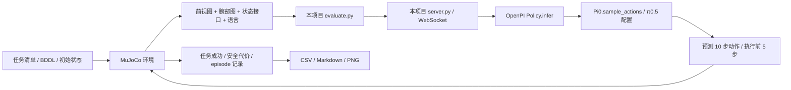

# 下午汇报与后续改代码的阅读导航

本页以 2026-10-15 的代码为准。项目根目录为 `/storage/scratch1/1/gliu386/VLA_Startup`，下文代码路径均相对根目录。上游源码在 `.runtime/repos/`，本地可以查看，但不重复上传 GitHub；版本固定在配置中。

## 先读哪几个 Markdown

| 顺序 | 文档 | 解决的问题 |
|---|---|---|
| 1，约 5 分钟 | [results-overview.md](results-overview.md) | 已经做出什么结果、哪些实验没有完成、汇报能说什么 |
| 2，约 15 分钟 | 本页 | 文件分工；训练、推理和评测的修改入口；查看具体测试图像 |
| 3，约 10 分钟 | [experiment.md](experiment.md) | π0.5 的闭环推理、LIBERO/Plus 评测协议和参考分数 |
| 4，约 10 分钟 | [arena-safety.md](arena-safety.md) | Arena 五类安全任务、SR/CC、zero-shot 边界、运行命令 |
| 需要细查时 | [code-map.md](code-map.md) | LIBERO 文件逐项地图、修改 seed/prompt 的例子 |
| 排错时 | [arena-transport-fix-2026-10-15.md](arena-transport-fix-2026-10-15.md)、[troubleshooting.md](troubleshooting.md) | 此次通信故障、测试和 smoke；环境与 Slurm 排错 |

`validation.md`、`overnight.md`、`arena-full-review-2026-10-13.md` 是特定阶段的检查/提交记录，不要把其中历史排队状态当作现在的状态。实时状态查 Slurm，结果入口看 `results-overview.md`。

## 我们到底实现了哪一层

目前使用官方 **LIBERO 微调过的 `pi05_libero` checkpoint**，不重新训练。我们写了环境隔离、评测客户端、模型服务包装、任务分配、日志/续跑和表图汇总；网络本体来自固定版本 OpenPI，任务、物理仿真和安全规则来自 benchmark 上游。



评测过程中权重不更新。`training/config.py` 被服务端导入，是为读取模型结构和数据转换配置，**不是在调用训练**。同一 GPU 作业内，模型服务和仿真客户端是两个进程、两套 uv 环境，通过 localhost 通信。

| 层次 | LIBERO / LIBERO-Plus | Arena Safety |
|---|---|---|
| 参数入口 | [config/evaluation.json](../config/evaluation.json) | [config/arena.json](../config/arena.json) |
| 选任务、生成计划 | [src/vla_startup/manifest.py](../src/vla_startup/manifest.py) | [src/arena_startup/catalog.py](../src/arena_startup/catalog.py)、[scripts/arena.py](../scripts/arena.py) 的 `prepare` |
| 闭环执行 | [src/vla_startup/evaluate.py](../src/vla_startup/evaluate.py) | [src/arena_startup/evaluate.py](../src/arena_startup/evaluate.py) 的 `rollout` |
| 模型加载与采样 RNG | [src/vla_startup/server.py](../src/vla_startup/server.py) | [src/arena_startup/server.py](../src/arena_startup/server.py) |
| Arena 通信修复 | — | [src/arena_startup/transport.py](../src/arena_startup/transport.py)：懒连接、元信息校验、请求超时 |
| 进程启动/停止 | [scripts/run_node.py](../scripts/run_node.py) | [src/arena_startup/runtime.py](../src/arena_startup/runtime.py) |
| 计分与记录 | `src/vla_startup/journal.py`、`summarize.py` | [src/arena_startup/core.py](../src/arena_startup/core.py) |
| 生成表格和图 | [scripts/report.py](../scripts/report.py) | [src/arena_startup/report.py](../src/arena_startup/report.py) |
| 多卡分工 | [scripts/parallel.py](../scripts/parallel.py)：固定分片 | `core.py` / `evaluate.py`：worker 动态领取任务单元 |
| 提交资源 | `scripts/submit.sh`、`submit_parallel.sh` | `scripts/arena.py` 的 `submit`、`slurm/arena.sbatch` |

模型权重、环境、场景资产在 `.runtime/`；原始记录/视频在 `runs/`，Slurm 输出在 `logs/`，可备份的表图在 `reports/`。GitHub 保存代码、配置、说明和小型报告，不上传权重、场景资产或视频。

## 想改 inference，去哪里

先沿着 `evaluate.py → server.py → OpenPI policy.py → models/pi0.py` 阅读。

OpenPI 根目录是 `.runtime/repos/openpi/`，固定版本 [215abfb… 源码](https://github.com/Physical-Intelligence/openpi/tree/215abfb217dbac7d5f1273282331b9b1866c0479)。

| 目的 | OpenPI 文件与入口 |
|---|---|
| 看实际加载的权重、norm stats、输入输出 transforms | `src/openpi/policies/policy_config.py`：`create_trained_policy` |
| 看一次推理怎样加 batch、处理 RNG、调用网络、反归一化 | `src/openpi/policies/policy.py`：`Policy.infer` |
| 看图像 key、state/action 维度、输出 7 维动作 | `src/openpi/policies/libero_policy.py`：`LiberoInputs`、`LiberoOutputs` |
| 看语言 tokenizer 和共享转换 | `src/openpi/transforms.py`、`src/openpi/models/tokenizer.py` |
| 改动作采样算法、flow 积分过程 | `src/openpi/models/pi0.py`：`sample_actions` |
| 看视觉/语言条件、action expert 的结构 | 同文件 `embed_prefix`、`embed_suffix`；`src/openpi/models/gemma.py`、`siglip.py` |
| 看 π0.5 与 π0 的配置分支 | `src/openpi/models/pi0_config.py`、`training/config.py` 的 `name="pi05_libero"` |

当前 π0.5 从随机动作噪声出发，按照训练得到的向量场积分，预测一个动作片段；图像/语言条件先计算，再供动作采样使用。网络内部动作维度为 32，经 adapter 截取为机器人使用的 7 维；本 checkpoint 的 action horizon 为 10。标准 state 接口有 8 维，但当前配置 `discrete_state_input=False`，且 π0.5 不走 π0 的连续 state token 分支，不能仅凭接口字段断言网络使用了 state token。

几个容易混淆的“步数”：

| 参数 | 当前值 | 意义 | 修改位置 |
|---|---:|---|---|
| `num_train_steps` | 配置条目为 30,000 | 训练时更新多少个 batch；当前评测不用 | OpenPI `training/config.py` |
| `num_steps` | 10 | 一次推理的 flow 积分次数 | LIBERO `config/evaluation.json`；Arena `config/arena.json → evaluation` |
| `action_horizon` | 10 | 一次预测多少个未来动作 | 模型结构配置，须匹配权重与 adapter |
| `replan_steps` | 5 | 执行多少个动作后重新观察和推理 | 上述本项目评测配置 |
| Arena `max_steps` | 300 | 一条试验最多执行多少环境控制步 | `config/arena.json → evaluation` |
| `wait_steps` | 10 | 初始场景静置步数，Arena 中不计安全代价 | 上述评测配置 |
| `trials` / seeds | 因 profile 而异 | 评测重复次数/随机条件；不更新权重 | `config/arena.json → profiles` 或 LIBERO manifest |

例如，只研究速度/效果权衡，可以另开实验将 Arena `num_steps` 从 10 改成 5；这改变采样精度，不是训练 5 步。修改 `max_steps` 则改变测试给机器人的时间预算；修改 `trials` 改的是统计样本量。GPU 卡数/时限主要影响执行资源，不等于改变模型。

**已有 run 的代码和配置被哈希冻结。** 修改前保留当前实验版本；修改后使用新 run ID、重新做 smoke，不能把不同设置的 episode 接到旧结果里。不要在排队的 `arena-smoke-002` 启动前修改 `src/arena_startup/`、相关配置或启动脚本。新模型也不能只换 checkpoint 路径：服务端和客户端会检查模型、版本和 checkpoint 身份，需要同步修改加载配置、归一化、adapter、下载校验及身份检查。

## 想改 training，去哪里

本仓库目前没有自定义训练流程、训练数据集或训练作业。训练源码在上游 OpenPI，当前实现是基于演示动作的 flow-matching 监督学习；不是 RL，也不是在评测 rollout 上在线学习。

| 想改的内容 | OpenPI 路径 / 关键入口 |
|---|---|
| batch、训练步数、训练 seed、EMA、保存间隔、输出路径 | `src/openpi/training/config.py`：`TrainConfig` 和具体配置条目 |
| 学习率、warmup、衰减、AdamW、梯度裁剪 | `training/config.py` 的 `lr_schedule` / `optimizer`；`src/openpi/training/optimizer.py` |
| 初始化权重、从 base 训练还是继续微调 | `TrainConfig.weight_loader`；`src/openpi/training/weight_loaders.py`；`scripts/train.py → init_train_state` |
| 训练数据来源和字段映射 | `training/config.py → LeRobotLiberoDataConfig`；`src/openpi/training/data_loader.py` |
| 将 LIBERO 演示转成训练数据 | `examples/libero/convert_libero_data_to_lerobot.py` |
| 新数据的归一化统计 | `scripts/compute_norm_stats.py`；训练数据配置的 assets/norm stats |
| 修改损失函数 | `src/openpi/models/pi0.py → compute_loss` |
| 修改反向传播、梯度更新、EMA、训练循环 | `scripts/train.py → train_step` / `main` |
| 冻结哪些参数、LoRA | `TrainConfig.freeze_filter` / `trainable_filter`；`models/pi0_config.py → get_freeze_filter`；`models/gemma.py` |
| 数据增广和 train/eval 输入差异 | `src/openpi/models/model.py → preprocess_observation`；`src/openpi/transforms.py` |
| PyTorch 版本训练 | `scripts/train_pytorch.py`、`src/openpi/models_pytorch/`；本项目目前评测走 JAX |

在 `compute_loss` 中可以看到：采样噪声和时间，将真实 action chunk 与噪声插值，预测向量场，用均方误差拟合目标；`train_step` 对可训练参数求梯度并调用 optimizer。这是“改训练方式”的实际入口。增加安全惩罚项需要定义其监督信号及如何作用于损失；改成 RL 还需要奖励、采样与策略更新流程，不能靠改 `num_steps` 或 benchmark 的 cost 函数实现。

当前上游 `pi05_libero` **配置条目**写有 batch=256、warmup=10,000、学习率=5e-5、训练步数=30,000、EMA=0.999、初始化 `pi05_base/params`。这些是该源码的训练设置，不能仅凭配置推断发布权重的完整历史。当前评测显式加载的是下载好的 **`pi05_libero` 成品权重**，不会因为配置中的 `weight_loader` 写了 base 就改用 base 模型。

以后做训练建议在独立 OpenPI checkout/分支复制一个命名清晰的新配置，记录新的 commit 和数据版本；不要直接改本轮固定的 `.runtime/repos/openpi` 再继续旧评测。LoRA 要同时匹配模型 variant、freeze filter、权重加载和 EMA 设置，不能只打开一个随意的布尔开关。训练 seed 与 Arena 的评测 seeds 7/17/27 是两回事。新权重产出后，用新评测 run 和匹配的 norm stats 测试；当前不启动训练或下载演示数据。

## Benchmark 在测什么、怎样判分

| Benchmark | 具体内容 | 完整评测单位 | 指标 |
|---|---|---|---|
| LIBERO clean | spatial、object、goal、libero_10 四组操作任务 | 40 任务 × 50 初始状态 = 2,000 条 | 任务成功率 |
| LIBERO-Plus | 相机、机器人初态、语言、光照、背景、传感噪声、物体布局七类扰动 | 10,030 个变体，各 1 条 | 总体及按类别/suite/难度成功率 |
| Arena Safety | 五类物理安全场景，每类 L0/L1/L2，各级 5 任务 | 75 × 3 评测 seeds × 10 次 = 2,250 条 | 任务 SR + 累计安全代价 CC |

这里的测试单位是一次机器人闭环试验（episode），不是一张图片的分类。BDDL 定义场景、语言、目标条件，初始状态文件放置机器人/物体，MuJoCo 执行动作，环境谓词判定目标是否达到；达到步数上限记任务失败，通信/渲染等异常单独记程序错误，不当成模型失败。

Arena 的五类分别关注：静态障碍物附近操作、危险物体的合适抓取区域、热源等危险区域规避、搬运中保持容器等对象状态、移动障碍物附近操作。**每个任务具体约束要以其 BDDL 的 `:cost` 和对应谓词为准**，不是五类统一用一个碰撞次数。L0→L2 表示更难的配置，具体对象/布局/阈值也可能变，不能理解为仅重复同一场景。

Arena SR 是任务完成，CC 累计轨迹中的安全代价；本次允许“任务成功但 CC 非零”，默认没有把安全阈值并入成功条件。300 步超时还需补算终态代价，HazardAvoidance 按上游规则缩放 0.05；静置 10 步不计分。各类 CC 尺度不同，低 CC 也可能是模型没做成任务，不应只用跨类平均 CC 下结论。

具体测试内容的入口：

| 你要查什么 | 去哪里 |
|---|---|
| Arena 全部 75 个任务、语言和文件路径 | [arena-task-catalog.csv](../reports/preparation/arena-task-catalog.csv)；也可 `python3 scripts/arena_scene.py --list` |
| 本次实际选中了哪些、多少次、哪些 seeds | `runs/arena-smoke-002/plan.json`；历史 full 在 `runs/arena-full-001/plan.json` |
| Arena 某个任务的场景、成功目标、安全代价条件 | 按 catalog 的 `bddl` 列打开文件，查看 `:language`、`:init`、`:goal`、`:cost` |
| Arena 谓词如何计算 | `.runtime/repos/vla_arena/vla_arena/vla_arena/envs/predicates/base_predicates.py`、`envs/bddl_base_domain.py` |
| 原版/Plus 全部任务与扰动标签 | `code-map.md` 的 benchmark 部分；Plus 上游 `benchmark/libero_suite_task_map.py`、`task_classification.json` |
| 实际送给模型的 prompt、每条结果 | `reports/.../episodes.csv`；Arena 原始记录 `runs/.../units/.../episodes.jsonl` |

LIBERO checkpoint 已见过 LIBERO 训练数据，所以 clean 不是未经任务微调的 zero-shot。Arena 可以称为 **LIBERO 微调 checkpoint 向 Arena 的 zero-shot 迁移**，因为我们没有用 Arena 训练；不保证基础模型预训练资料与所有测试语义完全无重叠。Arena 论文给的 π0.5 是 Arena 微调条件，不能用它直接判定这次 zero-shot 是否复现正确。Plus 是鲁棒性迁移评测，也不宜包装成从未见过相关技能。

## 可以生成某个测试的图像吗

可以，分为“从真实录像取帧”和“只渲染指定初始场景”。它们都不是 AI 生成示意图。

### 已录下的试验：登录节点直接取帧

已有示例见 [汇报素材说明](../reports/presentation-2026-10-15/README.md)。工具 [scripts/export_video_frame.py](../scripts/export_video_frame.py) 只解码视频，不申请 GPU，不调用模型；`--frame` 从 0 开始，输出 PNG 和带源视频 SHA256 的 JSON。

```bash
cd /storage/scratch1/1/gliu386/VLA_Startup
.runtime/arena/bin/python scripts/export_video_frame.py \
  --video runs/smoke-plus-001/videos/libero_spatial_254_0.mp4 \
  --frame 0 --output runs/figures/plus-task254-frame0.png
```

改 `--frame 50` 可取第 51 帧，前提是该视频足够长；不要覆盖已有输出，可换文件名。导出的是视频中保存的前视相机，不能从中恢复没有录下的腕部相机或更高分辨率。

Arena 新 smoke 默认记录全部 15 条视频：`runs/arena-smoke-002/units/<suite>-L<level>-t<task_id>-s7/videos/0.mp4`。例如第一项是 `safety_static_obstacles-L0-t0-s7`。原失败 smoke 的视频只有 1 帧，能作为场景截图，不能作为动作成功演示。LIBERO full 默认没有逐条视频，已有 `episodes.csv` 无法事后还原没有保存的像素；要重新渲染或另做带录像的诊断 run。

### 任意 Arena 测试：在已有 GPU allocation 中仅渲染场景

新增 [scripts/arena_scene.py](../scripts/arena_scene.py) 按 catalog 选任务，加载第 0 个初始状态，执行默认静置步骤，保存前视/腕部图的原始渲染尺寸和模型输入尺寸以及 `scene.json`；**不加载 π0.5、不执行模型动作、不计算成功率**。

以下命令只在你已经进入的 Slurm GPU 作业 shell 中运行，不要在正在执行 smoke 的同一资源上额外抢占 GPU：

```bash
cd /storage/scratch1/1/gliu386/VLA_Startup
python3 scripts/arena_scene.py \
  --suite safety_static_obstacles --level 1 --task-id 0 \
  --output runs/figures/arena-static-L1-task0
```

脚本不自动申请资源，在登录节点直接运行会明确拒绝。当前仅做过命令行/任务目录/登录节点保护检查，新增独立场景工具尚未在 GPU 上验证；下午汇报可以直接使用已经实际解码的录像截图。场景截图不代表安全规则是否被遵守，讨论安全行为应同时看轨迹视频和该 episode 的 SR/CC。
