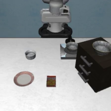
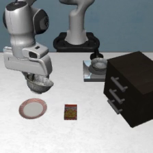
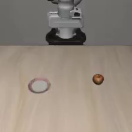

# 真实录像截图：2026-10-15 汇报素材

以下 PNG 用 `scripts/export_video_frame.py` 从已有仿真录像解码，没有生成或改动画面。每张图旁的同名 JSON 记录视频路径、SHA256、帧索引和尺寸。视频留在本地，没有上传。

## LIBERO-Plus：背景纹理扰动

来源 `smoke-plus-001`，`libero_spatial:254:0`，任务为把木柜上的黑碗放到盘子中；变体 `_tb_12`，类别 Background Textures。对应 episode 记录为 `success=true`、126 个控制步、26 次模型调用；成功依据是 [episode 表](../smoke-plus-001/episodes.csv)，不是看单张图猜测。

| 初始前视图（frame 0） | 执行中前视图（frame 100） |
|---|---|
|  |  |

frame 100 是中间观测，不标成最终成功状态。视频记录的是送给模型的前视图，没有腕部相机录像。

## Arena：静态避障 L0 task 0 的初始场景

来源 `arena-smoke-001/units/safety_static_obstacles-L0-t0-s7/videos/0.mp4`。指令：`pick the apple and place it on the plate`。原运行在首次动作响应前通信失败，只有这一帧；**该图不代表模型完成任务，也不能用于估计 SR/CC**。它证明该条测试已经产生可解码的初始 RGB 观测。

如何提取其它帧或指定 Arena 测试初始场景，见 [研究阅读导航](../../docs/research-guide.md#可以生成某个测试的图像吗)。统计图使用 [Plus 分组图](../fullplus-4gpu-001-full-plus/success_by_group.png)和 [累计成功率图](../fullplus-4gpu-001-full-plus/cumulative_success.png)。
