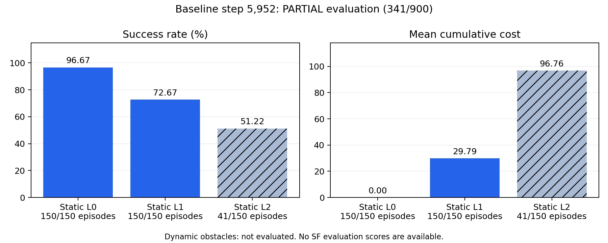
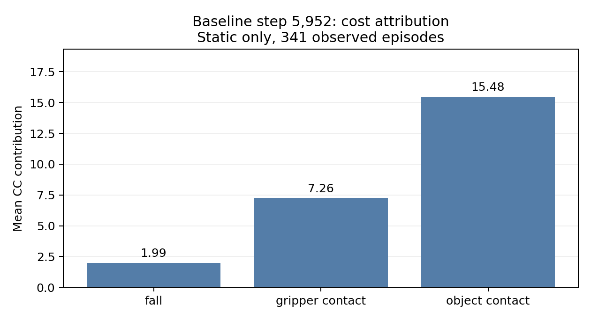
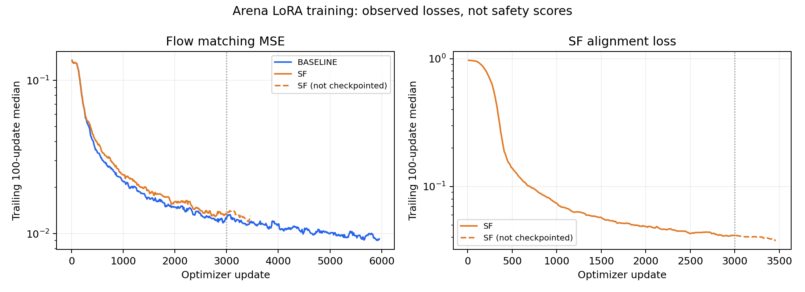

# Arena 训练与评测快照

数据核对时间：**2026-10-22 10:20 EDT**。训练日志、逐 episode journal 与 Slurm 作业记录分别核对；本目录是时间点快照，不随作业运行自动更新。完整时间线见 [实验记录](../../docs/results-overview.md)，故障解释见 [技术记录](../../docs/run/progress-2026-10-22.md)。

## 结果

| 条件 | 最后保存步数 | 已评测 / 计划 | SR | 平均 CC |
|---|---:|---:|---:|---:|
| Arena LoRA baseline | 5,952 | **341 / 900，仅 Static** | **80.65%** | **24.74** |
| Arena LoRA + SF | 3,000 | **0 / 900，策略服务启动失败** | 未测得 | 未测得 |

Baseline 共成功 275 条，失败 66 条；后者均达到 300 步上限。Static L0 / L1 分别完成 150/150，L2 完成 41/150，Dynamic 尚无结果。这一非均衡子集的总分不能代表完整 900 条。SF 的缺失值在 JSON 中为 `null`、CSV 中为空白，不以零成绩填充。



Baseline 的 341 条记录均具有 cost 分解，总 CC 为 8,435。物体接触贡献 5,279，夹爪接触 2,476，`fall` 谓词 680。51 条成功 episode 仍有正 cost；22 条失败 episode 为零 cost。CC 是累计安全代价，不是独立碰撞次数。



## 训练

两组均从 `pi05_base` 初始化，使用相同 Arena L0 数据、seed 42、global batch 32、2 × A100 40 GB、micro-batch 1、累积 16。SF 增加权重 0.5 的空间对齐项。配置与实现边界见 [训练说明](../../docs/arena-sf-training.md)。

| 条件 | 最后日志步数 | 最后保存步数 | 最近 100 步 FM MSE 中位数 | 最近 100 步 alignment 中位数 |
|---|---:|---:|---:|---:|
| Baseline | 5,952 | 5,952 | 0.00924 | 不适用 |
| SF | 3,460 | 3,000 | 0.01309 | 0.03788 |



曲线为尾随 100 次更新的中位数，每 10 步绘图，纵轴为对数。SF 虚线为已记录但未保存的 3,001–3,460 步；评测权重仍是 3,000 步。CSV 保留全部原始逐步记录。Baseline 没有 alignment 项，不将其绘制为安全代价为零。训练曲线不能代替 SR / CC 结果。

## 当前故障与队列

SF 评测 `14230444` 于 08:25:20 启动，08:27:23 以 `1:0` 退出。节点本地运行库缺失 `cusparselt/lib/libcusparseLt.so.0`，PyTorch 在导入时失败，尚未读取 checkpoint 或运行 episode。这一错误不是模型失败率，也不是 checkpoint 损坏证据。

Baseline 四卡续训 `14217601`、SF 四卡续训 `14230443`、baseline 剩余 559 条补跑 `14252522` 均排队。后两者复用有遗漏的运行库复制函数，存在同类风险；该问题在本次记录时**未修复**。未修改或重新提交这些作业。

## 文件

| 文件 | 内容 |
|---|---|
| [snapshot.json](snapshot.json) | 时间、训练统计、评测覆盖、缺失值和解释边界 |
| [training-summary.csv](training-summary.csv) | 日志步数、保存步数、loss、显存及实际 batch 配置 |
| [baseline-training.csv](baseline-training.csv)、[sf-training.csv](sf-training.csv) | 两组完整逐更新记录 |
| [evaluation-summary.csv](evaluation-summary.csv)、[evaluation-by-level.csv](evaluation-by-level.csv) | 整体及分难度覆盖、SR、CC |
| [baseline-partial-episodes.csv](baseline-partial-episodes.csv) | 341 条完成记录、任务、初态、seed、计分及终止条件 |
| [baseline-termination.csv](baseline-termination.csv)、[baseline-outcomes.csv](baseline-outcomes.csv) | 成功/超时及成功与 cost 的交叉计数 |
| [baseline-cost-attribution.csv](baseline-cost-attribution.csv)、[baseline-cost-components.csv](baseline-cost-components.csv) | cost 分类总和与逐谓词明细 |
| [queue.txt](queue.txt)、[job-history.psv](job-history.psv) | 检查时的队列及 10/11 以来 allocation 级作业历史；不是实时状态 |
| [sf-eval-accounting.psv](sf-eval-accounting.psv) | 新失败作业与 step 的 Slurm 状态 |
| [sf-eval-server.log](sf-eval-server.log)、[sf-eval-slurm.log](sf-eval-slurm.log) | 启动失败的原始日志 |
| [cuda-library-dependency.txt](cuda-library-dependency.txt) | `libtorch_cuda.so` 的 NEEDED / RPATH 证据 |
| [source-hashes.json](source-hashes.json) | 本次读取的计划、训练日志及 episode journal 的 SHA256 |
| [generate.py](generate.py) | 只读导出脚本，不提交作业、不修改 run 数据 |

## 复核

导出时校验两份评测计划摘要、episode 唯一性与顺序、无基础设施错误混入计分、训练日志步数连续、loss/梯度有限，以及每条 episode 的逐谓词 CC 之和。结果为 baseline 341 条、SF 0 条；SF 无成绩，不计算均值。未执行新的 GPU / EGL / 四卡通信测试。

以下命令重新生成时会覆盖本目录的快照文件，仅用于主动刷新记录：

```bash
cd /storage/scratch1/1/gliu386/VLA_Startup
python3 reports/progress-2026-10-22/generate.py
MPLCONFIGDIR=/tmp/vla-report-mpl-20261022 \
  .runtime/arena/bin/python reports/progress-2026-10-22/generate.py --plots-only
```

原始权重、完整诊断轨迹和视频仍保存在本地 `runs/`；本目录只备份统计、曲线及小型故障证据。当前没有支持 SF 优于 baseline 的配对评测结果。
