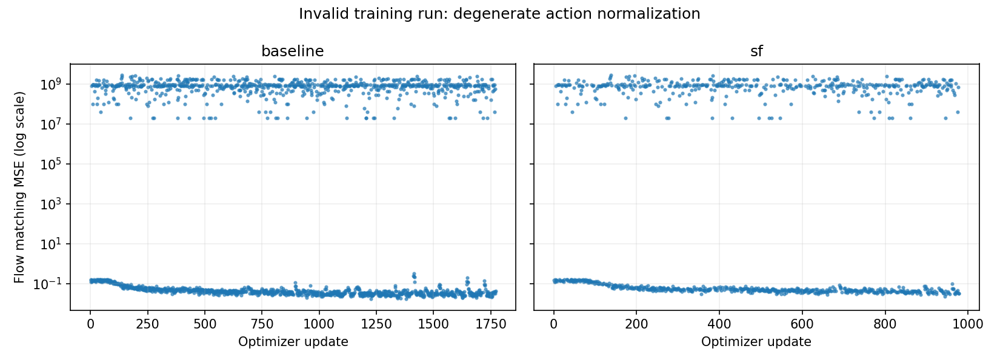

# Training normalization audit

Snapshot: 2026-10-17T19:24:17.708403-04:00

Run: `arena-sf-train-full-001`. Both jobs were running at inspection time. No job or training input was changed by this audit.

## Finding

The fourth and fifth action coordinates (zero-based indices 3 and 4) have `q01 = q99 = 0`, despite containing nonzero rotations. The current normalization divides by `q99 - q01 + 1e-6`, amplifying sparse nonzero targets to approximately 1.35 million. Loss spikes are therefore a data normalization defect, not evidence about the relative safety performance of baseline and Spatial Forcing.

| Arm | Logged updates | Updates with MSE > 1,000 | Outlier/target pattern matches |
|---|---:|---:|---:|
| baseline | 1771 / 60000 | 783 (44.2%) | 1771 / 1771 |
| sf | 978 / 60000 | 437 (44.7%) | 978 / 978 |

The first full-training anomaly occurs at update 5 in both arms: target mean square is approximately 791,013,867 and logged flow MSE is 791,030,976. Every inspected loss outlier matches a batch with extreme normalized targets. Exact thresholds and per-update values are retained in the CSV files.

## Validation limits

Training validation job 14127618 completed successfully after 17 minutes 53 seconds. It exercised three optimizer updates per arm, checkpoint restoration, and finite inference outputs. Its batch size was 4; formal training uses 32. It did not cover the rare-action normalization defect. Finiteness checks alone do not reject extreme finite targets.

## Required correction

Before restarting from pi05_base, define and record a nondegenerate normalization rule for sparse action coordinates and its matching inverse for evaluation. Validate all action dimensions across the dataset, add regression checks with rare rotations, and run a broader training validation. Existing checkpoints should not be used as the starting point of the corrected scientific comparison. Do not infer SR or collision cost from these training curves; no fine-tuned safety evaluation has been completed.

## Artifacts

- [Audit metadata](audit.json)
- [Baseline batch audit](baseline-batch-audit.csv)
- [SF batch audit](sf-batch-audit.csv)
- [Loss curves](loss-audit.png)

